# Complete Guide to Neural Networks: ANN, RNN, Architecture, Training, and Applications
Neural Networks are one of the most important concepts in Deep Learning, and understanding them properly will make it much easier to understand CNNs, RNNs, LSTMs, GRUs, Transformers, and eventually modern Large Language Models (LLMs).

We'll build the understanding from the ground up, starting with a single artificial neuron and gradually moving towards complete neural network architectures.

The most important thing to understand initially is:

ANN and RNN are not separate from Neural Networks. They are types of Neural Networks designed for different kinds of problems.

Let's understand everything step by step.

## Contents

- [Foundations](#1-what-is-a-neural-network)
- [Artificial neurons and ANN architecture](#3-what-is-an-artificial-neuron)
- [Training and activation functions](#6-how-does-a-neural-network-learn)
- [Neural network types](#10-types-of-neural-networks)
- [ANN and RNN connection](#11-understanding-ann-vs-rnn)
- [Implementation and practical guidance](#15-practical-implementation-building-an-ann-using-python)
- [Revision and quiz](#18-the-three-things-you-should-write-in-your-notes)

## 1. What is a Neural Network?
A Neural Network (NN) is a computational model inspired by the way biological neurons in the human brain process information.

It consists of interconnected computational units called neurons, which work together to learn patterns and relationships from data.

Neural Networks are used to solve problems such as:
- Image recognition: Identifying objects, people, animals, etc.
- Natural Language Processing (NLP): Understanding and processing human language.
- Speech recognition: Converting spoken language into text.
- Prediction: Predicting house prices, stock trends, customer behavior, etc.
- Classification: Classifying emails as spam or not spam.
- Generative AI: Generating text, images, audio, and videos.

### A simple example
Imagine that you want to build a model that predicts whether a student will pass or fail based on:
1. Hours studied.
2. Attendance percentage.
3. Previous examination marks.
You provide historical student data to a Neural Network.

Initially, the network doesn't know which factors are important or how they relate to one another.

It learns these relationships by examining examples and adjusting its internal parameters (weights and biases).

Eventually, it learns patterns such as:
- More study hours generally increase the probability of passing.
- Better attendance might correlate with better performance.
- Previous examination marks might be a strong predictor.
When you provide information about a new student, the network uses what it has learned to predict the outcome.


> Source: cloud.tencent.com


This is the fundamental idea behind Neural Networks:

Input data → Processing through neurons → Learning patterns → Output prediction

## 2. Understanding the Biological Inspiration
Neural Networks are inspired by biological neural networks found in the human brain.

Before understanding artificial neurons, let's briefly understand biological neurons.


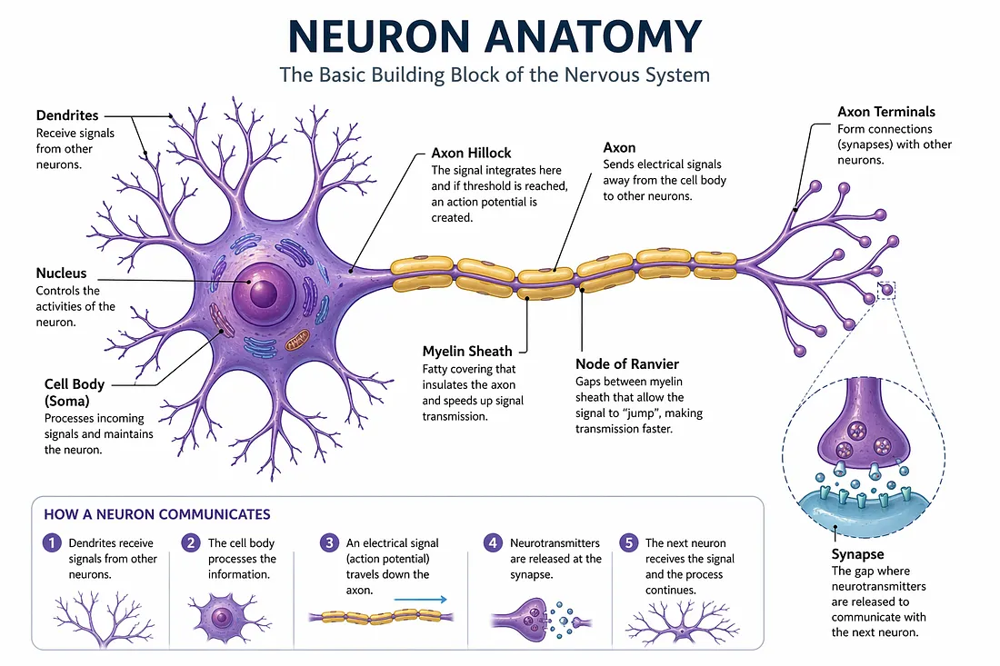


A biological neuron consists of several important components:
| Component | Function |
| --- | --- |
| Dendrites | Receive signals from other neurons. |
| Cell body (Soma) | Processes incoming signals. |
| Axon | Transmits electrical signals. |
| Synapses | Help neurons communicate with other neurons. |

How does a biological neuron work?
1. It receives signals through dendrites.
2. It processes those incoming signals.
3. If the combined signal is strong enough, it generates an electrical impulse.
4. The impulse travels through the axon.
5. The signal is transmitted to other neurons through synapses.
Artificial Neural Networks take inspiration from this mechanism.

However, remember that artificial neurons are mathematical computations, not actual biological neurons.

## 3. What is an Artificial Neuron?
An Artificial Neuron is the smallest fundamental computational unit of an Artificial Neural Network.

It receives one or more inputs, multiplies them by weights, adds a bias, and passes the result through an activation function.

### Let's understand each component.


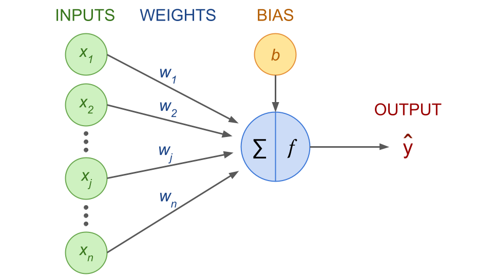


An artificial neuron has four major components:
1. Inputs.
2. Weights.
3. Bias.
4. Activation Function.

### 3.1 Inputs (X)
Inputs represent the information provided to a neuron.

For example, suppose we want to predict whether a student will pass.

We provide:
- \(x_1\) = Hours studied.
- \(x_2\) = Attendance.
- \(x_3\) = Previous marks.
These are the input features.

### 3.2 Weights (W)
Weights determine the importance or influence of each input.

Suppose:
- Hours studied have a weight of 0.8.
- Attendance has a weight of 0.5.
- Previous marks have a weight of 0.9.
This indicates that the model currently assigns different importance to each feature.

The weighted inputs are calculated as:

$$
x_1w_1+x_2w_2+x_3w_3

$$

Important: Weights are learned during training. We generally don't manually decide their final values.

The network adjusts them to improve its predictions.

### 3.3 Bias (b)
Bias is an additional learnable parameter that allows a neuron to shift its activation threshold or decision boundary.

Without bias, a neuron has less flexibility in learning relationships between inputs and outputs.

For example:

$$
z = x_1w_1+x_2w_2+x_3w_3+b

$$

Here, \(b\) is the bias.

Think of bias as an adjustable offset added to the weighted sum.

### 3.4 Activation Function (f)
After calculating the weighted sum and adding the bias, we apply an activation function.

$$
y=f(z)

$$

The activation function determines the neuron's output.

Why do we need it?

Because without nonlinear activation functions, stacking multiple neural network layers would still behave like a single linear transformation.

Nonlinearity allows neural networks to learn complex patterns and relationships.

We'll explore activation functions in detail later.

### 3.5 Complete mathematical representation
The mathematical representation of an artificial neuron is:

$$
\boxed{y=f\left(\sum_{i=1}^{n}w_ix_i+b\right)}

$$

Where:
| Symbol | Meaning |
| --- | --- |
| \(x_i\) | Input feature |
| \(w_i\) | Weight associated with the input |
| \(b\) | Bias |
| \(n\) | Number of inputs |
| \(f\) | Activation function |
| \(y\) | Neuron output |

Let's calculate a simple example.
Suppose:
- \(x_1=2\)
- \(x_2=3\)
- \(w_1=0.5\)
- \(w_2=0.8\)
- \(b=1\)
First, calculate the weighted sum:

$$
z=(2\times0.5)+(3\times0.8)+1

$$

$$
z=1+2.4+1=4.4

$$

Now, suppose we use the ReLU activation function:

$$
ReLU(z)=\max(0,z)

$$

Therefore:

$$
y=\max(0,4.4)=4.4

$$

Final output = 4.4
That's how a single artificial neuron works.

## 4. What is an Artificial Neural Network (ANN)?
An Artificial Neural Network (ANN) is a computational network consisting of multiple interconnected artificial neurons that work together to learn patterns from data.

Instead of using just one artificial neuron, we connect multiple neurons to form a network.

Each neuron performs calculations, passes its output to other neurons, and contributes to the final prediction.

An ANN typically consists of three types of layers:
1. Input Layer.
2. Hidden Layer(s).
3. Output Layer.


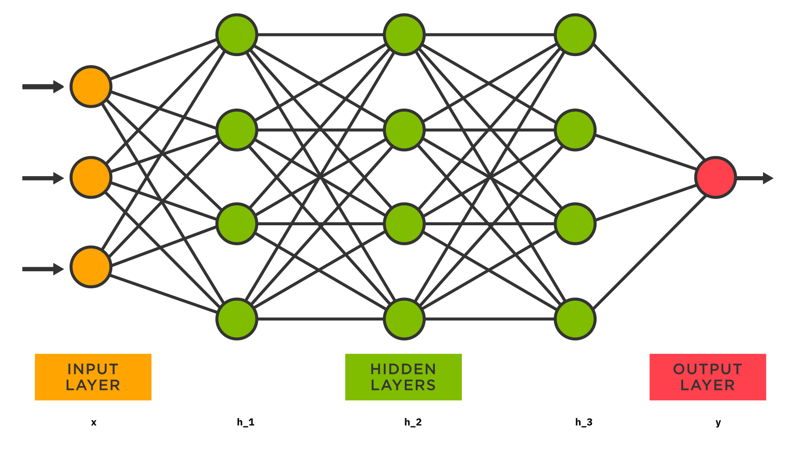


### Let's understand them.

### 4.1 Input Layer
The input layer receives the data that we want to process.

For example, suppose we want to predict house prices using:
- House area.
- Number of bedrooms.
- Number of bathrooms.
- Location score.
We have four input features.

Therefore, our input layer will have four input neurons.

Important: The input layer generally represents the input features. It doesn't perform the same weighted calculations as the hidden neurons.

### 4.2 Hidden Layer
The hidden layers perform most of the computational work.

They receive information from the previous layer, apply weights and biases, and pass the results through activation functions.

Why are they called hidden layers?

Because their intermediate outputs are not directly provided as the final result to the user.

Suppose we have two hidden layers:
- Hidden Layer 1: Learns basic relationships between features.
- Hidden Layer 2: Combines those learned relationships into more complex patterns.
For example, in an image recognition model:
- Earlier layers might learn edges and simple shapes.
- Intermediate layers might learn textures and object parts.
- Deeper layers might learn complete objects.
These are intuitive examples; the actual features learned depend on the architecture and training data.

### 4.3 Output Layer
The output layer produces the final prediction.

Its structure depends on the problem we are solving.

Examples:
| Problem | Output |
| --- | --- |
| Spam classification | Spam / Not Spam |
| House price prediction | Numerical value |
| Image classification | Class probabilities |
| Sentiment analysis | Positive / Negative |
| Multi-class classification | Probability for each class |

For example, if a model predicts whether an email is spam, its output might be:

$$
P(Spam)=0.92

$$

$$
P(Not\ Spam)=0.08

$$

The model predicts Spam because it has the higher probability.

## 5. How Does a Neural Network Actually Work?
Now let's connect everything.

Consider a neural network with:
- 3 input neurons.
- 4 neurons in the first hidden layer.
- 3 neurons in the second hidden layer.
- 1 output neuron.


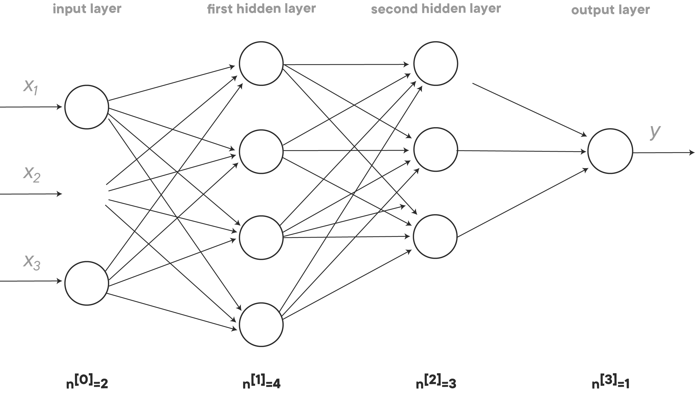


The process works as follows.

### Step 1: Input data
We provide the input features:

$$
X=[x_1,x_2,x_3]

$$

For example:

$$
X=[5,85,75]

$$

These might represent hours studied, attendance, and previous marks.

### Step 2: Weighted sum
Each neuron in the first hidden layer receives the input values.

It calculates:

$$
z=w_1x_1+w_2x_2+w_3x_3+b

$$

Each neuron has its own weights and bias.

Therefore, four neurons will perform four different calculations.

### Step 3: Activation function
The weighted sum passes through an activation function.

$$
a=f(z)

$$

The output of one layer becomes the input of the next layer.

### Step 4: Hidden layer processing
The second hidden layer receives the outputs from the first hidden layer.

It performs another set of weighted calculations and activation functions.

This continues until the output layer is reached.

### Step 5: Final prediction
The output layer generates the prediction.

For example:

$$
P(Pass)=0.87

$$

The model predicts that the student will pass.

But here's an important question:

How does the network know which weights and biases to use?

Initially, it doesn't.

It learns them through a process called training.

Let's understand that next.

## 6. How Does a Neural Network Learn?
Neural Networks learn through a process called Training.

During training, the network repeatedly:
1. Makes a prediction.
2. Compares the prediction with the actual answer.
3. Calculates the error.
4. Determines how to reduce the error.
5. Updates its weights and biases.
6. Repeats the process.
There are four major concepts involved:
- Forward Propagation.
- Loss Function.
- Backpropagation.
- Optimization.


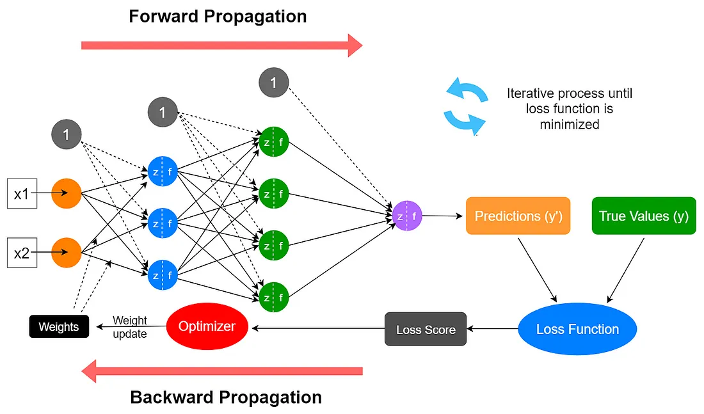


### 6.1 Forward Propagation
Forward Propagation is the process of passing input data through the network to generate an output.

The information flows in this direction:

$$
Input\rightarrow Hidden\ Layers\rightarrow Output

$$

During forward propagation:
1. Input features enter the network.
2. Each neuron calculates weighted sums.
3. Biases are added.
4. Activation functions are applied.
5. Outputs are passed to subsequent layers.
6. The final prediction is generated.
This is called forward propagation because information travels from the input layer towards the output layer.

### 6.2 Loss Function
After generating a prediction, we need to determine how accurate it is.

A Loss Function measures the difference between the predicted output and the actual output.

Let's consider a house price prediction example.

Actual price:

$$
y=50\text{ lakhs}

$$

Predicted price:

$$
\hat y=45\text{ lakhs}

$$

The prediction error is:

$$
Error=y-\hat y

$$

$$
Error=50-45=5

$$

The model has made an error of 5 lakhs.

However, we generally use mathematical loss functions rather than simply calculating the difference.

### Common Loss Functions
1. Mean Squared Error (MSE)

Used primarily for regression problems.

$$
MSE=\frac{1}{n}\sum_{i=1}^{n}(y_i-\hat y_i)^2

$$

It calculates the average squared difference between actual and predicted values.

2. Mean Absolute Error (MAE)

$$
MAE=\frac{1}{n}\sum_{i=1}^{n}|y_i-\hat y_i|

$$

It calculates the average absolute difference.

3. Binary Cross-Entropy

Used for binary classification problems.

For example:
- Spam / Not Spam.
- Fraud / Not Fraud.
- Pass / Fail.
4. Categorical Cross-Entropy

Used for multi-class classification problems.

For example:
- Cat.
- Dog.
- Horse.
- Elephant.
The objective of training is to minimize the loss function.

### 6.3 Backpropagation
This is one of the most important concepts in Neural Networks.

Backpropagation (Backward Propagation) is an algorithm used to calculate how much each weight and bias contributed to the prediction error.

It works by propagating error-related gradients backwards through the network using the chain rule of calculus.

Let's understand this intuitively.

Suppose a neural network predicts:
- Actual output: 1
- Predicted output: 0.3
The network has made a considerable error.

Backpropagation calculates how the loss changes with respect to each trainable parameter.

Mathematically:

$$
\frac{\partial L}{\partial w}

$$

This represents the gradient of the loss \(L\) with respect to weight \(w\).

It tells us how sensitive the loss is to a change in that weight.

The network calculates these gradients for its trainable parameters.

Important distinction:
- Forward propagation generates predictions.
- Backpropagation calculates gradients.
- An optimizer uses those gradients to update weights and biases.
Backpropagation itself does not directly update the weights.

### 6.4 Gradient Descent
Once we calculate the gradients, we need a method to update the weights.

This is where Gradient Descent comes in.

Gradient Descent is an optimization algorithm that adjusts the model parameters to minimize the loss function.

The basic weight update equation is:

$$
\boxed{w_{new}=w_{old}-\eta\frac{\partial L}{\partial w}}

$$

Where:
| Symbol | Meaning |
| --- | --- |
| \(w_{new}\) | Updated weight |
| \(w_{old}\) | Previous weight |
| \(\eta\) | Learning rate |
| \(\frac{\partial L}{\partial w}\) | Gradient |

### What is Learning Rate?
The Learning Rate controls how large a step the optimizer takes when updating the model's parameters.

For example:
- Learning rate = 0.1: Larger updates.
- Learning rate = 0.001: Smaller updates.
- Learning rate = 0.0001: Even smaller updates.
If the learning rate is too high, training may become unstable or fail to converge.

If it is too low, training may become unnecessarily slow.


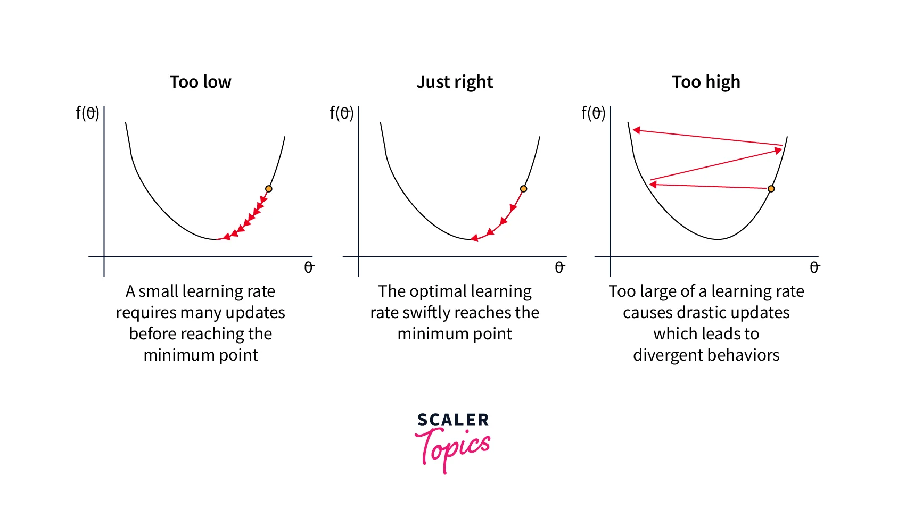


Popular Optimization Algorithms
| Optimizer | Main idea |
| --- | --- |
| Gradient Descent | Updates parameters using gradients. |
| SGD | Uses individual examples or small batches to estimate gradients. |
| Mini-batch Gradient Descent | Uses small batches of training examples. |
| Momentum | Uses accumulated gradient direction to smooth updates. |
| RMSprop | Adapts learning rates using moving averages of squared gradients. |
| Adam | Combines momentum and adaptive learning rates. |

Adam is widely used in modern deep learning applications.

## 7. Important Training Terminology
Before moving to ANN and RNN architectures, let's understand the terminology associated with neural network training.

### 7.1 Epoch
An Epoch is one complete pass through the entire training dataset.

For example, suppose you have 1,000 training examples.

If the model processes all 1,000 examples once, it has completed one epoch.

If it processes the entire dataset 50 times, it has completed 50 epochs.

### 7.2 Batch Size
Batch Size is the number of training examples processed together before an optimizer update.

Suppose:
- Dataset size = 1,000.
- Batch size = 100.
Then:

$$
Number\ of\ batches=\frac{1000}{100}=10

$$

The network processes 100 examples at a time.

There will be 10 batches in one epoch.

### 7.3 Iteration
An iteration is generally one training step involving a batch of data and an optimizer update.

For the previous example:
- 10 batches.
- 10 iterations per epoch.
- 50 epochs.
Total iterations:

$$
10\times50=500

$$

### 7.4 Parameters
Parameters are the values that the neural network learns during training.

They primarily include:
- Weights.
- Biases.
For example, if a network has 10,000 weights and 200 biases:

$$
Total\ Parameters=10,000+200=10,200

$$

### 7.5 Hyperparameters
Hyperparameters are settings that control the training process or model architecture.

Unlike weights and biases, they are generally specified before training rather than directly learned through backpropagation.

Examples:
- Learning rate.
- Batch size.
- Number of epochs.
- Number of hidden layers.
- Number of neurons per layer.
- Dropout rate.

### Parameters vs Hyperparameters
| Parameters | Hyperparameters |
| --- | --- |
| Learned during training | Set or tuned by the practitioner |
| Weights | Learning rate |
| Biases | Batch size |
| Updated through optimization | Number of epochs |
| Define the learned model | Control model architecture/training |


## 8. Activation Functions
We discussed activation functions when learning about artificial neurons.

Let's explore them in more detail.

An Activation Function is a mathematical function applied to a neuron's weighted sum to produce its output.

Its most important purpose in standard neural networks is to introduce nonlinearity.

Without nonlinear activation functions, even a network with multiple fully connected layers would be equivalent to a single linear transformation.

Let's look at the commonly used activation functions.

### 8.1 Linear Activation
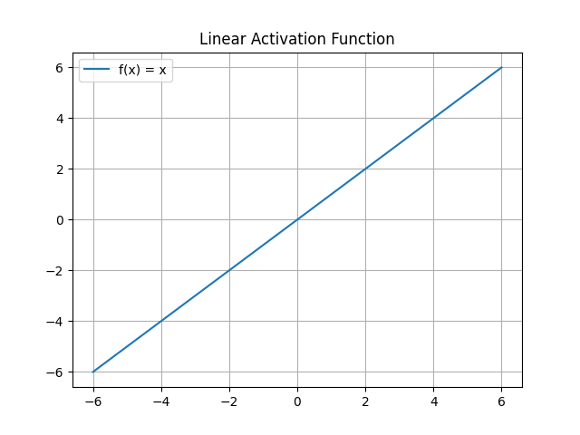

$$
f(x)=x

$$

The output is equal to the input.

Used primarily in the output layer of regression models.


### 8.2 Sigmoid
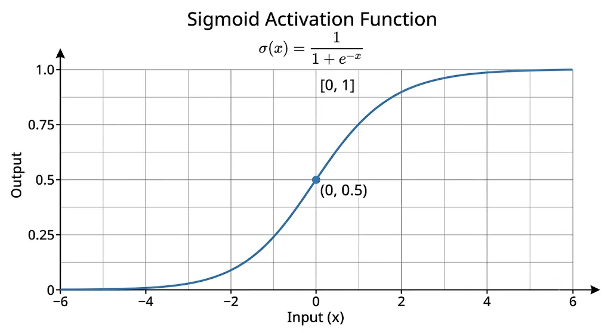

$$
\sigma(x)=\frac{1}{1+e^{-x}}

$$

It converts the input into a value between 0 and 1.


Common uses:
- Binary classification output layers.
- Predicting probabilities for binary outcomes.
For example:

$$
\sigma(2)=0.881

$$

The output is approximately 0.881.

One limitation is the vanishing gradient problem when inputs are in saturated regions.

### 8.3 Tanh
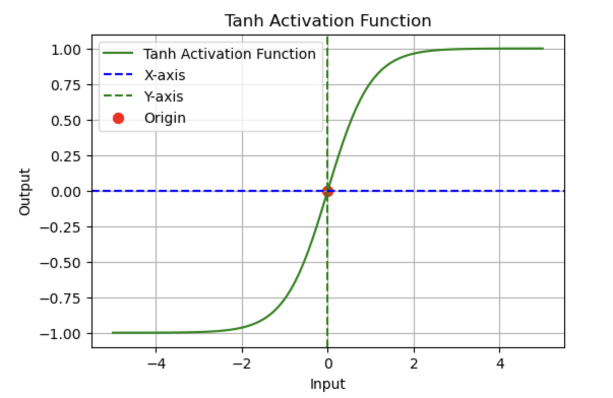

$$
\tanh(x)=\frac{e^x-e^{-x}}{e^x+e^{-x}}

$$

Its output ranges between -1 and 1.


Commonly used in traditional RNN architectures.

Unlike Sigmoid, Tanh is zero-centered.

However, it can also suffer from vanishing gradients.

### 8.4 ReLU (Rectified Linear Unit)
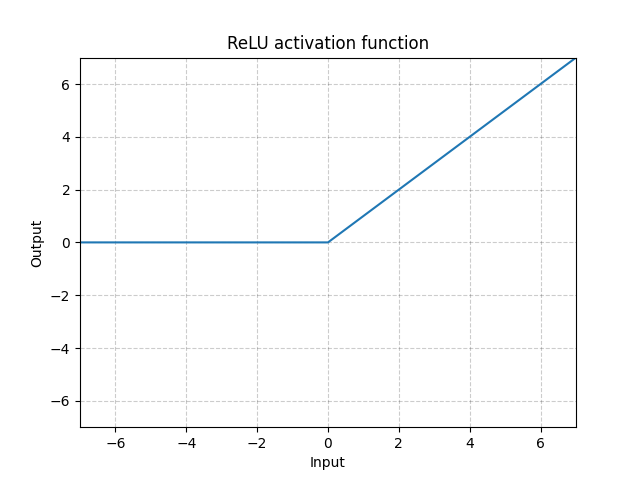

$$
ReLU(x)=\max(0,x)

$$

It returns:
- 0 for negative inputs.
- The input itself for positive inputs.


It is widely used in hidden layers of feedforward networks and CNNs.

One limitation is the dying ReLU problem, where some neurons can become inactive and output zero consistently.

### 8.5 Leaky ReLU

$$
f(x)=\max(\alpha x,x)

$$

It allows a small negative output instead of returning zero for every negative input.

This can help reduce the dying ReLU problem.

### 8.6 Softmax
Softmax converts a vector of scores (logits) into a probability distribution.

$$
Softmax(z_i)=
\frac{e^{z_i}}{\sum_{j=1}^{n}e^{z_j}}

$$

For example, a model predicts:
| Class | Probability |
| --- | --- |
| Cat | 0.75 |
| Dog | 0.15 |
| Horse | 0.10 |

The probabilities add up to 1.

Softmax is commonly used in the output layer of multi-class classification networks.

### Activation Functions: Quick Comparison
| Function | Output range | Common use |
| --- | --- | --- |
| Linear | \((-\infty,\infty)\) | Regression output |
| Sigmoid | (0, 1) | Binary classification output |
| Tanh | (-1, 1) | Traditional RNNs |
| ReLU | [0, ∞) | Hidden layers |
| Leaky ReLU | \((-\infty,\infty)\) | Hidden layers |
| Softmax | Probabilities summing to 1 | Multi-class output |


## 9. What is Deep Learning, and How is it Connected to Neural Networks?
This is another important distinction.

Deep Learning is a subfield of Machine Learning that uses neural networks with multiple layers to learn increasingly complex patterns from data.

Let's understand the relationship.


> Source: frontiersin.org


The hierarchy is:

$$
Artificial\ Intelligence
\supset
Machine\ Learning
\supset
Deep\ Learning

$$

More specifically:
- Artificial Intelligence (AI): The broader field of creating systems that perform tasks associated with intelligence.
- Machine Learning (ML): A field where systems learn patterns from data.
- Deep Learning (DL): A branch of ML that uses deep neural networks.

### Why is it called Deep Learning?
Because the network contains multiple processing layers between its input and output.

For example:
- A network with one hidden layer is a shallow neural network.
- A network with many hidden layers is generally called a deep neural network.
There is no universally fixed number of layers at which a network becomes deep.

Remember: Every Deep Learning model is based on neural network architectures, but not every neural network is necessarily deep.

## 10. Types of Neural Networks
Now we reach the most important architectural distinction.

Neural Networks have different architectures depending on the nature of the data and the problem.

Some architectures process independent inputs, some specialize in images, some handle sequences, and others process relationships between tokens.

Here is a high-level classification:


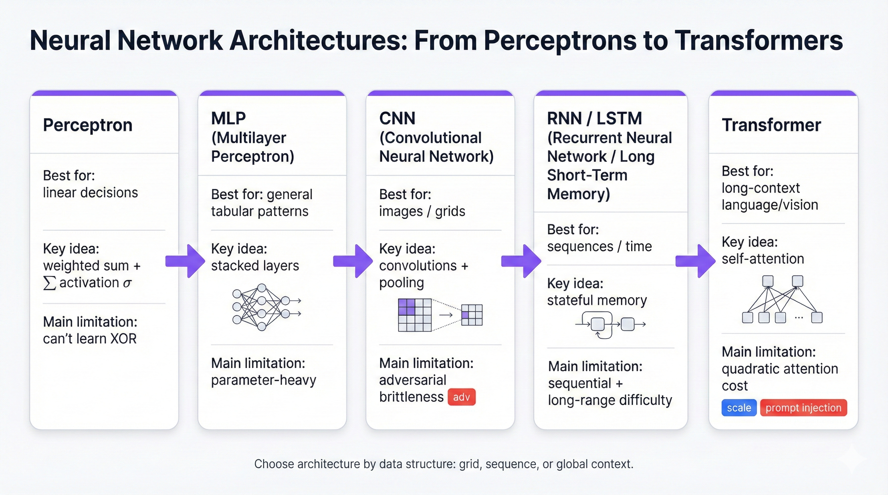


### Let's explore them.

### 10.1 Feedforward Neural Network (FNN)
A Feedforward Neural Network is one of the simplest neural network architectures.

Information flows in one direction:

$$
Input\rightarrow Hidden\ Layers\rightarrow Output

$$

There are no recurrent connections or feedback loops in a standard feedforward network.

It doesn't maintain an internal sequence state from previous inputs.

Applications:
- House price prediction.
- Customer churn prediction.
- Student performance prediction.
- Basic classification problems.

### 10.2 Artificial Neural Network (ANN)
ANN is a broad term for neural networks made of artificial neurons.

In many introductory ML courses, ANN is used specifically to refer to a traditional feedforward, fully connected network, also called a Multilayer Perceptron (MLP).

In an MLP:
- Neurons in one layer are typically connected to neurons in the next layer.
- Information moves forward.
- Hidden layers learn relationships.
- There are no recurrent connections.
An important terminology distinction:

An MLP is a specific type of feedforward ANN. ANN can also be used as an umbrella term for artificial neural network architectures more generally.

### 10.3 Convolutional Neural Network (CNN)
CNNs are neural networks primarily designed for processing grid-like data, especially images.

They use convolutional filters to extract spatial features.

For example, when processing an image:
- Early layers detect edges.
- Deeper layers detect textures and shapes.
- Later layers can recognize objects.
Applications:
- Face recognition.
- Object detection.
- Medical image analysis.
- Image classification.


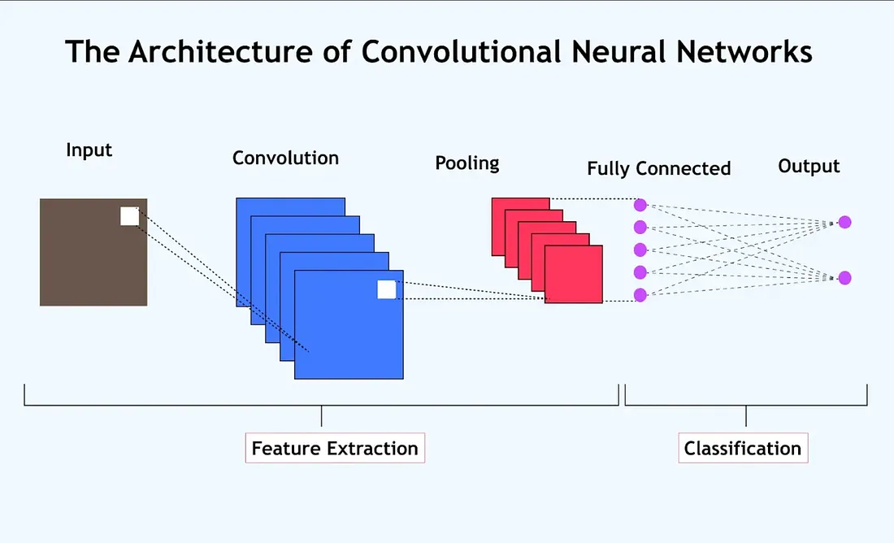


### 10.4 Recurrent Neural Network (RNN)
RNNs are neural networks specifically designed for sequential data.

Unlike a basic feedforward network, an RNN maintains information from previous time steps through a hidden state.

This allows it to use context from earlier inputs when processing later inputs.

Applications:
- Text processing.
- Speech recognition.
- Time-series prediction.
- Language modeling.
We'll explore RNNs in considerable detail shortly.

### 10.5 LSTM (Long Short-Term Memory)
LSTM is a special type of RNN.

Traditional RNNs struggle to retain information across long sequences because of the vanishing gradient problem.

LSTM introduces a memory cell and gates that regulate information flow.

Its three main gates are:
1. Forget Gate.
2. Input Gate.
3. Output Gate.
It is designed to capture longer-term dependencies.

### 10.6 GRU (Gated Recurrent Unit)
GRU is another RNN architecture designed to address limitations of traditional RNNs.

It has two main gates:
- Update Gate.
- Reset Gate.
It combines certain functionalities of LSTM into a simpler architecture.

GRUs often have fewer parameters than comparable LSTMs.

### 10.7 Transformer Neural Networks
Transformers are neural network architectures based primarily on attention mechanisms.

Unlike traditional RNNs, standard Transformers do not process tokens through a recurrent hidden state.

They use self-attention to determine how different tokens in a sequence relate to one another.

Applications:
- ChatGPT and other LLMs.
- Machine translation.
- Text summarization.
- Code generation.
- Image generation.
- Speech processing.


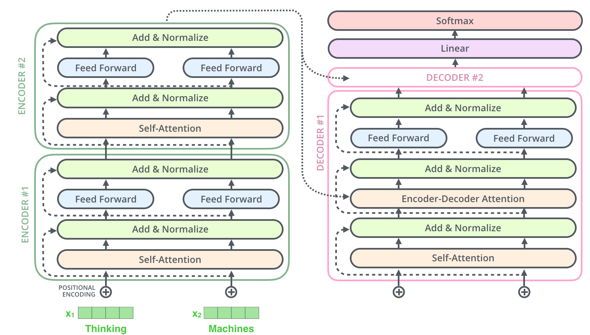


We'll connect these architectures together in the next section.

## 11. Understanding ANN vs RNN
This is the central distinction in your question.

Both ANN and RNN belong to the family of Artificial Neural Networks, but their architectures and ways of processing data are different.

### 11.1 What is ANN?
As discussed earlier, ANN is an artificial neural network.

When people compare ANN and RNN in introductory Deep Learning courses, ANN usually means a traditional feedforward network or MLP.

It processes inputs through its layers and generates an output.

It doesn't have a built-in recurrent mechanism to preserve information from previous time steps.


### Example: Predicting house prices
Suppose you want to predict the price of a house.

Your input is:

$$
X=[Area,Bedrooms,Bathrooms]

$$

The ANN receives all these features and predicts the house price.

$$
ANN(X)\rightarrow Price

$$

The model doesn't need to remember what the previous house looked like.

Each prediction can be made independently.


### 11.2 What is RNN?
A Recurrent Neural Network (RNN) is a type of neural network designed to process sequential data.

It has recurrent connections that allow information from previous time steps to influence the current computation.

Unlike a basic feedforward ANN, it maintains an internal representation of previous information called the hidden state.

### Example: Predicting the next word
Consider the sentence:

"The weather is very _____."

To predict the next word, the model needs to understand the preceding words.

For example:

"The weather is very beautiful."

An RNN processes the sentence sequentially:
1. The weather
2. is
3. very
4. beautiful
At every step, it updates its hidden state based on the current input and the previous hidden state.

This hidden state carries contextual information forward.


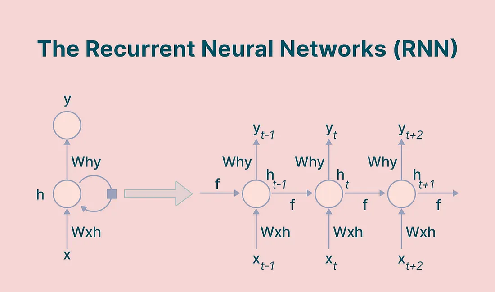


### 11.3 How Does an RNN Work?
A traditional RNN has two main inputs at each time step:
1. Current input \(x_t\).
2. Previous hidden state \(h_{t-1}\).
It produces:
1. New hidden state \(h_t\).
2. An output \(y_t\), depending on the architecture.
The hidden state is calculated as:

$$
\boxed{h_t=\tanh(W_{xh}x_t+W_{hh}h_{t-1}+b_h)}

$$

Where:
| Symbol | Meaning |
| --- | --- |
| \(x_t\) | Current input |
| \(h_t\) | Current hidden state |
| \(h_{t-1}\) | Previous hidden state |
| \(W_{xh}\) | Input-to-hidden weights |
| \(W_{hh}\) | Hidden-to-hidden recurrent weights |
| \(b_h\) | Hidden layer bias |
| \(\tanh\) | Activation function |

Notice something important:

The current hidden state depends on both the current input and the previous hidden state.

That's what gives RNNs their ability to maintain context.

### ANN vs RNN: Comparison
| Feature | ANN / MLP | RNN |
| --- | --- | --- |
| Full name | Artificial Neural Network | Recurrent Neural Network |
| Architecture | Feedforward | Recurrent |
| Data | Typically independent feature vectors | Sequential data |
| Information flow | Forward through layers | Forward through time with recurrent state |
| Memory of previous steps | No built-in recurrent memory | Yes, through hidden state |
| Input length | Usually fixed-size feature vector | Can process variable-length sequences |
| Main application | Classification and regression | Sequence modeling |
| Example | House price prediction | Language modeling |

### The most important difference
An ANN processes features to generate a prediction.

An RNN processes a sequence while maintaining information from previous time steps.

## 12. How are ANN and RNN Connected to Neural Networks?
Let's put everything together.
Neural Networks

Computational models made of interconnected artificial neurons


Feedforward Networks

Information moves forward


Recurrent Networks

Maintain sequential state


Examples

MLP / Traditional ANN

CNN (specialized feedforward architecture)


Examples

Simple RNN

LSTM

GRU


Transformers

Another major neural network architecture. Uses attention rather than traditional recurrent connections.


One clarification: CNNs are generally feedforward architectures, but they aren't simply ordinary fully connected MLPs. They use specialized convolutional operations. Also, the diagram is a conceptual classification, not an exhaustive taxonomy.

### The relationship can be summarized as:
- Neural Network is the broader concept.
- ANN describes artificial neural networks.
- Feedforward ANN/MLP is a particular architecture.
- RNN is a recurrent neural network architecture.
- LSTM and GRU are specialized RNN architectures.
- CNNs and Transformers are other major neural network architectures.

## 13. Why Do We Need Different Neural Network Architectures?
You might wonder why we don't just use one neural network architecture for everything.

The answer is that different types of data have different structures.

Consider these examples:
| Data type | Important characteristic | Suitable architecture |
| --- | --- | --- |
| Tabular data | Relationships between features | ANN / MLP |
| Images | Spatial relationships | CNN |
| Sequential text | Order and context | RNN / Transformer |
| Time series | Temporal dependencies | RNN / LSTM / GRU / Transformer |
| Video | Spatial and temporal information | CNN + RNN or video Transformers |
| Graphs | Relationships between nodes | GNN |

The architecture should match the problem's structure.

For example:
- In an image, nearby pixels often have meaningful spatial relationships.
- In a sentence, word order matters.
- In a time series, earlier observations may influence future observations.
A basic MLP doesn't explicitly model these structures in the same way specialized architectures do.

## 14. Important Concepts and Challenges in Neural Networks
Understanding the architecture and training process isn't enough. You should also understand common challenges.

### 14.1 Overfitting
Overfitting occurs when a model learns the training data too closely, including noise and irrelevant patterns.

As a result:
- Training performance is very good.
- Performance on unseen data is poor.
Example:

A student memorizes all the questions from a practice test but struggles with new questions.

The student has memorized rather than learned the underlying concepts.
How to prevent overfitting?
- Dropout.
- Regularization.
- Data augmentation.
- Early stopping.
- More training data.
- Appropriate model complexity.

### 14.2 Underfitting
Underfitting occurs when a model is too simple or insufficiently trained to learn the underlying patterns.

As a result:
- Training performance is poor.
- Testing performance is also poor.
Example:

A student only studies one chapter for an examination.

They don't understand enough of the syllabus to perform well.
How to address underfitting?
- Increase model complexity.
- Train for more epochs when appropriate.
- Improve input features.
- Reduce excessive regularization.
- Improve model architecture.

### 14.3 Vanishing Gradient Problem
During backpropagation, gradients are propagated through multiple layers.

Sometimes gradients become extremely small as they travel backwards.

This means the earlier layers receive very small updates and learn slowly.

This problem is particularly associated with deep networks using saturating activation functions and traditional RNNs handling long sequences.

Solutions include:
- ReLU and related activation functions.
- Proper weight initialization.
- Residual connections.
- LSTM and GRU for recurrent networks.
- Normalization techniques.

### 14.4 Exploding Gradient Problem
The opposite problem occurs when gradients become extremely large.

This can cause unstable training and excessively large parameter updates.

A common solution is Gradient Clipping, which limits gradient magnitude.

### 14.5 Regularization
Regularization techniques help prevent overfitting by discouraging overly complex models or improving their generalization.

Common methods:
- L1 Regularization.
- L2 Regularization.
- Dropout.
- Early Stopping.
What is Dropout?
Dropout randomly disables a fraction of neurons during training.

This prevents the network from relying too heavily on specific neurons and encourages more robust representations.

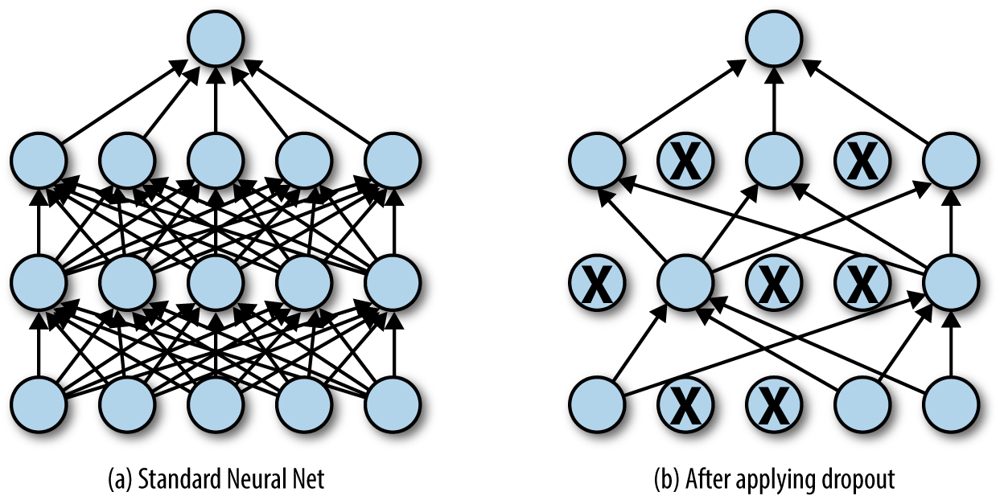


## 15. Practical Implementation: Building an ANN Using Python
Now let's see how the theoretical concepts translate into code.

We'll use:
- Python.
- TensorFlow.
- Keras.
Our task will be to classify students into two categories based on their features.

The example below uses randomly generated data for demonstration.

### Step 1: Install TensorFlow

```bash
pip install tensorflow

```


### Step 2: Import libraries

```python
import numpy as np
import tensorflow as tf
from tensorflow.keras import Sequential
from tensorflow.keras.layers import Dense

```


### Step 3: Prepare training data

```python
X = np.array([
    [2, 50, 40],
    [3, 60, 45],
    [5, 80, 70],
    [6, 90, 85],
    [1, 30, 25],
    [7, 95, 90],
], dtype=float)
y = np.array([0, 0, 1, 1, 0, 1])

```


Here:
- Feature 1 = Study hours.
- Feature 2 = Attendance.
- Feature 3 = Previous marks.
- Target = 0 (Fail) or 1 (Pass).
This is a tiny illustrative dataset, not enough to train a reliable real-world predictor.

### Step 4: Build the ANN

```python
model = Sequential([
    Dense(8, activation="relu", input_shape=(3,)),
    Dense(4, activation="relu"),
    Dense(1, activation="sigmoid"),
])

```


Let's understand this architecture.
| Layer | Configuration | Purpose |
| --- | --- | --- |
| Input | 3 features | Receives student data |
| Hidden 1 | 8 neurons, ReLU | Learns relationships |
| Hidden 2 | 4 neurons, ReLU | Learns more complex patterns |
| Output | 1 neuron, Sigmoid | Predicts pass probability |

### Step 5: Compile the model

```python
model.compile(
    optimizer="adam",
    loss="binary_crossentropy",
    metrics=["accuracy"],
)

```


Here:
- Adam: Optimizer.
- Binary Cross-Entropy: Loss function.
- Accuracy: Evaluation metric.

### Step 6: Train the model

```python
model.fit(
    X,
    y,
    epochs=100,
    batch_size=2,
    verbose=1,
)

```


The model will train for 100 epochs.

### Step 7: Make predictions

```python
new_student = np.array([[5, 85, 75]])
prediction = model.predict(new_student)
print(prediction)

```


The output will be a probability between 0 and 1.

You can convert it into a class:

```python
if prediction[0][0] >= 0.5:
    print("Pass")
else:
    print("Fail")

```


This demonstrates the complete ANN workflow:

$$
Data\rightarrow Architecture\rightarrow Training\rightarrow Prediction

$$


## 16. ANN vs CNN vs RNN vs LSTM vs GRU vs Transformer
This is a comparison you should keep in your notes because you'll encounter these architectures repeatedly while studying Deep Learning.
| Architecture | Primary purpose | Key mechanism |
| --- | --- | --- |
| ANN / MLP | General feature-based learning | Fully connected layers |
| CNN | Image and spatial data | Convolution and filters |
| RNN | Sequential data | Recurrent hidden state |
| LSTM | Long-term sequential dependencies | Memory cell and gates |
| GRU | Sequential learning | Update and reset gates |
| Transformer | Complex sequence relationships | Self-attention |

### A quick real-world example
Imagine you are building an AI application that understands videos.

You could use different architectures for different tasks:
- CNN: Extract visual features from individual frames.
- RNN/LSTM: Process temporal information across frames.
- Transformer: Model relationships across many frames using attention.
Modern systems frequently use Transformers and other specialized architectures instead of traditional RNNs.

## 17. The Complete Neural Network Learning Roadmap
Since you're studying Deep Learning and NLP, here's the order I recommend following.

### Neural Networks Learning Path
1. Neural Network Fundamentals

   Artificial neurons, weights, biases, layers and network architecture.
   Foundation
2. ANN / Feedforward Neural Networks

   Perceptrons, MLP, forward propagation and network implementation.
3. Training Neural Networks

   Loss functions, backpropagation, gradient descent and optimizers.
4. Activation Functions and Regularization

   ReLU, Sigmoid, Tanh, Softmax, Dropout and overfitting.
5. Convolutional Neural Networks

   Convolution, pooling, feature maps and image classification.
6. Recurrent Neural Networks

   Sequential data, hidden states, recurrent connections and BPTT.
7. LSTM and GRU

   Gates, memory cells and long-term dependencies.
8. Sequence-to-Sequence Architecture

   Encoder, decoder, context vectors and attention mechanisms.
9. Transformers

   Self-attention, positional encoding, multi-head attention and encoder-decoder architecture.
10. Large Language Models

    Tokenization, embeddings, pretraining, fine-tuning, inference and LLM applications.

A particularly important connection is:

$$
RNN\rightarrow LSTM/GRU\rightarrow Seq2Seq\rightarrow Attention\rightarrow Transformers

$$

Understanding this progression will help you understand why Transformers became so important in modern NLP.

## 18. The Three Things You Should Write in Your Notes
These are the most important definitions to remember.

1. Neural Network (NN)

A computational model inspired by biological neural networks, consisting of interconnected artificial neurons that learn patterns from data through weights, biases and activation functions.

2. Artificial Neural Network (ANN)

A network of interconnected artificial neurons. In introductory Deep Learning terminology, ANN often refers specifically to a feedforward network such as an MLP, which processes input features through successive layers to generate predictions.

3. Recurrent Neural Network (RNN)

A specialized neural network architecture designed for sequential data. It maintains a hidden state that carries information from previous time steps, allowing the network to use past context when processing current inputs.

## 19. Test Your Understanding
Let's check whether you've understood the fundamental concepts.
Neural Networks Quiz
0/5 answered

1. What is the primary purpose of weights in an artificial neuron?

To store the input data

To determine the influence of each input

To decide the number of layers

To calculate the learning rate


2. What introduces nonlinearity into a neural network?

Bias

Weights

Activation functions

Epochs


3. Which process calculates gradients of the loss with respect to network parameters?

Forward propagation

Backpropagation

Prediction

Normalization


4. What makes an RNN different from a basic feedforward ANN?

It has no weights

It uses only one neuron

It maintains a recurrent hidden state

It cannot use activation functions


5. Which architecture is primarily designed around self-attention?

CNN

MLP

Traditional RNN

Transformer


### Submit answers

### Final takeaway
If you remember just one thing from this entire guide, remember this:

Neural Network is the broader concept. ANN, CNN, RNN and Transformers are different neural network architectures designed to learn different kinds of patterns.
- ANN/MLP → General feature-based learning.
- CNN → Spatial patterns, especially images.
- RNN → Sequential patterns and previous context.
- LSTM/GRU → Improved recurrent learning with gating mechanisms.
- Transformers → Relationships between elements using attention.
Your next logical step is to understand how ANN works mathematically, particularly the Perceptron, Multilayer Perceptron (MLP), Forward Propagation and Backpropagation, before moving deeper into specialized architectures.
