# ANN and RNN: A Complete Guide
Now that we've understood the fundamentals of Neural Networks, let's go deeper into Artificial Neural Networks (ANNs) and Recurrent Neural Networks (RNNs).

We'll study both architectures from the basics to their mathematical working, architecture, training process, applications, advantages, limitations, and Python implementation.

The most important distinction to keep in mind is:
- ANN (in the traditional MLP sense): Learns relationships between input features.
- RNN: Learns relationships between sequential inputs while maintaining information from previous time steps.
Both are neural network architectures, but they are designed to solve different types of problems.

## Contents

- [Artificial Neural Networks](#1-what-is-an-artificial-neural-network)
- [Recurrent Neural Networks](#10-what-is-a-recurrent-neural-network)
- [Training and mathematical foundations](#6-mathematics-behind-ann)
- [LSTM, GRU, and bidirectional RNNs](#19-lstm-and-gru-improvements-over-traditional-rnns)
- [Python implementations](#22-implementing-an-ann-using-python)
- [ANN vs RNN comparison](#25-ann-vs-rnn-complete-comparison)
- [Review and next steps](#28-important-terminology-to-remember)


## Part 1: Artificial Neural Network (ANN)

### 1. What is an Artificial Neural Network?
An Artificial Neural Network (ANN) is a computational model consisting of interconnected artificial neurons organized into layers. It learns patterns and relationships from data by adjusting weights and biases during training.

In traditional introductory Deep Learning terminology, ANN commonly refers to a Feedforward Neural Network, particularly a Multilayer Perceptron (MLP).

It is inspired by the biological neural networks present in the human brain.

ANNs are particularly useful when we want to learn relationships between different input features.

#### Real-world examples
Consider these problems:
| Problem | Input features | Prediction |
| --- | --- | --- |
| House price prediction | Area, location, bedrooms | House price |
| Student performance | Attendance, study hours, marks | Pass/Fail |
| Loan approval | Income, credit score, employment | Approved/Rejected |
| Customer churn | Usage, complaints, subscription | Churn/No Churn |
| Disease classification | Medical measurements | Disease category |

In all these examples, an ANN learns relationships between input features and the desired output.

For example, a bank might want to predict whether a customer will repay a loan.

It provides historical customer information to an ANN, which learns patterns associated with repayment.

When new customer information is provided, the trained network generates a prediction.

### 2. Architecture of an ANN
A traditional ANN (MLP) consists of three major types of layers:
1. Input Layer.
2. Hidden Layer(s).
3. Output Layer.


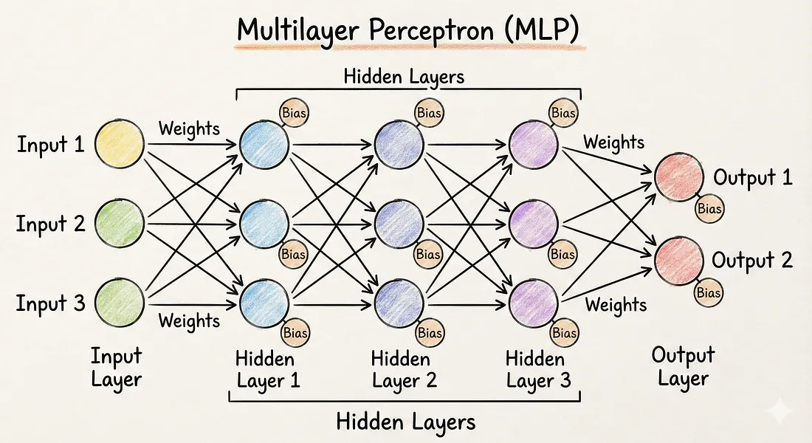


#### Let's understand each layer in detail.

#### 2.1 Input Layer
The input layer receives the data that will be processed by the neural network.

Each input neuron generally represents one feature of the dataset.

Consider a dataset containing information about houses:
| Area (sq. ft.) | Bedrooms | Bathrooms | Location Score | Price |
| --- | --- | --- | --- | --- |
| 1200 | 2 | 1 | 8 | 40 lakhs |
| 1800 | 3 | 2 | 9 | 65 lakhs |
| 2500 | 4 | 3 | 7 | 85 lakhs |

Here, we have four input features:
- Area.
- Bedrooms.
- Bathrooms.
- Location score.
Therefore, the input layer contains four input values.

$$
X=[x_1,x_2,x_3,x_4]

$$

Important: The input layer generally passes feature values to the next layer. The trainable weighted calculations happen in the subsequent computational layers.

#### 2.2 Hidden Layers
Hidden layers are responsible for learning relationships and patterns from the input data.

Each hidden layer consists of multiple artificial neurons.

Every neuron:
1. Receives inputs from the previous layer.
2. Multiplies them by weights.
3. Adds a bias.
4. Applies an activation function.
5. Passes the result to the next layer.
Why do we need hidden layers?

Because real-world relationships are often complex and nonlinear.

For example, house prices don't depend on area alone.

They depend on several interacting factors:
- Area.
- Location.
- Number of rooms.
- Amenities.
- Property age.
Hidden layers help the network learn these complex relationships.

#### Multiple hidden layers
An ANN can contain one or multiple hidden layers.

For example:
Example ANN Architecture
Input
4
Neurons

Hidden 1
8
Neurons

Hidden 2
4
Neurons

Output
1
Neuron


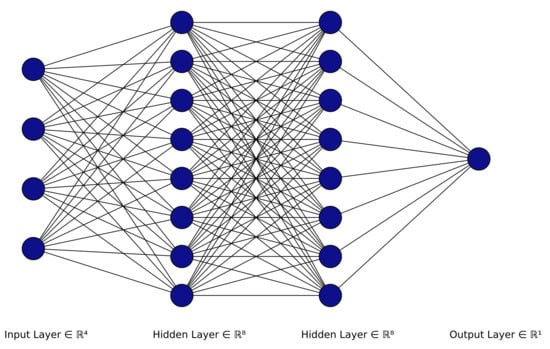


Illustrative architecture: 4 → 8 → 4 → 1.

Here:
- Input Layer: 4 neurons.
- First Hidden Layer: 8 neurons.
- Second Hidden Layer: 4 neurons.
- Output Layer: 1 neuron.
The first hidden layer learns relationships between the original features.

The second hidden layer processes the representations produced by the first hidden layer.

The output layer generates the final prediction.

#### 2.3 Output Layer
The output layer produces the final result of the neural network.

Its number of neurons and activation function depend on the problem.

There are three common scenarios:

Scenario 1: Regression

Suppose we want to predict house prices.

The output is a continuous numerical value.

Example:

$$
Predicted\ Price=65.5\text{ lakhs}

$$

Usually, a single neuron with a linear activation function is used.

Scenario 2: Binary Classification

Suppose we want to predict whether a customer will default on a loan.

Possible outputs:
- 0 = No Default.
- 1 = Default.
A single sigmoid output neuron is commonly used.

$$
P(Default)=0.85

$$

Scenario 3: Multi-class Classification

Suppose we want to classify an image into:
- Cat.
- Dog.
- Horse.
We use three output neurons, usually with Softmax activation.
| Class | Probability |
| --- | --- |
| Cat | 0.80 |
| Dog | 0.15 |
| Horse | 0.05 |

The predicted class is Cat.

### 3. Understanding the Perceptron
Before understanding a complete ANN, we need to understand the Perceptron.

A Perceptron is one of the earliest and simplest artificial neuron models.

It was introduced by Frank Rosenblatt in 1958.

It takes multiple inputs, calculates a weighted sum, adds a bias, and applies an activation function to generate an output.


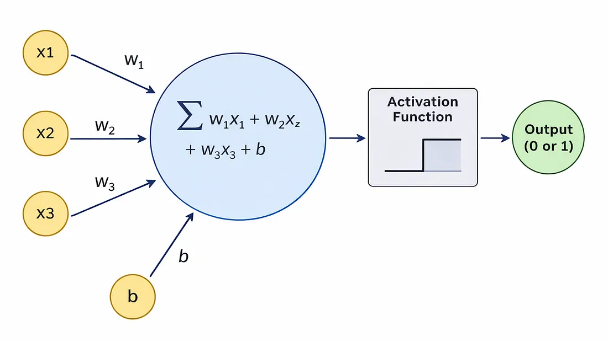


#### Mathematical representation

$$
z=\sum_{i=1}^{n}w_ix_i+b

$$

The output is:

$$
y=f(z)

$$

A traditional perceptron uses a step activation function:

$$
f(z)=
\begin{cases}
1 & z\geq 0\\
0 & z<0
\end{cases}

$$

#### Example
Suppose we want to predict whether a student passes based on study hours and attendance.

Inputs:

$$
x_1=5,\quad x_2=80

$$

Weights:

$$
w_1=0.6,\quad w_2=0.02

$$

Bias:

$$
b=-3

$$

Calculate the weighted sum:

$$
z=(5\times0.6)+(80\times0.02)-3

$$

$$
z=3+1.6-3=1.6

$$

Since \(z\geq0\):

$$
y=1

$$

The perceptron predicts Pass.

#### Limitation of a Perceptron
A single-layer perceptron can only learn linearly separable patterns.

For example, it can learn the AND and OR logical operations, but it cannot learn XOR correctly.

This limitation led to the development and popularity of multilayer neural networks.

### 4. Single-Layer Perceptron vs Multilayer Perceptron
This is an important distinction.
Single-Layer Perceptron (SLP)
A Single-Layer Perceptron has an input layer connected directly to an output layer.

It doesn't contain hidden layers.

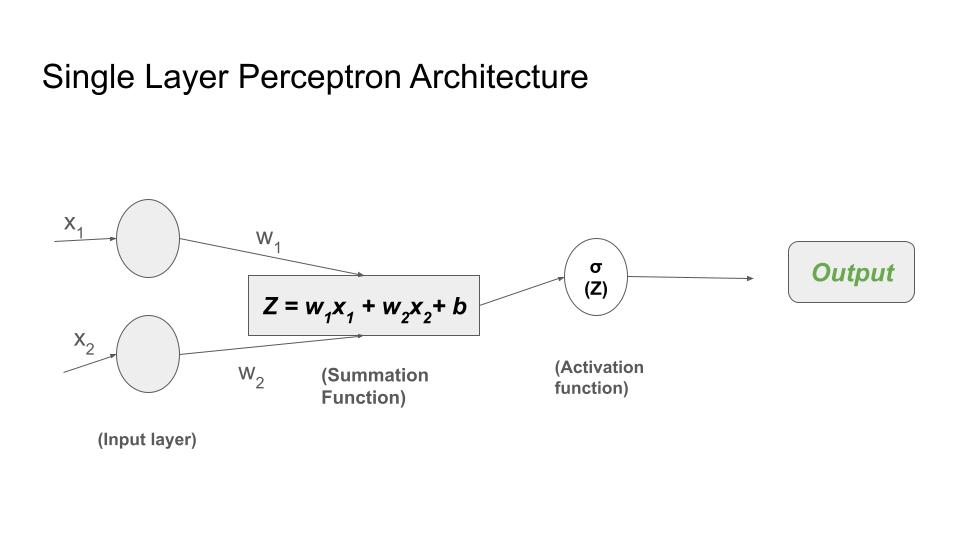

It is suitable for simple linearly separable classification problems.
Multilayer Perceptron (MLP)
A Multilayer Perceptron contains:
- An input layer.
- One or more hidden layers.
- An output layer.


It can learn complex nonlinear relationships through nonlinear activation functions.

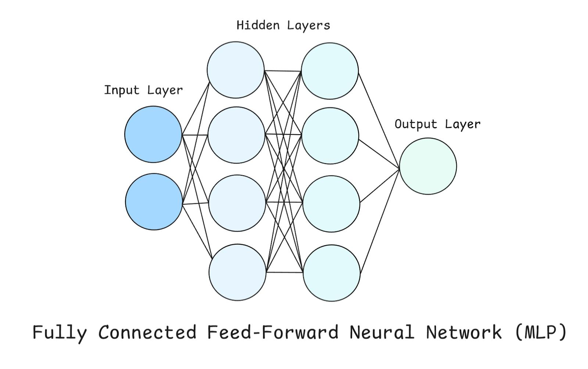

#### Comparison
| Feature | SLP | MLP |
| --- | --- | --- |
| Hidden layers | None | One or more |
| Complexity | Simple | More complex |
| Learning capability | Linear decision boundaries | Nonlinear relationships |
| Training | Perceptron learning rule | Usually backpropagation |
| XOR problem | Cannot solve | Can solve |
| Applications | Simple classification | Regression and complex classification |

Remember: An MLP is a type of ANN. It is one of the most commonly studied ANN architectures.

### 5. How Does ANN Work Internally?
Now let's understand the actual mathematical working of an ANN.

Consider this architecture:

$$
4\rightarrow3\rightarrow2\rightarrow1

$$

Where:
- 4 input features.
- 3 neurons in Hidden Layer 1.
- 2 neurons in Hidden Layer 2.
- 1 output neuron.
The network works through the following process.

#### Step 1: Receive Input
Suppose our input is:

$$
X=
\begin{bmatrix}
x_1\\x_2\\x_3\\x_4
\end{bmatrix}

$$

For example:

$$
X=
\begin{bmatrix}
1200\\3\\2\\8
\end{bmatrix}

$$

In real applications, features should generally be appropriately scaled or normalized before training.

#### Step 2: Calculate Weighted Sum
Each neuron in the first hidden layer calculates a weighted sum.

For neuron 1:

$$
z_1=w_{11}x_1+w_{21}x_2+w_{31}x_3+w_{41}x_4+b_1

$$

For neuron 2:

$$
z_2=w_{12}x_1+w_{22}x_2+w_{32}x_3+w_{42}x_4+b_2

$$

The same process happens for neuron 3.

Each neuron has its own weights and bias.

#### Step 3: Apply Activation Function
The weighted sums are passed through an activation function.

For example, using ReLU:

$$
a_i=\max(0,z_i)

$$

These activated values become the inputs to the next layer.

#### Step 4: Process Subsequent Hidden Layers
The second hidden layer receives the outputs of the first hidden layer.

It performs another weighted calculation and activation.

This process continues until the output layer is reached.

#### Step 5: Generate Prediction
The output layer produces the final prediction.

For example:

$$
\hat y=65.5

$$

The predicted house price is ₹65.5 lakhs.


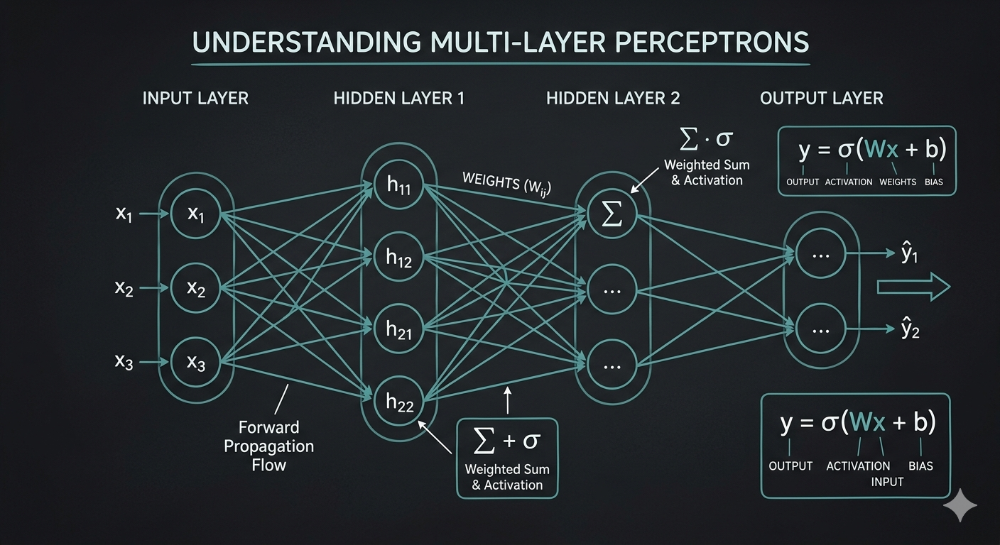


### 6. Mathematics Behind ANN
Understanding matrix operations is extremely important when studying neural networks.

Instead of calculating every neuron separately, we use matrices and vectors.

This makes calculations efficient, especially when dealing with hundreds or thousands of neurons.

For a layer, the general mathematical representation is:

$$
\boxed{A^{[l]}=f(W^{[l]}A^{[l-1]}+b^{[l]})}

$$

Where:
| Symbol | Meaning |
| --- | --- |
| \(A^{[l-1]}\) | Activations from the previous layer |
| \(W^{[l]}\) | Weight matrix of current layer |
| \(b^{[l]}\) | Bias vector |
| \(f\) | Activation function |
| \(A^{[l]}\) | Output activations of current layer |
| \(l\) | Current layer number |

For the first hidden layer:

$$
A^{[1]}=f(W^{[1]}X+b^{[1]})

$$

For the second hidden layer:

$$
A^{[2]}=f(W^{[2]}A^{[1]}+b^{[2]})

$$

For the output layer:

$$
\hat Y=g(W^{[3]}A^{[2]}+b^{[3]})

$$

Here, \(g\) represents the output activation function.

#### Understanding the dimensions
Suppose:
- Input features = 4.
- First hidden layer = 3 neurons.
- Second hidden layer = 2 neurons.
- Output layer = 1 neuron.
The dimensions will be:
| Matrix | Dimensions |
| --- | --- |
| Input \(X\) | \(4\times1\) |
| First weights \(W^{[1]}\) | \(3\times4\) |
| First bias \(b^{[1]}\) | \(3\times1\) |
| First activation \(A^{[1]}\) | \(3\times1\) |
| Second weights \(W^{[2]}\) | \(2\times3\) |
| Second activation \(A^{[2]}\) | \(2\times1\) |
| Output weights \(W^{[3]}\) | \(1\times2\) |
| Output \(\hat Y\) | \(1\times1\) |

The dimensions must be compatible for matrix multiplication.

#### How many parameters does an ANN have?
For a fully connected layer:

$$
\boxed{Parameters=(Inputs\times Neurons)+Neurons}

$$

The first part calculates weights, and the second part calculates biases.

For our example:

Layer 1:

$$
(4\times3)+3=15

$$

Layer 2:

$$
(3\times2)+2=8

$$

Output Layer:

$$
(2\times1)+1=3

$$

Total:

$$
15+8+3=\boxed{26}

$$

26 trainable parameters
This is useful when calculating model complexity and understanding how neural network architecture affects the number of learnable parameters.

### 7. Training an ANN
An ANN learns through an iterative training process.

The main components are:
1. Forward Propagation.
2. Loss Calculation.
3. Backpropagation.
4. Optimization.
5. Repetition.


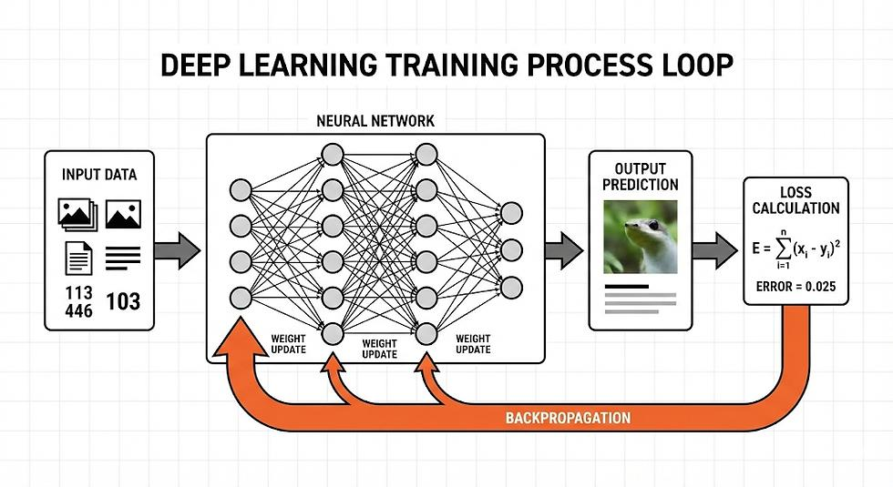


Let's understand the complete process using a classification example.

#### Step 1: Forward Propagation
The input data passes through the network.

The network generates a prediction.

$$
X\rightarrow ANN\rightarrow\hat Y

$$

#### Step 2: Calculate Loss
Compare the prediction with the actual output.

Suppose:

$$
Actual=1

$$

$$
Predicted=0.3

$$

Using Binary Cross-Entropy:

$$
L=-[y\log(\hat y)+(1-y)\log(1-\hat y)]

$$

Substituting:

$$
L=-\log(0.3)

$$

$$
L\approx1.204

$$

The model has a loss of approximately 1.204.

#### Step 3: Backpropagation
Backpropagation calculates gradients of the loss with respect to the network's weights and biases.

Using the chain rule, the gradients are propagated from the output layer towards the earlier layers.

#### Step 4: Update Weights
An optimizer such as Adam or SGD uses the gradients to update the parameters.

For a simple gradient descent update:

$$
w_{new}=w_{old}-\eta\frac{\partial L}{\partial w}

$$

The goal is to reduce the loss.

#### Step 5: Repeat
The network repeats this process across multiple batches and epochs until training is completed.

The trained network should ideally perform well on unseen data, not just the training dataset.

### 8. Types of ANN
The term ANN is broad, but in introductory courses it often refers to the traditional feedforward MLP.

Some commonly discussed ANN architectures include:
| Architecture | Description |
| --- | --- |
| Single-Layer Perceptron | Input directly connected to output |
| Multilayer Perceptron | Multiple layers of fully connected neurons |
| Feedforward Neural Network | Information flows forward without recurrent connections |
| Radial Basis Function Network | Uses radial basis functions for nonlinear mapping |

CNNs and RNNs are also artificial neural networks in the broader sense, but they are specialized architectures and are generally studied separately.

### 9. Advantages and Limitations of ANN

#### Advantages
1. Nonlinear learning: Can learn complex relationships between features.
2. Automatic feature learning: Hidden layers can learn useful representations.
3. Versatility: Supports classification, regression and other tasks.
4. Parallel computation: Matrix operations can be efficiently executed on GPUs.
5. Adaptability: Can be trained for many different applications.

#### Limitations
1. Requires sufficient data: Complex models may need large training datasets.
2. Computational cost: Deep networks can require substantial resources.
3. Overfitting: May memorize training data.
4. Interpretability: Understanding why a model made a particular prediction can be difficult.
5. Feature scaling: Often benefits from normalization or standardization.
6. No inherent sequence memory: A basic feedforward MLP doesn't maintain previous time-step information.
The last limitation is particularly important because it motivates architectures such as RNNs.

## Part 2: Recurrent Neural Network (RNN)

### 10. What is a Recurrent Neural Network?
A Recurrent Neural Network (RNN) is a type of artificial neural network specifically designed to process sequential data.

Unlike a traditional feedforward ANN, an RNN maintains information from previous time steps using an internal component called a Hidden State.

This allows it to understand the relationship between the current input and previously processed inputs.

#### Why do we need RNN?
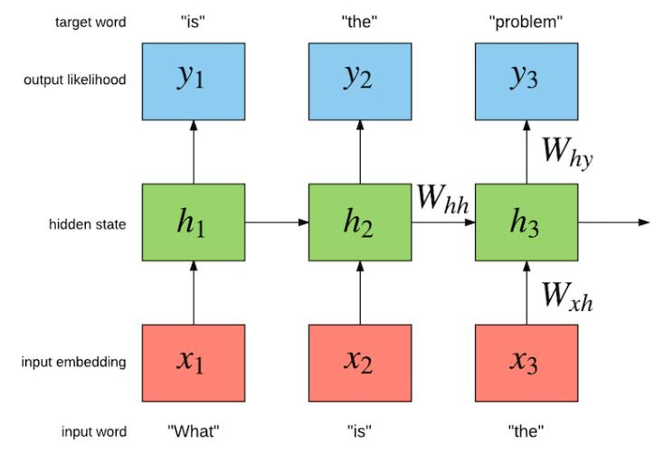

Let's understand with an example.

Suppose we have the following sentence:
I love learning Artificial Intelligence.

To understand the meaning of the sentence, we need to consider the order of words.

For example:
- "I love learning."
- "I learning love."
Both contain similar words, but their meanings and grammatical structures differ.

A traditional ANN doesn't inherently understand the sequential relationship between these words.

An RNN, however, processes words one by one and maintains information from previously processed words.

This makes it useful for:
- Natural Language Processing.
- Language modeling.
- Sentiment analysis.
- Speech recognition.
- Time-series forecasting.
- Sequence prediction.


> Source: davidsbatista.net


The key idea: An RNN uses information from previous time steps to help process the current input.

### 11. Understanding Sequential Data
Before understanding RNN architecture, we need to understand what sequential data actually means.

Sequential Data is data in which the order of observations matters.

In other words, the position or timing of an observation can influence its meaning.

#### Examples of sequential data
1. Text Data

Consider:

"I am learning Python."

The words appear in a particular order.

Changing their order changes the meaning.

2. Time-Series Data

Consider daily temperatures:
| Day | Temperature |
| --- | --- |
| Monday | 25°C |
| Tuesday | 27°C |
| Wednesday | 29°C |
| Thursday | 28°C |
| Friday | 31°C |

The temperature today may depend on previous weather conditions.

3. Stock Market Data

Stock prices are recorded over time.

Previous observations can help a model identify temporal patterns.

4. Speech Data

Speech consists of a sequence of audio samples or extracted features.

The order of those samples is important for understanding spoken words.

5. Video Data

A video consists of multiple frames arranged in chronological order.

The sequence of frames represents movement and events.

#### Why is order important?
Consider these two sentences:
- "The dog chased the cat."
- "The cat chased the dog."
Both contain exactly the same words.

However, the meaning is different because the word order changes.

A sequence-processing architecture must account for this.

This is one of the primary reasons RNNs were developed.

### 12. Architecture of an RNN
An RNN contains three major components:
1. Input.
2. Hidden State.
3. Output.
Unlike a traditional feedforward ANN, the RNN has a recurrent connection that carries the hidden state from one time step to the next.


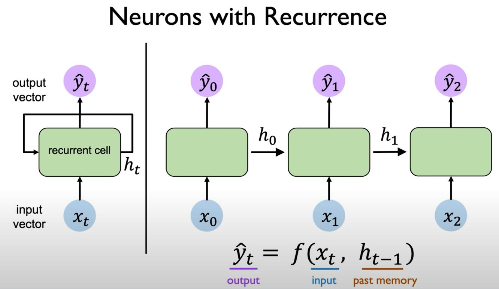


#### Let's understand each component.

#### 12.1 Input (x)
The input represents the current element in a sequence.

For example, consider:

"I love Python."

The RNN receives the words one by one:
- \(x_1\) = I
- \(x_2\) = love
- \(x_3\) = Python
In actual implementations, words are converted into numerical representations such as token IDs and embeddings before being passed into the RNN.

#### 12.2 Hidden State (h)
This is the most important component of an RNN.

The hidden state maintains a representation of information from previously processed inputs.

Think of it as the network's working memory.

For example:

At time step 1:

Input: "I"

The network processes the word and generates a hidden state.

At time step 2:

Input: "love"

The network receives:
- Current input: "love".
- Previous hidden state: Information from "I".
It combines these to produce a new hidden state.

At time step 3:

Input: "Python"

The network receives:
- Current input: "Python".
- Previous hidden state: Information carried from the earlier words.
It updates its hidden state again.

This is how an RNN maintains sequential context.


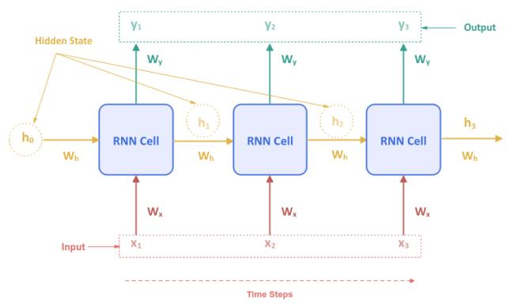


Important: The hidden state is not a perfect storage of every previous input. It is a learned representation that may preserve useful information, but traditional RNNs often struggle to retain information across long sequences.

#### 12.3 Output (y)
The output is the result generated by the RNN.

Depending on the task, the network can generate an output:
- At every time step.
- Only at the final time step.
- At selected time steps.
For example, in sentiment analysis, the RNN may process an entire sentence and generate one final sentiment prediction.

$$
Input\ Sequence\rightarrow RNN\rightarrow Sentiment

$$


### 13. How Does an RNN Work Internally?
Let's understand the complete working of a traditional RNN.

Consider this sentence:

"I love Machine Learning."

The RNN processes it sequentially.


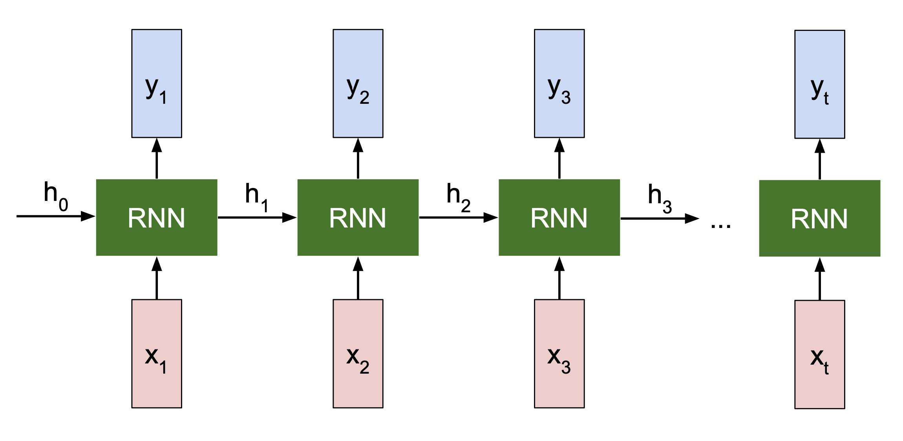


#### Step 1: First Time Step
Input:

$$
x_1=I

$$

The RNN receives the first word.

Since there is no previous information, the initial hidden state is usually initialized to zero (although other initializations are possible).

$$
h_0=0

$$

The network calculates:

$$
h_1=f(W_{xh}x_1+W_{hh}h_0+b_h)

$$

It generates the first hidden state.

#### Step 2: Second Time Step
Input:

$$
x_2=love

$$

Now the network receives:
- Current input: love.
- Previous hidden state: \(h_1\).
It calculates:

$$
h_2=f(W_{xh}x_2+W_{hh}h_1+b_h)

$$

The new hidden state contains information influenced by both the current word and the previous state.

#### Step 3: Third Time Step
Input:

$$
x_3=Machine

$$

The network uses:
- Current input: Machine.
- Previous hidden state: \(h_2\).

$$
h_3=f(W_{xh}x_3+W_{hh}h_2+b_h)

$$

#### Step 4: Fourth Time Step
Input:

$$
x_4=Learning

$$

The network calculates:

$$
h_4=f(W_{xh}x_4+W_{hh}h_3+b_h)

$$

The final hidden state has been influenced by all four inputs.

It can now be used to generate a prediction, such as the sentiment of the sentence or a next-token prediction.

#### What is happening here?
Notice that:

$$
h_1\rightarrow h_2\rightarrow h_3\rightarrow h_4

$$

Each hidden state influences the next hidden state.

This is the recurrent mechanism.

### 14. Mathematics Behind RNN
This is one of the most important sections for understanding RNNs properly.

A traditional RNN uses two main equations.

#### 14.1 Hidden State Equation

$$
\boxed{h_t=\tanh(W_{xh}x_t+W_{hh}h_{t-1}+b_h)}

$$

Let's break it down.
| Component | Meaning |
| --- | --- |
| \(h_t\) | Current hidden state |
| \(x_t\) | Current input |
| \(h_{t-1}\) | Previous hidden state |
| \(W_{xh}\) | Input-to-hidden weight matrix |
| \(W_{hh}\) | Hidden-to-hidden recurrent weight matrix |
| \(b_h\) | Hidden bias |
| \(\tanh\) | Activation function |

There are two important operations:

Operation 1: Current input processing

$$
W_{xh}x_t

$$

This processes the current input.

Operation 2: Previous information processing

$$
W_{hh}h_{t-1}

$$

This processes information carried from the previous time step.

Both are combined, a bias is added, and an activation function is applied.

The result is the current hidden state.

#### 14.2 Output Equation
After calculating the hidden state, we can calculate the output.

$$
\boxed{y_t=g(W_{hy}h_t+b_y)}

$$

Where:
| Component | Meaning |
| --- | --- |
| \(y_t\) | Current output |
| \(h_t\) | Current hidden state |
| \(W_{hy}\) | Hidden-to-output weight matrix |
| \(b_y\) | Output bias |
| \(g\) | Output activation function |

The output activation depends on the task.

For example:
- Sigmoid for binary classification.
- Softmax for multi-class classification.
- Linear activation for regression.

#### 14.3 An important concept: Weight Sharing
This is a particularly important characteristic of RNNs.

In an RNN, the same weight matrices are reused at every time step.

For example:

$$
h_1=f(W_{xh}x_1+W_{hh}h_0+b_h)

$$

$$
h_2=f(W_{xh}x_2+W_{hh}h_1+b_h)

$$

$$
h_3=f(W_{xh}x_3+W_{hh}h_2+b_h)

$$

Notice that \(W_{xh}\), \(W_{hh}\), and \(b_h\) remain the same.

They are not newly created for every word.

This is called Parameter Sharing.

#### Why is parameter sharing useful?
1. Reduces the number of trainable parameters.
2. Allows the same model to process sequences of different lengths.
3. Learns reusable patterns across different time steps.
4. Makes the model more parameter-efficient.


> Source: scaler.com


### 15. Understanding RNN Through a Practical Example
Let's build a simple mental model.

Suppose we want to develop a sentiment analysis application.

The application should classify a sentence as:
- Positive.
- Negative.
- Neutral.
Consider:

"I really enjoyed this movie."

The input sentence contains five words.

#### Step 1: Tokenization
Convert the sentence into individual tokens.
["I", "really", "enjoyed", "this", "movie"]


#### Step 2: Numerical Representation
Neural networks cannot directly process ordinary text.

We convert words into numerical representations.

For example, an embedding layer might convert the words into vectors:
I        -> [0.12, 0.25, 0.41]
really   -> [0.32, 0.18, 0.56]
enjoyed  -> [0.72, 0.63, 0.21]
this     -> [0.11, 0.29, 0.44]
movie    -> [0.52, 0.75, 0.31]


These are illustrative vectors, not actual trained embeddings.

#### Step 3: Sequential Processing
The RNN processes each vector one at a time.
| Time step | Input | Previous state | New state |
| --- | --- | --- | --- |
| 1 | I | \(h_0\) | \(h_1\) |
| 2 | really | \(h_1\) | \(h_2\) |
| 3 | enjoyed | \(h_2\) | \(h_3\) |
| 4 | this | \(h_3\) | \(h_4\) |
| 5 | movie | \(h_4\) | \(h_5\) |

#### Step 4: Generate Sentiment
The final hidden state is passed through an output layer.

For example:
| Sentiment | Probability |
| --- | --- |
| Positive | 0.94 |
| Negative | 0.02 |
| Neutral | 0.04 |

The model classifies the sentence as Positive.

This is an example of a Many-to-One RNN, which we'll discuss next.

### 16. Different Types of RNN Architectures
RNNs can be structured in different ways depending on the relationship between inputs and outputs.

There are four commonly studied input-output patterns:
1. One-to-One.
2. One-to-Many.
3. Many-to-One.
4. Many-to-Many.


> Source: sunwoo76.github.io


#### Let's understand each.

#### 16.1 One-to-One
One input produces one output.

This is a standard input-output arrangement and doesn't require recurrence.

Example:

Image classification:

$$
Image\rightarrow Class

$$

This pattern is generally handled by architectures such as CNNs or MLPs rather than a conventional RNN.

#### 16.2 One-to-Many
One input produces a sequence of outputs.

Example: Image Caption Generation.

Input:

An image of a dog.

Output:

"A dog is running in a park."

The model receives one image representation and generates multiple words sequentially.

$$
One\ Input\rightarrow Multiple\ Outputs

$$

#### 16.3 Many-to-One
Multiple sequential inputs produce one output.

Example: Sentiment Analysis.

Input:

"I really love this product."

Output:

Positive.

$$
Multiple\ Inputs\rightarrow One\ Output

$$

This is one of the most common arrangements for sequence classification.

#### 16.4 Many-to-Many
Multiple inputs produce multiple outputs.

There are different variations of this architecture.

Example 1: Sequence labeling

Input:

A sentence containing multiple words.

Output:

A corresponding label for each word.

For example, Named Entity Recognition:
| Input word | Output label |
| --- | --- |
| Jaiveer | Person |
| studies | Other |
| at | Other |
| Chitkara | Organization |
| University | Organization |

Example 2: Machine Translation

Input:

"How are you?"

Output:

"Comment allez-vous?"

The input and output sequences can have different lengths.

This is commonly implemented using an encoder-decoder architecture.

### 17. How is an RNN Trained?
RNNs are trained using a process similar to ordinary feedforward neural networks.

However, there is an important difference in how gradients are calculated.

RNNs use a technique called:

Backpropagation Through Time (BPTT).

Let's understand this.

#### 17.1 Forward Propagation Through Time
An RNN processes a sequence one time step at a time.

For example:

$$
x_1\rightarrow x_2\rightarrow x_3\rightarrow x_4

$$

At every time step, the hidden state is updated.

$$
h_1\rightarrow h_2\rightarrow h_3\rightarrow h_4

$$

The model produces predictions, and the loss is calculated.

For a sequence prediction task, the total loss may be calculated by summing or averaging the losses across time steps.

$$
L_{total}=\sum_{t=1}^{T}L_t

$$

#### 17.2 Backpropagation Through Time (BPTT)
In a traditional ANN, backpropagation moves gradients backwards through the network's layers.

In an RNN, we also need to propagate gradients backwards through the time steps.

This is called Backpropagation Through Time.


> Source: deeplearningmath.org


For example:

Forward direction:

$$
h_1\rightarrow h_2\rightarrow h_3\rightarrow h_4

$$

Backward direction:

$$
h_4\rightarrow h_3\rightarrow h_2\rightarrow h_1

$$

The model calculates gradients through the unrolled recurrent network.

These gradients are used to update the shared weights.

#### ANN Backpropagation vs RNN BPTT
| Feature | ANN | RNN |
| --- | --- | --- |
| Gradient calculation | Across network layers | Across layers and time steps |
| Algorithm | Backpropagation | Backpropagation Through Time |
| Network structure | Feedforward | Recurrent |
| Shared recurrent weights | No | Yes |
| Temporal dependencies | Not inherently modeled | Modeled through hidden states |


### 18. Problems with Traditional RNNs
Traditional RNNs are useful, but they have important limitations.

The two most significant problems are:
1. Vanishing Gradient Problem.
2. Exploding Gradient Problem.
These problems become especially important when processing long sequences.

#### 18.1 Vanishing Gradient Problem
The Vanishing Gradient Problem occurs when gradients become extremely small during backpropagation.

As gradients travel backwards through many time steps, they may shrink.

As a result, earlier time steps receive very small updates.

The network struggles to learn relationships between distant elements in a sequence.

#### Example
Consider:

"The student who studied consistently throughout the semester despite several personal challenges finally passed the examination."

To understand the complete sentence, information from earlier words may be important when processing later words.

A traditional RNN can struggle to preserve useful information across long sequences.

#### Why does it happen?
The hidden state repeatedly applies transformations and activation functions.

During backpropagation, gradients involve repeated multiplication by derivatives and weight matrices.

If these products are generally smaller than 1, gradients may shrink exponentially.

#### Solutions
- LSTM.
- GRU.
- Proper weight initialization.
- Gradient-preserving architectural techniques.
LSTM and GRU were specifically developed to improve the handling of long-term dependencies.

#### 18.2 Exploding Gradient Problem
This is the opposite problem.

Gradients become excessively large during backpropagation.

This can lead to:
- Unstable training.
- Extremely large weight updates.
- Numerical instability.
- Failure to converge.

#### Solution: Gradient Clipping
Gradient Clipping limits the magnitude of gradients before applying an update.

For example, we might set a maximum gradient norm.

If the gradient exceeds the threshold, it is scaled down.

This helps stabilize training.


> Source: medium.com


#### 18.3 Difficulty Learning Long-Term Dependencies
A traditional RNN can learn short-term relationships relatively well.

However, it often struggles when important information is separated by many time steps.

This is related to the vanishing gradient problem.

For example:

"The book that I borrowed from my friend last month was extremely interesting."

To understand the sentence, the model needs to connect information appearing far apart.

Traditional RNNs may lose important context over long sequences.

This limitation motivated the development of LSTM and GRU architectures.

### 19. LSTM and GRU: Improvements Over Traditional RNNs
LSTM and GRU are specialized types of Recurrent Neural Networks.

They introduce gating mechanisms to control how information is retained, updated, or discarded.

#### 19.1 LSTM (Long Short-Term Memory)
LSTM was introduced to address the difficulty traditional RNNs face when learning long-term dependencies.

It introduces a memory cell and three gates.


> Source: mdpi.com


The three gates are:

1. Forget Gate

Decides what information from the previous cell state should be discarded.

2. Input Gate

Controls what new information should be added to the cell state.

3. Output Gate

Controls what information from the cell state should contribute to the current hidden state.

The cell state acts as a pathway for carrying information across time steps.

LSTMs are useful for:
- Long-sequence modeling.
- Speech recognition.
- Time-series forecasting.
- Language modeling.
- Sequence classification.

#### 19.2 GRU (Gated Recurrent Unit)
GRU is another specialized recurrent architecture.

It simplifies the LSTM design by using two gates.


> Source: courses.cis.cornell.edu


Its two main gates are:

1. Update Gate

Controls how much previous information should be retained versus how much new information should be incorporated.

2. Reset Gate

Controls how much previous information should be used when calculating the candidate hidden state.

#### LSTM vs GRU vs Traditional RNN
| Feature | Simple RNN | LSTM | GRU |
| --- | --- | --- | --- |
| Hidden state | Yes | Yes | Yes |
| Cell state | No | Yes | No separate cell state |
| Gates | No | 3 | 2 |
| Long-term dependencies | Difficult | Better supported | Better supported |
| Architecture | Simple | More complex | Simpler than LSTM |
| Parameters | Generally fewer | Generally more | Usually fewer than comparable LSTM |
| Main limitation | Vanishing gradients | More computational complexity | May not suit every task as well as LSTM |

Important: LSTM and GRU help with long-term dependency learning, but they do not guarantee that every long-term relationship will be learned successfully.

### 20. Bidirectional RNN
A standard RNN processes a sequence in one direction.

For example:

$$
x_1\rightarrow x_2\rightarrow x_3\rightarrow x_4

$$

But sometimes understanding the current element requires information from both the past and the future.

This is where a Bidirectional RNN (BiRNN) becomes useful.

A Bidirectional RNN processes the sequence in two directions:
- Forward RNN: From beginning to end.
- Backward RNN: From end to beginning.


> Source: medium.com


The two representations are combined to generate the output.

#### Example: Named Entity Recognition
Consider:

"I went to Washington."

To understand whether Washington refers to a place, the network can use surrounding context.

A bidirectional model considers both preceding and following words when creating representations.

Applications:
- Named Entity Recognition.
- Text classification.
- Speech recognition.
- Sequence labeling.
Limitation: A bidirectional RNN generally requires access to the complete input sequence, so it isn't naturally suited to strictly real-time prediction where future inputs are unavailable.

### 21. Stacked RNN
A Stacked RNN consists of multiple recurrent layers placed on top of one another.

Instead of having just one RNN layer, we use several RNN layers.


laub.au


For example:
- RNN Layer 1 learns lower-level sequential patterns.
- RNN Layer 2 learns more complex representations.
- RNN Layer 3 learns higher-level sequential patterns.
This is conceptually similar to using multiple hidden layers in a deep ANN.

Stacked RNNs can be useful for more complex sequence modeling tasks, although increasing depth also increases computational requirements and training difficulty.

## Part 3: Practical Implementation

### 22. Implementing an ANN Using Python
Let's implement an ANN using TensorFlow and Keras.

We'll use a binary classification problem: predicting whether a student passes or fails.
#### Step 1: Install dependencies

```bash
pip install tensorflow numpy scikit-learn

```


#### Step 2: Import libraries

```python
import numpy as np
import tensorflow as tf
from tensorflow.keras.models import Sequential
from tensorflow.keras.layers import Dense
from sklearn.preprocessing import StandardScaler

```


#### Step 3: Prepare the dataset

```python
X = np.array([
    [2, 50, 40],
    [3, 60, 45],
    [5, 80, 70],
    [6, 90, 85],
    [1, 30, 25],
    [7, 95, 90],
    [4, 70, 65],
    [2, 40, 35],
], dtype=float)
y = np.array([0, 0, 1, 1, 0, 1, 1, 0])

```


Features:
- Study hours.
- Attendance.
- Previous marks.
Target:
- 0 = Fail.
- 1 = Pass.
#### Step 4: Normalize the data

```python
scaler = StandardScaler()
X = scaler.fit_transform(X)

```


Standardization helps features with different numerical scales become comparable.

For real applications, fit the scaler only on training data and use the same fitted scaler to transform validation, test, and prediction data.
#### Step 5: Build the ANN

```python
model = Sequential([
    Dense(8, activation="relu", input_shape=(3,)),
    Dense(4, activation="relu"),
    Dense(1, activation="sigmoid"),
])

```


#### Step 6: Compile the model

```python
model.compile(
    optimizer="adam",
    loss="binary_crossentropy",
    metrics=["accuracy"],
)

```


#### Step 7: Train

```python
model.fit(
    X,
    y,
    epochs=100,
    batch_size=2,
    verbose=1,
)

```


#### Step 8: Predict
```python
new_student = np.array([[5, 85, 75]])
new_student = scaler.transform(new_student)
prediction = model.predict(new_student)
print(prediction)
```


This is the basic implementation of an ANN.

Note that this tiny dataset is only for demonstrating the API and architecture. It is not suitable for producing a reliable student-performance model.

### 23. Implementing an RNN Using Python
Now let's implement a simple RNN.

We'll use a sequence-based classification example.

Suppose we want to classify sequences based on their numerical patterns.
#### Step 1: Import libraries

```python
import numpy as np
import tensorflow as tf
from tensorflow.keras.models import Sequential
from tensorflow.keras.layers import SimpleRNN, Dense

```


#### Step 2: Prepare sequential data

```python
X = np.array([
    [[1], [2], [3], [4]],
    [[2], [3], [4], [5]],
    [[3], [4], [5], [6]],
    [[4], [5], [6], [7]],
    [[5], [6], [7], [8]],
    [[6], [7], [8], [9]],
], dtype=float)
y = np.array([0, 0, 0, 1, 1, 1])

```


Notice the structure of X.

Its shape is:
(6, 4, 1)


This represents:
- 6 sequences (samples).
- 4 time steps per sequence.
- 1 feature at each time step.
This is an important difference from ordinary ANN input.
#### Step 3: Build the RNN

```python
model = Sequential([
    SimpleRNN(
        16,
        activation="tanh",
        input_shape=(4, 1),
    ),
    Dense(1, activation="sigmoid"),
])

```


Let's understand the architecture:
| Layer | Configuration | Purpose |
| --- | --- | --- |
| Input | 4 time steps, 1 feature | Receives sequence |
| SimpleRNN | 16 units | Learns sequential patterns |
| Dense | 1 neuron, Sigmoid | Generates prediction |

#### Step 4: Compile

```python
model.compile(
    optimizer="adam",
    loss="binary_crossentropy",
    metrics=["accuracy"],
)

```


#### Step 5: Train

```python
model.fit(
    X,
    y,
    epochs=100,
    batch_size=2,
    verbose=1,
)

```


#### Step 6: Predict

```python
new_sequence = np.array([[[7], [8], [9], [10]]])
prediction = model.predict(new_sequence)
print(prediction)

```


The output is a probability between 0 and 1.

Again, this is a demonstration of RNN implementation rather than a meaningful predictive model; a real application needs a sufficiently large dataset, appropriate evaluation, and validation.

### 24. Understanding ANN vs RNN at the Code Level
This is particularly useful because you'll encounter these differences when implementing Deep Learning models.

#### ANN input shape
An ANN generally accepts:
X.shape = (samples, features)


For example:
X.shape = (1000, 5)


Meaning:
- 1,000 samples.
- 5 features per sample.
Each sample is generally processed as an independent feature vector.

#### RNN input shape
An RNN generally accepts:
X.shape = (samples, timesteps, features)


For example:
X.shape = (1000, 10, 5)


Meaning:
- 1,000 sequences.
- 10 time steps per sequence.
- 5 features at each time step.
Each sequence contains an ordered set of observations.

#### Visualizing the difference
ANN
One sample = one feature vector
Feature 1

Feature 2

Feature 3

Feature 4


All features are provided together.

RNN
One sample = one ordered sequence
Time 1

Input

Time 2

Input

Time 3

Input

Time 4

Input


Inputs are processed in an ordered temporal sequence, with hidden-state information carried forward.


## Part 4: Comparison And Applications

### 25. ANN vs RNN: Complete Comparison
Let's consolidate everything into one comparison table.
| Parameter | ANN (MLP) | RNN |
| --- | --- | --- |
| Full form | Artificial Neural Network | Recurrent Neural Network |
| Architecture | Feedforward | Recurrent |
| Data type | Feature-based data | Sequential data |
| Information flow | Input to output | Across layers and time steps |
| Hidden state | No recurrent hidden state | Maintains hidden state |
| Memory | No built-in temporal memory | Carries previous state |
| Connections | Typically fully connected between adjacent layers | Includes recurrent connections |
| Weight sharing | Across samples, not time steps | Across time steps |
| Input shape | 2D | Usually 3D |
| Training | Backpropagation | Backpropagation Through Time |
| Long-term dependencies | Not inherently modeled | Can model them, but vanilla RNN struggles |
| Complexity | Depends on depth and width | Depends on sequence length and hidden size |
| Applications | Classification, regression | NLP, speech, time series |

### 26. When Should You Use ANN and When Should You Use RNN?
This is an important practical decision.
Use ANN when:
- Your dataset contains independent feature vectors.
- You are working with structured or tabular data.
- You want to predict a numerical value.
- You want to perform classification using multiple features.
- Previous time steps aren't inherently required.
Examples:
- Customer churn prediction.
- Loan approval.
- House price prediction.
- Student performance prediction.
- Fraud classification using transaction-level features.
Use RNN when:
- The order of data matters.
- Previous observations influence current predictions.
- You need to process sequences.
- You need to maintain information across time steps.
Examples:
- Sentiment analysis.
- Text generation.
- Speech recognition.
- Time-series forecasting.
- Sequential pattern recognition.

#### A practical scenario
Suppose you are building a banking application.

You want to predict fraudulent transactions.

There are two possible approaches.

#### Approach 1: ANN

You provide transaction-level features:
- Transaction amount.
- Transaction location.
- Transaction type.
- Device information.
- Time of transaction.
The ANN learns relationships between these features to classify a transaction as fraudulent or legitimate.

#### Approach 2: RNN

Instead of examining only the current transaction, you provide a sequence of previous transactions.

For example:
| Time | Transaction |
| --- | --- |
| 10:00 AM | ₹200 |
| 10:30 AM | ₹500 |
| 11:00 AM | ₹300 |
| 11:05 AM | ₹50,000 |

The RNN can learn sequential patterns and identify unusual behavior based on transaction history.

This illustrates why the choice of architecture depends on the information available and the problem being solved.

### 27. Limitations of RNN and Why Transformers Became Important
Since you're learning NLP, this connection is particularly important.

Traditional RNNs process sequences sequentially.

For example:

$$
x_1\rightarrow x_2\rightarrow x_3\rightarrow x_4

$$

The next time step depends on the previous hidden state.

This creates two major challenges:

1. Sequential computation

The next time step generally needs the previous hidden state, which limits parallelization across sequence positions during training.

2. Long-term dependency limitations

Even though RNNs carry information through hidden states, they can struggle to preserve important information across very long sequences.

LSTM and GRU improve this situation through gating mechanisms, but they still process sequences recurrently.

#### Enter Transformers
Transformers use self-attention instead of relying on recurrent hidden-state updates.


> Source: codefriends.net


Consider this sentence:

"The animal didn't cross the road because it was too tired."

To understand what "it" refers to, the model needs to identify relationships between words that may be far apart.

A Transformer can use self-attention to directly model relationships between different token positions.

Unlike a standard RNN, it doesn't need to pass information sequentially through every preceding token.

This is one of the major reasons Transformers became dominant in modern NLP.

The conceptual progression is:

$$
\boxed{RNN\rightarrow LSTM/GRU\rightarrow Attention\rightarrow Transformers}

$$

This is an important historical and conceptual progression, although these architectures continue to coexist.

### 28. Important Terminology to Remember
Here is a consolidated glossary for your notes.
| Term | Meaning |
| --- | --- |
| ANN | Artificial Neural Network |
| SLP | Single-Layer Perceptron |
| MLP | Multilayer Perceptron |
| FNN | Feedforward Neural Network |
| RNN | Recurrent Neural Network |
| Hidden State | Information representation carried across time steps |
| Time Step | One position in a sequence |
| Recurrent Connection | Connection carrying previous hidden-state information forward |
| Weight Sharing | Reusing the same weights across time steps |
| BPTT | Backpropagation Through Time |
| LSTM | Long Short-Term Memory |
| GRU | Gated Recurrent Unit |
| BiRNN | Bidirectional Recurrent Neural Network |
| Stacked RNN | Multiple recurrent layers stacked together |
| Vanishing Gradient | Gradients become extremely small |
| Exploding Gradient | Gradients become excessively large |
| Gradient Clipping | Limits gradient magnitude to stabilize training |


### 29. Final Conceptual Summary
ANN and RNN: Architecture Map
Artificial Neural Networks

The broad family of networks made of artificial neurons

Feedforward ANN / MLP


- Perceptron

- Hidden layers

- Forward propagation

- Backpropagation


Recurrent Neural Networks


- Simple RNN

- LSTM

- GRU

- Bidirectional RNN


#### Remember the difference
ANN: Learns relationships between features.

RNN: Learns relationships between sequential inputs using hidden states.

### 30. Test Your Understanding
Try these questions to check whether you've understood ANN and RNN.
ANN & RNN Quiz
0/7 answered

1. Which architecture is commonly used to refer to a traditional feedforward ANN?

LSTM

MLP

GRU

Transformer


2. What is the primary limitation of a single-layer perceptron?

It cannot process numerical data

It cannot learn linearly separable patterns

It cannot learn non-linearly separable patterns such as XOR

It cannot have weights


3. What does the hidden state of an RNN represent?

The final loss

A representation of information carried from previous time steps

The learning rate

The number of neurons


4. What is BPTT?

A type of activation function

A regularization method

Backpropagation through time

A data preprocessing method


5. Which RNN architecture uses a memory cell and three main gates?

Simple RNN

GRU

LSTM

MLP


6. What is the main advantage of weight sharing in RNNs?

It removes the need for training

It reuses the same parameters across time steps

It eliminates hidden states

It prevents all overfitting


7. Which input shape is typically expected by a standard Keras RNN layer?

(samples, features)

(samples, timesteps, features)

(features, classes)

(timesteps, classes)


Submit answers

#### What should you study next?
I recommend following this sequence:
1. ANN: Perceptron, MLP, mathematical calculations, forward propagation and backpropagation.
2. RNN: Hidden states, recurrent connections, sequence processing and BPTT.
3. LSTM: Cell state, forget gate, input gate and output gate.
4. GRU: Update gate and reset gate.
5. Attention Mechanism: Understand how attention addresses some limitations of recurrent architectures.
6. Transformers: Self-attention, positional encoding and multi-head attention.
Since you're progressing towards NLP and LLMs, pay particular attention to RNN hidden states, sequence processing, embeddings, and the transition from recurrent architectures to attention.

My recommendation: Before moving to LSTM, make sure you can manually calculate the hidden state of a simple RNN for three consecutive time steps. That will make LSTM and GRU much easier to understand.
