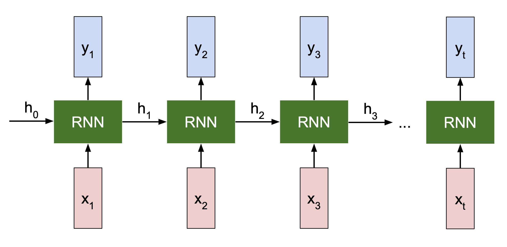
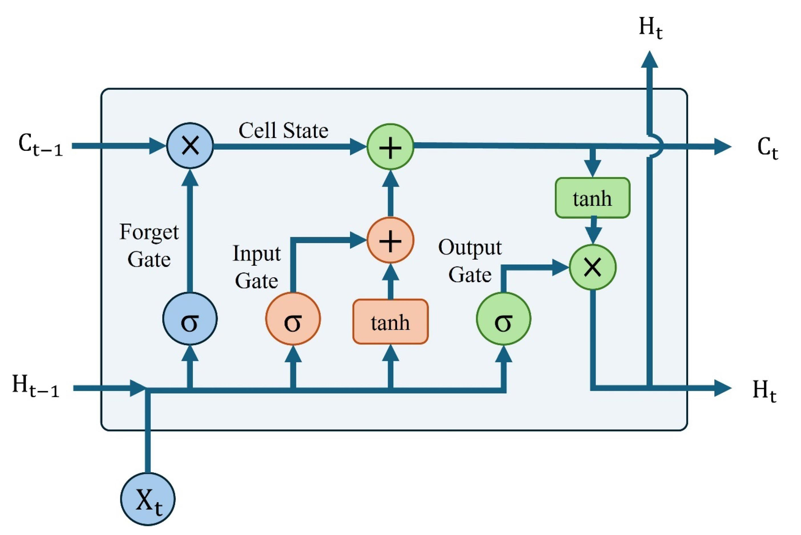
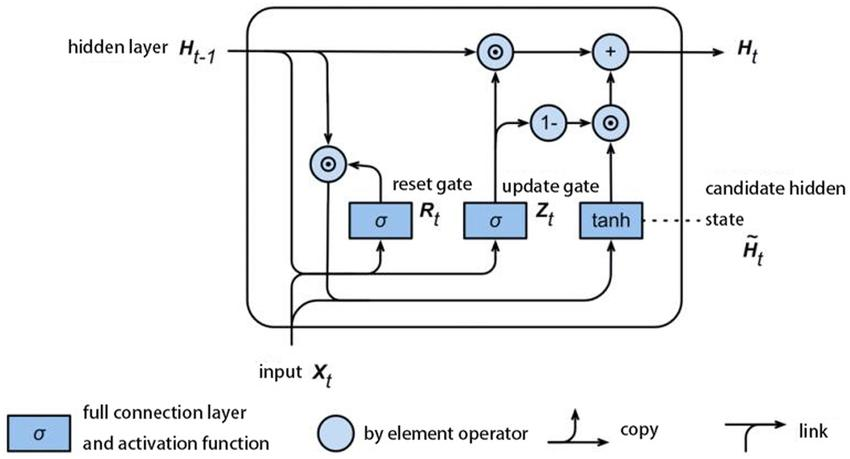
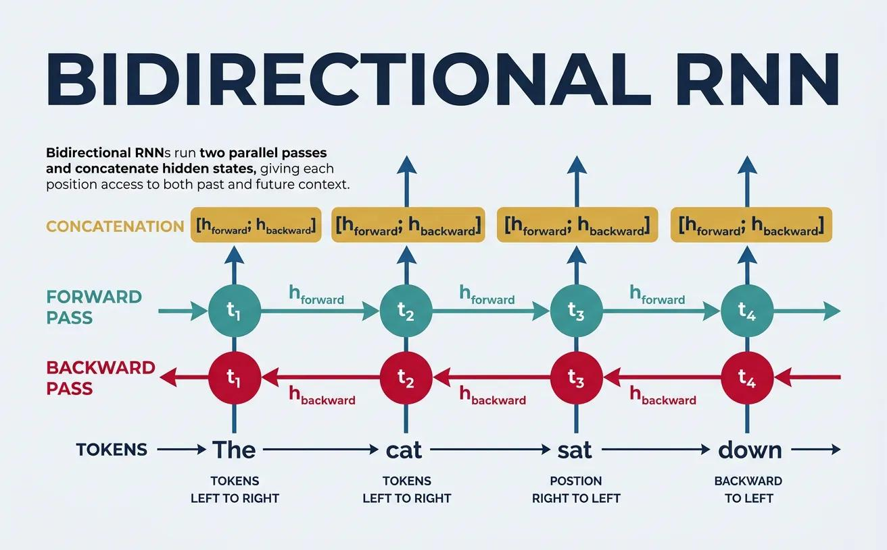
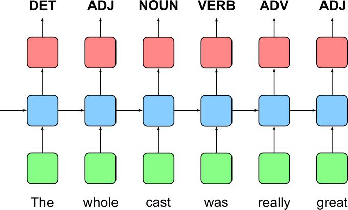
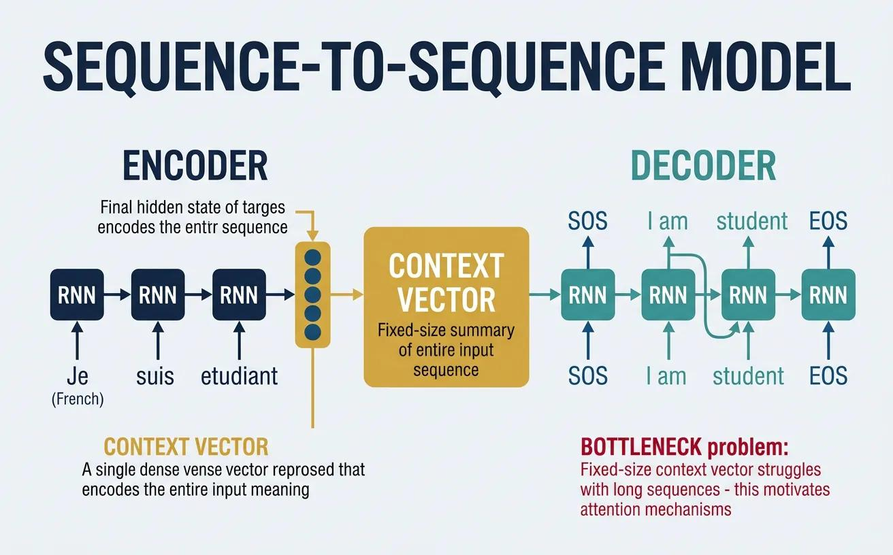

# Revision: RNN Architectures for Seq2Seq Models

Before studying the Sequence-to-Sequence (Seq2Seq) architecture, understand the four RNN architectures commonly used to build its encoder and decoder.

This revision focuses on:

- What each architecture is.
- Why it exists.
- How it handles sequential information.
- How it connects to Seq2Seq models.

## Contents

- [1. Simple RNN](#1-simple-rnn-vanilla-rnn)
- [2. LSTM](#2-lstm-long-short-term-memory)
- [3. GRU](#3-gru-gated-recurrent-unit)
- [4. Bidirectional RNN](#4-bidirectional-rnn-birnn)
- [5. Many-to-Many RNN](#5-many-to-many-rnn)
- [Quick comparison](#quick-comparison)
- [Complete RNN architecture classification](#complete-rnn-architecture-classification)
- [Connection to Seq2Seq](#connection-to-seq2seq-architecture)
- [Key points](#key-points-to-remember)

## 1. Simple RNN (Vanilla RNN)

A Simple RNN is a basic type of Recurrent Neural Network that processes sequential data by maintaining a hidden state, or memory.



### How it works

- It processes one element at a time.
- Each new element is processed using the current input and the previous hidden state.
- The hidden state carries information from previous time steps.

### Example

Consider the sentence:

> I love learning AI.

The RNN processes it sequentially:

1. Reads `I` and updates its memory.
2. Reads `love`, uses the previous memory, and updates it.
3. Reads `learning` and updates its memory again.
4. Reads `AI` and updates its memory again.

### Limitation

Simple RNNs struggle to remember information from very long sequences because of the **vanishing gradient problem**.

## 2. LSTM (Long Short-Term Memory)

LSTM is an advanced version of a Simple RNN designed to remember information for longer periods.

It addresses the long-term memory problem using a special structure called a **cell state** and three gates.



### Gates in an LSTM

| Gate | Purpose |
| --- | --- |
| Forget gate | Decides what information to remove. |
| Input gate | Decides what new information to store. |
| Output gate | Decides what information to output. |

### Example

Consider:

> I grew up in India. I speak fluent Hindi.

When processing the second sentence, an LSTM can retain relevant information about India from the earlier sentence.

### Key idea

An LSTM selectively remembers, forgets, and updates information.

## 3. GRU (Gated Recurrent Unit)

GRU is another improved version of an RNN, similar to an LSTM. However, it has a simpler architecture and uses only two gates.



### Gates in a GRU

| Gate | Purpose |
| --- | --- |
| Update gate | Decides how much previous information to retain and how much new information to add. |
| Reset gate | Decides how much previous information to forget when processing new input. |

### How is it different from LSTM?

- An LSTM has three gates and separate cell and hidden states.
- A GRU has two gates and combines cell-state functionality with the hidden state.
- A GRU generally has fewer parameters and can be computationally faster.

### Key idea

GRU provides a simpler way to capture long-term dependencies.

## 4. Bidirectional RNN (BiRNN)

A normal RNN processes information in only one direction:



```text
Word 1 → Word 2 → Word 3 → Word 4
```

A Bidirectional RNN processes information in two directions:

```text
Forward:  Word 1 → Word 2 → Word 3 → Word 4
Backward: Word 4 → Word 3 → Word 2 → Word 1
```

The outputs from both directions are combined.

### Why is this useful?

Consider:

> I went to the bank to deposit money.

To understand the word `bank`, the model benefits from both the preceding and following context. A Bidirectional RNN considers both directions, helping it understand the context more effectively.

### Key idea

A Bidirectional RNN captures information from both past and future context.

## 5. Many-to-Many RNN

There are different ways an RNN can accept inputs and produce outputs. These are called **RNN input-output architectures**.

A Many-to-Many RNN is an architecture in which the model receives a sequence of inputs and produces a sequence of outputs.

In simple words:

**Multiple inputs → Multiple outputs**

There are two important variations of Many-to-Many RNNs.

### A. Synchronized Many-to-Many RNN



In this architecture, the RNN produces an output at every time step corresponding to its input.

#### Example: Named Entity Recognition (NER)

Input sentence:

`John lives in India`

Output labels:

`Person → O → O → Location`

| Input | Output |
| --- | --- |
| John | Person |
| lives | O |
| in | O |
| India | Location |

Other applications include:

- Part-of-speech tagging.
- Sequence labeling.
- Video frame classification.

**Key idea:** One input at each time step produces one corresponding output.

### B. Encoder-Decoder Many-to-Many RNN (Seq2Seq)



This architecture also accepts multiple inputs and produces multiple outputs, but the input and output sequences do not need to have the same length.

It consists of two major components:

1. **Encoder:** Reads the complete input sequence and converts it into an encoded representation.
2. **Decoder:** Uses that representation to generate the output sequence, usually one token at a time.

#### Example: Machine translation

| Input | Output |
| --- | --- |
| `I love learning AI` | `J'aime apprendre l'IA` |

The number of input and output words does not have to be equal.

Other applications include:

- Machine translation.
- Text summarization.
- Chatbots.
- Question answering.

**Key idea:** The encoder understands the input sequence, and the decoder generates a potentially different-length output sequence.

## Quick comparison

| Architecture | Main feature | Main advantage |
| --- | --- | --- |
| Simple RNN | Basic hidden-state memory | Handles sequential data |
| LSTM | Three gates and a cell state | Captures long-term dependencies |
| GRU | Two gates | Simpler and computationally efficient |
| Bidirectional RNN | Forward and backward processing | Understands context from both directions |

## Complete RNN architecture classification

### RNN input-output architectures

| Architecture | Input-output pattern | Example |
| --- | --- | --- |
| One-to-One | One input → One output | Image classification |
| One-to-Many | One input → Multiple outputs | Image caption generation |
| Many-to-One | Multiple inputs → One output | Sentiment analysis |
| Many-to-Many (Synchronized) | Multiple inputs → Multiple aligned outputs | Named Entity Recognition |
| Many-to-Many (Encoder-Decoder) | Multiple inputs → Multiple generated outputs | Machine translation (Seq2Seq) |

### Difference between the two Many-to-Many architectures

| Feature | Synchronized Many-to-Many | Encoder-Decoder (Seq2Seq) |
| --- | --- | --- |
| Input | Sequence | Sequence |
| Output | Sequence | Sequence |
| Output generation | At every input time step | After encoding, through the decoder |
| Sequence length | Usually aligned | Can be different |
| Example | NER | Translation |

## Connection to Seq2Seq Architecture

Seq2Seq is an architecture that converts one sequence into another sequence.

### Example: English-to-French translation

```text
Input sequence
I love learning AI
        │
        ▼
Encoder
Reads and understands the input sequence
        │
        ▼
Context / encoded representation
        │
        ▼
Decoder
Generates the output sequence
        │
        ▼
Output sequence
J'aime apprendre l'IA
```

The encoder and decoder can use Simple RNNs, LSTMs, GRUs, or combinations of these architectures.

### Possible combinations

- Simple RNN encoder + Simple RNN decoder.
- LSTM encoder + LSTM decoder.
- GRU encoder + GRU decoder.
- Bidirectional LSTM encoder + LSTM decoder.

Bidirectional RNNs are particularly useful in encoders because the entire input sequence is available while encoding.

## Key points to remember

1. **Simple RNN:** A basic recurrent network that maintains information through hidden states but struggles with long-term dependencies.
2. **LSTM and GRU:** Improved RNN architectures that use gates to manage information and capture long-term dependencies.
3. **Bidirectional RNN:** Processes a sequence in both forward and backward directions to capture context from both sides.
4. **Many-to-Many RNN:** Takes a sequence of inputs and produces a sequence of outputs.
5. **Synchronized Many-to-Many:** Produces an output corresponding to each input time step.
6. **Encoder-Decoder Many-to-Many:** Encodes the input sequence and then generates an output sequence, potentially of a different length.

**Important connection:** Simple RNN, LSTM, GRU, and Bidirectional RNN describe *how the recurrent network processes information*. Many-to-Many describes *how inputs and outputs are structured*. These are different ways of classifying RNN architectures.

## What to study next

Study the actual **Seq2Seq architecture**:

- Encoder.
- Context vector.
- Decoder.
- Information flow between the encoder and decoder.
- How the decoder generates output one token at a time.
