# 01. Encoder--Decoder \| Sequence-to-Sequence (Seq2Seq) Architecture

> **Core idea:** The encoder reads and represents an input sequence. The
> decoder uses that representation to generate an output sequence, often
> one token at a time.

## Table of Contents

1.  [Why Seq2Seq is needed](#1-why-seq2seq-is-needed)
2.  [What is Seq2Seq?](#2-what-is-seq2seq)
3.  [RNN foundations and variants](#3-rnn-foundations-and-variants)
4.  [Understanding the encoder](#4-understanding-the-encoder)
5.  [Understanding the decoder](#5-understanding-the-decoder)
6.  [Complete workflow](#6-complete-encoderdecoder-workflow)
7.  [Source and target sequences](#7-source-and-target-sequences)
8.  [How Seq2Seq learns](#8-how-does-the-model-learn)
9.  [LSTM encoder--decoder: hidden and cell
    states](#9-lstm-encoderdecoder-hidden-and-cell-states)
10. [RNN sequence-mapping patterns](#10-rnn-sequence-mapping-patterns)
11. [Limitations and BLEU score](#11-limitations-and-bleu-score)
12. [Attention mechanism](#12-attention-mechanism)
13. [Connection to Transformers](#13-connection-to-transformers)
14. [Applications](#14-applications)
15. [Important terminology](#15-important-terminology)
16. [The three things to write in your
    notes](#16-the-three-things-to-write-in-your-notes)
17. [Knowledge check](#17-knowledge-check)
18. [Recommended learning order](#18-recommended-learning-order)

------------------------------------------------------------------------

## 1. Why Seq2Seq is needed

Consider a sentiment-classification task:

``` text
Input:  "The product is amazing."
Output: Positive
```

The input is a sequence of words, but the output is one category.

Now consider translation:

``` text
Input:  "I love programming."
Output: "J'aime la programmation."
```

Both input and output are sequences. Their lengths can differ, and the
output may use a different word order.

Text summarization is another example:

``` text
Input:  A long paragraph containing many details.
Output: A short summary containing the main ideas.
```

The challenge is:

**How can a model process an entire input sequence and generate a
related, potentially different-length output sequence?**

Sequence-to-Sequence architecture addresses this problem.

## 2. What is Seq2Seq?

**Sequence-to-Sequence (Seq2Seq) is a deep-learning architecture that
transforms an input sequence into an output sequence. The input and
output can have different lengths.**

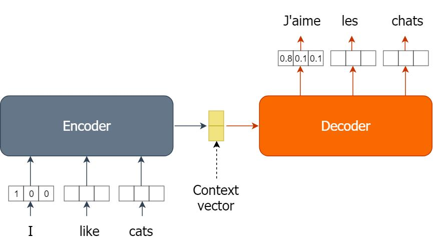

It has two main components:

1.  **Encoder:** Processes the input sequence and creates a learned
    representation of it.
2.  **Decoder:** Uses that representation to generate the output
    sequence, usually one token at a time.

``` text
Input sequence
      |
      v
   ENCODER
      |
      v
Encoded representation
(context)
      |
      v
   DECODER
      |
      v
Output sequence
```

A useful analogy:

-   **Encoder = reader / information extractor**
-   **Decoder = writer / output generator**

The encoder does not usually produce a human-readable summary. It
produces numerical representations that the decoder can use.

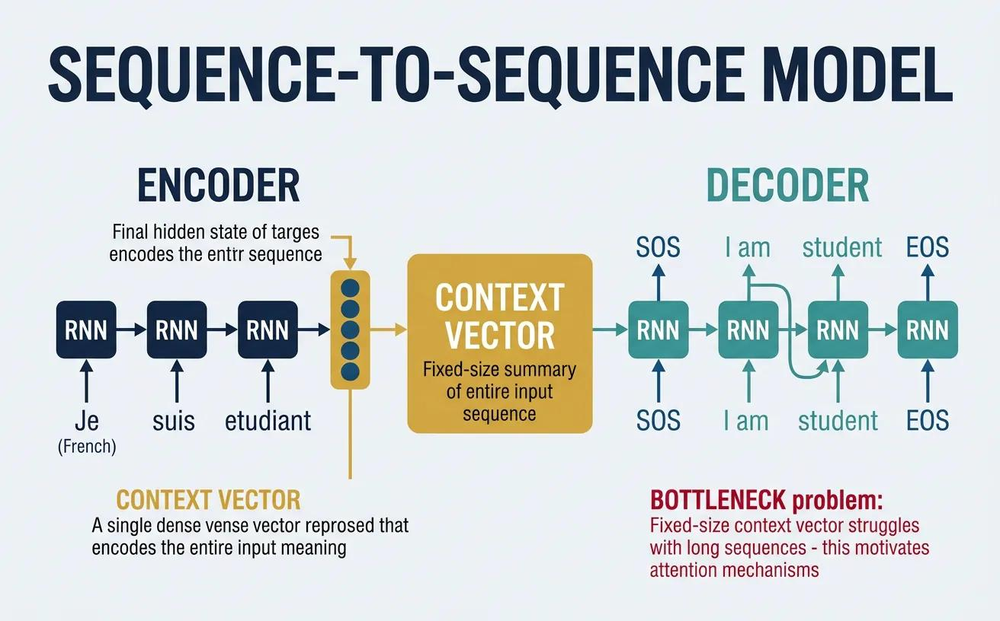

### Common examples

-   English → French translation
-   Long document → short summary
-   Question and context → generated answer
-   Audio sequence → text sequence (with an appropriate audio encoder)
-   Existing text → generated continuation

## 3. RNN foundations and variants

Traditional Seq2Seq architectures often use Recurrent Neural Networks
(RNNs).

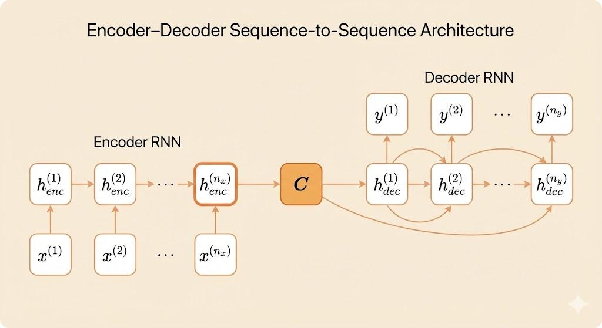

An RNN is designed for sequential data. It processes tokens over time
and maintains a hidden state that carries information from earlier time
steps.

For example:

``` text
I  ->  love  ->  programming
```

At each time step, the RNN receives the current input and previous
hidden state, then computes a new hidden state:

\[ h_t = f(W_xx_t + W_hh\_{t-1} + b) \]

Where:

-   (x_t): current input vector
-   (h\_{t-1}): previous hidden state
-   (h_t): current hidden state
-   (W_x, W_h): trainable weight matrices
-   (b): bias
-   (f): activation function

### 3.1 Simple RNN

A Simple RNN passes information from one time step to the next through
its hidden state.

**Limitation --- vanishing gradients:** During backpropagation through
many time steps, gradients can become extremely small. The network then
struggles to learn relationships between distant parts of a long
sequence.

For example, understanding a word near the end of a long sentence may
require information from much earlier in that sentence.

### 3.2 LSTM (Long Short-Term Memory)

LSTM was designed to help RNNs learn long-term dependencies. It
maintains two states:

-   **Cell state ((C_t)):** Carries information along the sequence and
    helps preserve longer-term information.
-   **Hidden state ((h_t)):** Represents the current output/state
    exposed to the next layer or time step.

LSTM uses three gates:

  -----------------------------------------------------------------------
  Gate                                Responsibility
  ----------------------------------- -----------------------------------
  Forget gate                         Controls what information from the
                                      previous cell state should be
                                      discarded.

  Input gate                          Controls what new information
                                      should be stored.

  Output gate                         Controls what information is
                                      exposed as the hidden state.
  -----------------------------------------------------------------------

The gates regulate information flow and help reduce the
vanishing-gradient difficulty compared with a basic RNN. They do not
guarantee that every long-range dependency will be learned.

### 3.3 GRU (Gated Recurrent Unit)

GRU is another gated RNN architecture. It uses two main gates:

  -----------------------------------------------------------------------
  Gate                                Responsibility
  ----------------------------------- -----------------------------------
  Update gate                         Controls how much previous
                                      information is retained versus new
                                      information incorporated.

  Reset gate                          Controls how much previous
                                      information is used when forming a
                                      candidate state.
  -----------------------------------------------------------------------

A GRU does not maintain a separate cell state; its information is
carried in the hidden state. It often has fewer parameters than an LSTM.

### 3.4 Bidirectional RNN

A normal RNN typically processes a sequence from left to right. A
Bidirectional RNN processes it in both directions:

-   Forward RNN: left to right
-   Backward RNN: right to left

The two representations are combined, allowing each input position to
incorporate information from both preceding and following tokens.

Bidirectional RNNs are useful in encoders because the full input
sequence is available. A standard autoregressive decoder cannot use
future target tokens that have not yet been generated.

### RNN variant comparison

  -----------------------------------------------------------------------
  Architecture            Main feature            Key advantage
  ----------------------- ----------------------- -----------------------
  Simple RNN              Recurrent hidden state  Basic sequential
                                                  processing

  LSTM                    Cell state and three    Better handling of
                          gates                   long-term dependencies

  GRU                     Two gates, no separate  Simpler gated
                          cell state              architecture

  Bidirectional RNN       Forward and backward    Uses both sides of
                          processing              input context
  -----------------------------------------------------------------------

## 4. Understanding the encoder

The encoder processes the input sequence and extracts useful
information.

Example input:

``` text
I love programming
```

### Step 1: Tokenization

The sentence is split into tokens:

``` python
["I", "love", "programming"]
```

### Step 2: Convert tokens into numerical representations

Neural networks operate on numbers, not ordinary text. Each token is
mapped to an embedding vector.

For illustration, suppose the embedding dimension is 4:

  Token         Illustrative embedding
  ------------- ------------------------
  I             `[0.2, 0.4, 0.1, 0.3]`
  love          `[0.7, 0.5, 0.3, 0.2]`
  programming   `[0.6, 0.8, 0.4, 0.1]`

These values are illustrative, not actual learned values. An embedding
layer may learn them during training or use pretrained embeddings.

### Step 3: Process the sequence

An RNN-based encoder processes the token embeddings in order:

``` text
I  ->  love  ->  programming
```

At each step, it uses the current token embedding and previous hidden
state to compute a new state.

-   Step 1 processes `I`.
-   Step 2 processes `love`, carrying information from `I`.
-   Step 3 processes `programming`, carrying information from earlier
    tokens.

The final hidden state is a learned representation of the sequence.

### Step 4: Create the context representation

In a basic RNN Seq2Seq architecture, the final encoder hidden state is
used as the context vector:

\[ C = h_T \]

Where:

-   (C): context vector
-   (h_T): final encoder hidden state
-   (T): number of input time steps

The context vector is a numerical representation, not a literal English
summary.

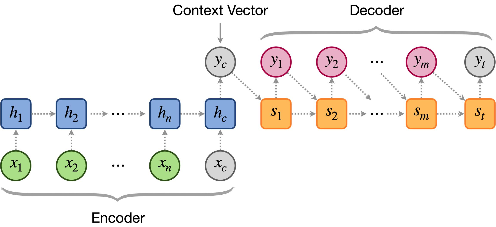

## 5. Understanding the decoder

The decoder generates an output sequence using the information provided
by the encoder.

Example translation:

``` text
Input:            I love programming
Expected output:  J'aime la programmation
```

### Step 1: Receive the encoder representation

In a basic RNN Seq2Seq model, the encoder's final hidden state may
initialize the decoder's hidden state:

\[ s_0 = h_T \]

Here, (s_0) is the decoder's initial hidden state.

For an LSTM encoder--decoder, both the final hidden state and cell state
are typically transferred (see Section 9).

### Step 2: Start with `<SOS>`

The decoder receives a special token:

-   `<SOS>` = Start of Sequence

This tells the decoder to begin generating.

### Step 3: Predict the first output token

The decoder calculates scores over the target vocabulary and converts
them into probabilities, commonly using Softmax.

Illustrative example:

  Candidate     Probability
  ----------- -------------
  Je                   0.10
  J'aime               0.75
  Le                   0.05
  La                   0.10

The model may select `J'aime`.

### Step 4: Predict the next token

The previously generated token is fed into the decoder as the next
input:

``` text
<SOS> -> J'aime
```

The decoder then predicts the next token, perhaps `la`.

### Step 5: Continue until `<EOS>`

``` text
<SOS>
   |
J'aime
   |
la
   |
programmation
   |
<EOS>
```

-   `<EOS>` = End of Sequence
-   It signals that generation is complete.

The decoder's next prediction depends on its current state, the previous
token, and the encoder information available to it.

This is called **autoregressive generation**: each generated token
becomes part of the context used to generate the next token.

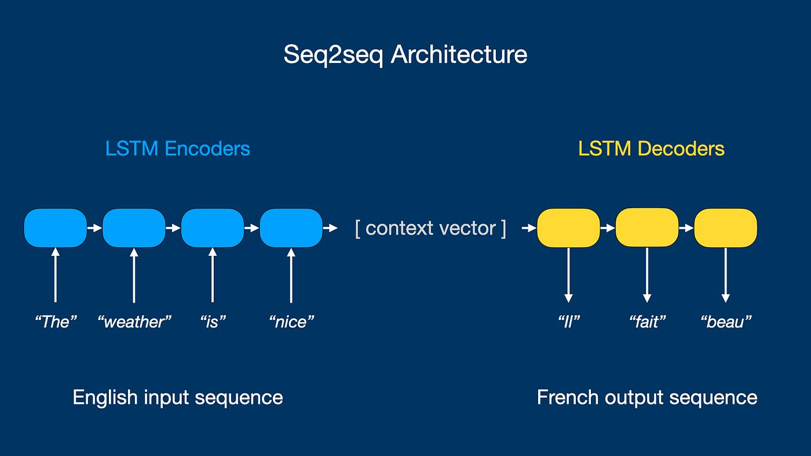

### Beam Search

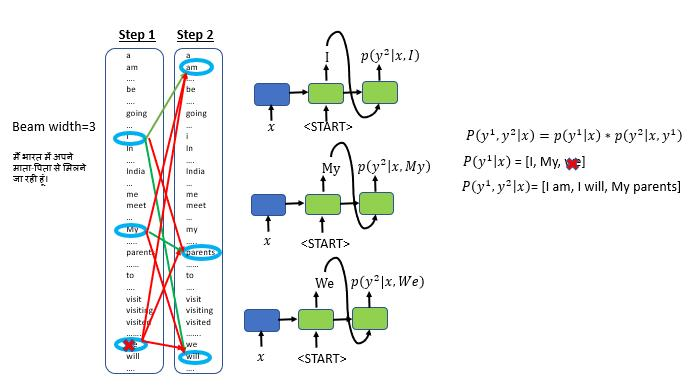

## 6. Complete Encoder--Decoder workflow

``` text
Input text
   |
Tokenization
   |
Token IDs
   |
Embedding lookup
   |
Encoder (RNN / LSTM / GRU)
   |
Encoded representation
   |
Decoder starts with <SOS>
   |
Predict next token
   |
Feed previous output token back
   |
Repeat until <EOS>
   |
Generated output sequence
```

  Stage   Operation
  ------- ------------------------------------------------------
  1       Receive input text
  2       Tokenize the input
  3       Convert tokens into embeddings
  4       Encoder processes the sequence
  5       Produce an encoded representation
  6       Pass representation to the decoder
  7       Decoder receives `<SOS>`
  8       Predict the first output token
  9       Feed the previous output token back into the decoder
  10      Continue until `<EOS>` or a stopping limit

## 7. Source and target sequences

Translation datasets commonly contain paired sentences. These are called
**parallel sentence pairs**, and a collection of them is a **parallel
corpus**.

  Source sequence (English)   Target sequence (French)
  --------------------------- --------------------------
  Thank you                   Merci
  Good morning                Bonjour
  I am happy                  Je suis heureux
  I love programming          J'aime la programmation

The source sentence is processed by the encoder. The target sentence
provides the desired output for training the decoder.

### Padding makes batch processing easier

When sequences have different lengths, padding tokens can be added so
that multiple sequences share the same batch shape.

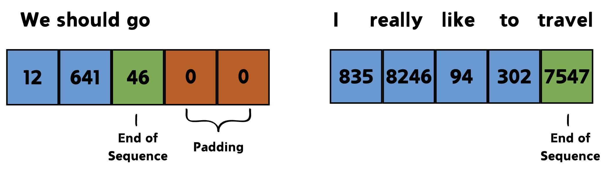

### Special sequence tokens

A sequence may be represented with boundary markers:

``` text
Source: <SOS> Thank you <EOS>
Target: <SOS> Merci <EOS>
```

-   `<SOS>` marks the beginning.
-   `<EOS>` marks the end.

The exact placement and use of boundary tokens can vary by
implementation. In a common setup, the decoder is given `<SOS>` and is
trained to predict the target tokens, including `<EOS>`.

### Where does One-Hot Encoding fit?

A vocabulary can assign an integer ID to each token. A one-hot vector is
another way to identify a vocabulary item.

Suppose the target vocabulary is:

``` text
<SOS>, Merci, Thank, you, <EOS>
```

  Token     One-hot vector
  --------- ----------------
  `<SOS>`   `[1,0,0,0,0]`
  Merci     `[0,1,0,0,0]`
  Thank     `[0,0,1,0,0]`
  you       `[0,0,0,1,0]`
  `<EOS>`   `[0,0,0,0,1]`

The token ID or one-hot representation identifies a vocabulary item. An
embedding layer maps it to a dense vector before the recurrent network
processes it.

Source and target languages may have separate vocabularies and embedding
layers.

## 8. How does the model learn?

The model learns from many source-target examples.

For example:

  English input        French target
  -------------------- -------------------------
  I love programming   J'aime la programmation
  I am happy           Je suis heureux
  Good morning         Bonjour
  How are you?         Comment allez-vous?
  I like music         J'aime la musique

### 8.1 Encoder pass

The encoder processes the source sentence and creates its
representation.

### 8.2 Teacher Forcing

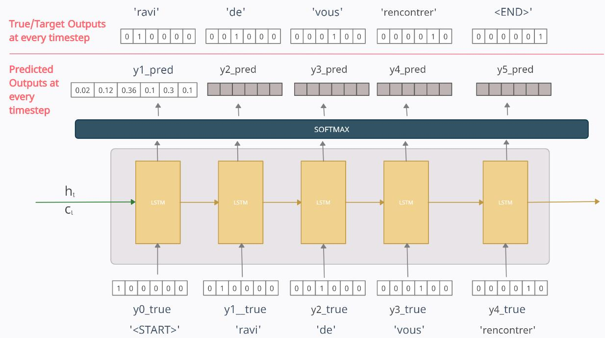

During training, a common technique called **Teacher Forcing** feeds the
decoder the actual previous target token instead of always feeding its
own previous prediction.

Expected target sequence:

``` text
<SOS> J'aime la programmation <EOS>
```

Training alignment:

  Decoder input   Expected prediction
  --------------- ---------------------
  `<SOS>`         J'aime
  J'aime          la
  la              programmation
  programmation   `<EOS>`

Teacher Forcing helps the decoder learn each next-token prediction using
the correct preceding target token.

### 8.3 Calculate loss

Suppose the model predicts:

``` text
<SOS> Je la programmation <EOS>
```

But the expected output is:

``` text
<SOS> J'aime la programmation <EOS>
```

The model's predictions are compared with the correct target tokens. A
common loss for next-token classification is cross-entropy.

For a target sequence of (T) tokens, a simplified average loss is:

\[ L=-`\frac{1}{T}`{=tex}`\sum`{=tex}*{t=1}\^{T}
`\log `{=tex}P(y_t`\mid `{=tex}y*{\<t},x) \]

Where:

-   (x): source sequence
-   (y_t): correct target token at time step (t)
-   (y\_{\<t}): preceding target tokens
-   (T): number of target time steps

The model is penalized when it assigns low probability to the correct
next token.

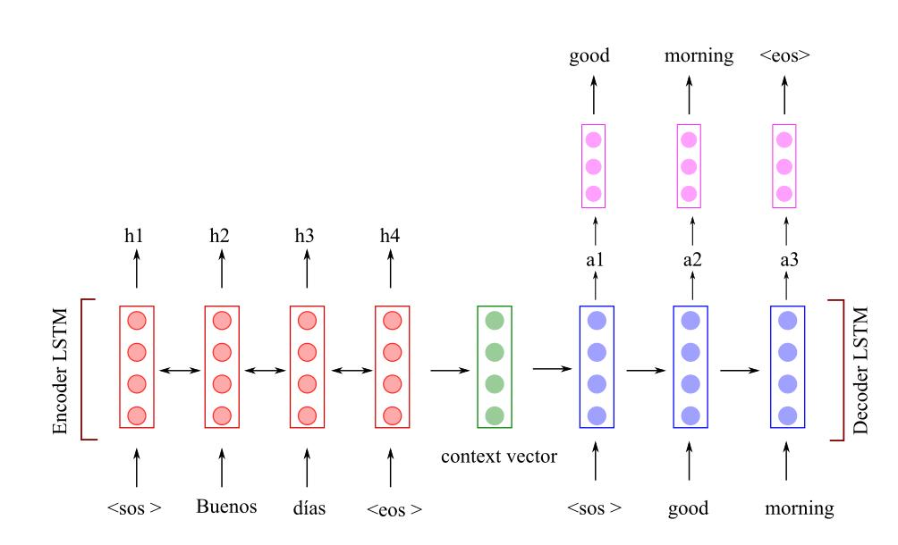

### 8.4 Backpropagation Through Time (BPTT)

For recurrent architectures, gradients are propagated through the
unrolled sequence using **Backpropagation Through Time**.

The optimizer updates the encoder and decoder parameters to reduce the
loss.

A generic gradient-descent update is:

\[ W\_{`\text{new}`{=tex}} = W\_{`\text{old}`{=tex}} -
`\eta `{=tex}`\nabla `{=tex}W \]

Where:

-   (W): trainable parameter
-   (`\eta`{=tex}): learning rate
-   (`\nabla `{=tex}W): gradient of the loss with respect to that
    parameter

Training repeats over examples and epochs.

### Training vs inference

  -----------------------------------------------------------------------
  Training                            Inference (using the trained model)
  ----------------------------------- -----------------------------------
  Source is passed to encoder.        Source is passed to encoder.

  Teacher Forcing may provide correct Decoder receives its own previous
  previous target tokens.             generated token.

  Predictions are compared with known No correct target is available.
  targets.                            

  Loss and backpropagation update     Model generates output until a
  parameters.                         stopping condition.
  -----------------------------------------------------------------------

**Important:** Teacher Forcing is a training technique. During ordinary
inference, the correct output sequence is not supplied.

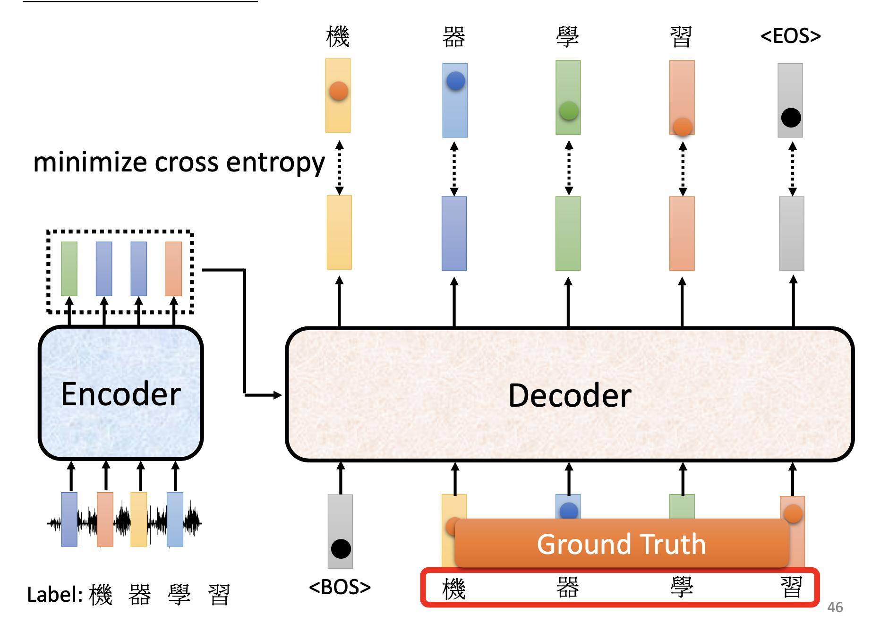

## 9. LSTM encoder--decoder: hidden and cell states

An LSTM maintains two states:

-   **Hidden state ((h_t)):** Represents the current output/state.
-   **Cell state ((C_t)):** Carries information through the sequence and
    helps preserve longer-term information.

In a basic LSTM Seq2Seq setup, the encoder's final states initialize the
decoder:

\[ h_0^{decoder}=h_T^{encoder} \]

\[ C_0^{decoder}=C_T^{encoder} \]

The decoder therefore begins with the information accumulated by the
encoder.

### LSTM decoder steps

At each decoding step, the LSTM receives:

1.  The embedding of the current decoder input token.
2.  The previous decoder hidden state.
3.  The previous decoder cell state.

It updates its hidden and cell states. A fully connected output layer
and Softmax can then produce probabilities over the target vocabulary.

Example:

  Decoder time step   Input     Expected/predicted output
  ------------------- --------- ---------------------------
  1                   `<SOS>`   Merci
  2                   Merci     `<EOS>`

The process ends when `<EOS>` is generated.

**Key distinction:** In an LSTM Seq2Seq model, transferring only the
hidden state leaves out the cell state. A standard LSTM encoder--decoder
normally transfers both.

## 10. RNN sequence-mapping patterns

RNNs can be arranged in different input-output mapping patterns:

  -----------------------------------------------------------------------
  Type                    Mapping                 Example
  ----------------------- ----------------------- -----------------------
  One-to-One              One input → One output  Image classification

  One-to-Many             One input → Output      Image captioning
                          sequence                

  Many-to-One             Input sequence → One    Sentiment analysis
                          output                  

  Many-to-Many            Input sequence → Output Machine translation
                          sequence                
  -----------------------------------------------------------------------

Seq2Seq is a many-to-many architecture. It allows the encoder to process
the input sequence and the decoder to generate an output sequence whose
length can differ from the input.

This differs from a simple time-aligned many-to-many RNN, where an
output may be produced at each input time step.

## 11. Limitations and BLEU score

### 11.1 Fixed-size context bottleneck

In the original basic RNN-based Seq2Seq architecture, the encoder
compresses the input into a fixed-size context representation, often its
final hidden state.

For a short sentence:

``` text
I love programming
```

this may be manageable.

For a long paragraph containing many details, compressing all useful
information into one fixed-size vector becomes difficult. Some
information may be lost, making it harder for the decoder to generate an
accurate output.

This is called the **information bottleneck**.

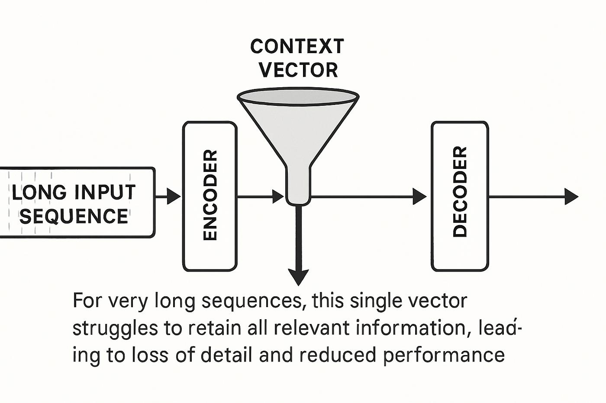

### 11.2 BLEU Score

**BLEU** stands for **Bilingual Evaluation Understudy**. It is a metric
commonly used to evaluate machine translation.

BLEU compares a generated translation with one or more reference
translations. It primarily uses modified n-gram precision and a brevity
penalty.

Example:

**Reference:**

``` text
I love learning artificial intelligence
```

**Generated A:**

``` text
I love learning artificial intelligence
```

This has strong n-gram overlap with the reference.

**Generated B:**

``` text
I love artificial intelligence
```

This has partial overlap.

A higher BLEU score generally indicates greater overlap with the
reference translation. BLEU is not a complete measure of meaning or
fluency, and it can penalize valid translations that use different
wording.

The PDF illustrates BLEU score against sentence length to motivate the
difficulty that fixed-context Seq2Seq models can face with longer
sequences. Sentence length alone does not determine BLEU: data, model
quality, reference translations, and other factors also matter.

## 12. Attention mechanism

The fixed-size context bottleneck motivated the development of
**Attention Mechanism**.

Instead of requiring the decoder to rely only on one final encoder
vector, attention lets it access different encoder hidden states while
generating each output token.

Suppose the encoder produces:

\[ h_1,h_2,h_3,`\ldots`{=tex},h_T \]

At decoder step (t), attention computes a relevance score for each
encoder state and converts the scores into weights:

\[
`\alpha`{=tex}*{t,1},`\alpha`{=tex}*{t,2},`\ldots`{=tex},`\alpha`{=tex}\_{t,T}
\]

The weights are used to create a context vector for that decoder step:

\[ c_t=`\sum`{=tex}*{i=1}\^{T}`\alpha`{=tex}*{t,i}h_i \]

Where:

-   (c_t): context vector at decoder step (t)
-   (h_i): encoder hidden state at input position (i)
-   (`\alpha`{=tex}\_{t,i}): attention weight for that position

For example, when generating the French word `programmation`, the
decoder may give more attention to the English word `programming`.

This is a simplified illustration; translation does not always have
exact one-to-one word alignment.

### Basic Seq2Seq vs Seq2Seq with Attention

  -----------------------------------------------------------------------
  Basic Seq2Seq                       Seq2Seq with Attention
  ----------------------------------- -----------------------------------
  Relies on a fixed encoded context   Builds a weighted context from
  in the original architecture.       encoder states at each decoding
                                      step.

  Can create an information           Gives the decoder direct access to
  bottleneck for long inputs.         relevant input representations.

  Less flexible for aligning input    Learns soft alignments between
  and output positions.               input and output positions.
  -----------------------------------------------------------------------

**Key idea:** Attention allows the decoder to focus on different parts
of the input at different output steps.

## 13. Connection to Transformers

The original Transformer architecture, introduced in the 2017 paper
*Attention Is All You Need*, also uses an encoder--decoder structure,
but replaces recurrent processing with attention-based layers.

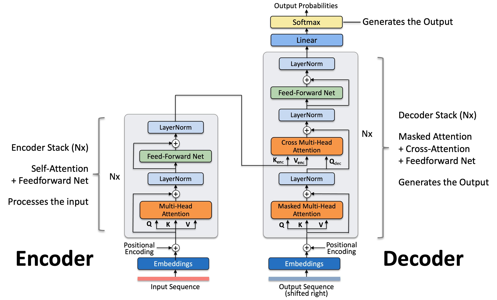

### Transformer encoder

-   Processes input token representations.
-   Uses self-attention to model relationships between input tokens.
-   Produces contextual representations.

### Transformer decoder

-   Uses masked self-attention to process previously available target
    tokens.
-   Uses cross-attention to access the encoder's output.
-   Predicts the next output token.

Unlike a basic RNN decoder that relies on a fixed context vector, a
Transformer decoder can use cross-attention to access encoder
representations at each output position.

### Encoder-only, decoder-only, and encoder--decoder models

  -----------------------------------------------------------------------
  Architecture            Example                 Main design/use
  ----------------------- ----------------------- -----------------------
  Encoder-only            BERT                    Bidirectional input
                                                  representations; useful
                                                  for classification and
                                                  token-level
                                                  understanding tasks.

  Decoder-only            GPT                     Autoregressive
                                                  next-token generation.

  Encoder--Decoder        T5                      Encodes an input and
                                                  generates a target
                                                  sequence; text-to-text
                                                  tasks.
  -----------------------------------------------------------------------

The original Transformer is an encoder--decoder architecture.

**Important:** GPT is decoder-only. It does not have a separate encoder
that first processes the prompt. Its decoder processes the prompt tokens
and generates subsequent tokens.

## 14. Applications

  -----------------------------------------------------------------------
  Application                         Input → Output
  ----------------------------------- -----------------------------------
  Machine translation                 English → French, Hindi → English,
                                      etc.

  Text summarization                  Long document → Short summary

  Conversational systems              Conversation context → Generated
                                      response

  Speech recognition                  Audio sequence → Text sequence,
                                      using a suitable audio encoder

  Question answering                  Question and context → Generated
                                      answer

  Text generation                     Prompt/context → Generated
                                      continuation
  -----------------------------------------------------------------------

## 15. Important terminology

  -----------------------------------------------------------------------
  Term                                Meaning
  ----------------------------------- -----------------------------------
  Encoder                             Processes the input sequence and
                                      generates representations.

  Decoder                             Generates the output sequence.

  Context vector                      Encoded representation of input
                                      information in basic Seq2Seq.

  Hidden state                        Carries information through an
                                      RNN's time steps.

  Cell state                          LSTM state that helps preserve
                                      longer-term information.

  `<SOS>`                             Start of Sequence token.

  `<EOS>`                             End of Sequence token.

  Teacher Forcing                     Feeds actual previous target tokens
                                      to the decoder during training.

  Autoregressive generation           Generates the next token using
                                      previously generated tokens.

  Attention                           Lets the decoder focus on relevant
                                      encoder representations.

  Cross-Entropy Loss                  Measures how well predicted token
                                      probabilities match the correct
                                      target tokens.

  BLEU Score                          Measures n-gram overlap between
                                      generated translations and
                                      reference translations, with a
                                      brevity penalty.

  BPTT                                Backpropagation Through Time;
                                      calculates gradients through
                                      recurrent time steps.

  Parallel Corpus                     Dataset containing corresponding
                                      sentences in two or more languages.

  Bidirectional RNN                   RNN that processes a sequence in
                                      forward and backward directions.

  Vanishing Gradient                  Gradients become very small during
                                      backpropagation through many time
                                      steps.
  -----------------------------------------------------------------------

## 16. The three things to write in your notes

1.  **Seq2Seq:** A deep-learning architecture that transforms an input
    sequence into an output sequence; their lengths can differ.
2.  **Encoder--Decoder:** The encoder processes the input and creates a
    representation; the decoder uses it to generate the output one token
    at a time. RNN, LSTM, or GRU can implement these components.
3.  **Limitation and improvement:** Basic RNN Seq2Seq uses a fixed-size
    context representation, creating an information bottleneck for long
    inputs. Attention lets the decoder access different encoder hidden
    states.

> **One-line revision:** Encoder reads and represents the input; decoder
> uses that representation to generate the output.

## 17. Knowledge check

Try answering these without looking back.

1.  What is the primary responsibility of the encoder?
2.  What token generally starts decoder generation during inference?
3.  What is Teacher Forcing?
4.  What is the information bottleneck in basic RNN Seq2Seq?
5.  How does attention improve basic Seq2Seq?
6.  Which of BERT, GPT, and T5 uses an encoder--decoder architecture?
7.  What two states are transferred from an LSTM encoder to its decoder?
8.  What does BLEU evaluate?

### Answers

1.  The encoder processes the input sequence and creates representations
    for the decoder.
2.  `<SOS>`.
3.  Feeding the actual previous target token to the decoder during
    training.
4.  The entire input must be represented through a fixed-size context
    vector.
5.  Attention lets the decoder access relevant encoder hidden states at
    each output step.
6.  T5. BERT is encoder-only; GPT is decoder-only.
7.  Hidden state and cell state.
8.  N-gram overlap between generated translations and reference
    translations, with a brevity penalty.

## 18. Recommended learning order

1.  **Attention Mechanism** --- Understand how the decoder focuses on
    relevant parts of the input.
2.  **Bahdanau Attention vs Luong Attention** --- Study early attention
    mechanisms used in Seq2Seq.
3.  **Transformer Architecture** --- Learn Self-Attention, Multi-Head
    Attention, Positional Encoding, and encoder/decoder blocks.
4.  **BERT vs GPT vs T5** --- Understand the three major Transformer
    architecture families.

**Recommended next topic: Attention Mechanism.** It directly addresses
the fixed-context limitation of basic Encoder--Decoder architecture and
prepares you for Transformers and LLMs.

------------------------------------------------------------------------

## Source coverage

These notes incorporate the topics and diagrams in the four-page
`EncoderDecoderSeq2SEq.pdf`:

-   **Page 1:** Simple RNN, LSTM, GRU, Bidirectional RNN, many-to-many
    mapping, encoder/decoder overview, context vector, and applications.
-   **Page 2:** Vanishing-gradient problem, LSTM Seq2Seq diagram,
    source/target examples, special tokens, one-hot representations,
    encoder/decoder states, and training-loss/optimizer concept.
-   **Page 3:** Encoder--decoder flow, embedding layer, fixed-context
    limitation, varying sentence lengths, and BLEU score.
-   **Page 4:** Attention Mechanism as the next development for Seq2Seq
    networks.

### Clarifications

-   The PDF sketches a squared-error-style loss expression. For standard
    next-token classification in translation, cross-entropy is the usual
    loss.
-   BLEU is a reference-based translation metric, not a direct measure
    of whether a model understands a sentence.
-   The single fixed context vector describes the basic Seq2Seq design;
    attention-based variants provide a context representation at each
    decoding step.
