# Attention Mechanism in Deep Learning & NLP
Complete Learning Guide · Beginner to Advanced

Now we're moving to one of the most important concepts in modern Deep Learning: **Attention Mechanism**.

This topic is particularly important because it connects everything we've studied so far:

- Artificial Neural Networks (ANN)
- Recurrent Neural Networks (RNN)
- LSTM and GRU
- Encoder-Decoder Architecture
- Sequence-to-Sequence (Seq2Seq)
- Transformers
- Large Language Models (LLMs)

In fact, understanding Attention properly is one of the biggest steps towards understanding how models like GPT work.

We'll start with the intuition, gradually introduce mathematical equations, implement attention using Python, and finally connect it to Transformers and modern LLMs.

## Contents

- [1. What is Attention Mechanism?](#1-what-is-attention-mechanism)
- [2. Why Do We Need Attention Mechanism?](#2-why-do-we-need-attention-mechanism)
- [3. How Does Attention Mechanism Work?](#3-how-does-attention-mechanism-work)
- [4. Numerical Example](#4-understanding-attention-through-a-numerical-example)
- [5. Types of Attention Mechanisms](#5-types-of-attention-mechanisms)
- [6. Self-Attention](#6-self-attention-the-most-important-concept)
- [7. Query, Key and Value](#7-understanding-query-key-and-value-q-k-v)
- [8. Generating Q, K and V](#8-how-are-q-k-and-v-generated)
- [9. Scaled Dot-Product Attention](#9-scaled-dot-product-attention)
- [10. Attention Score Matrix](#10-understanding-the-attention-score-matrix)
- [11. Multi-Head Attention](#11-multi-head-attention)
- [12. Attention Types in Transformers](#12-different-types-of-attention-in-transformers)
- [13. Positional Encoding](#13-positional-encoding-why-does-attention-need-it)
- [14. Padding and Causal Masks](#14-padding-mask-vs-causal-mask)
- [15. Transformer Encoder-Decoder](#15-complete-transformer-encoder-decoder-architecture)
- [16. Computational Complexity](#16-computational-complexity-of-attention)
- [17. Advanced Concepts](#17-advanced-attention-concepts)
- [18. Python Implementation](#18-implementing-attention-using-python)
- [19. Multi-Head Attention Implementation](#19-implementing-multi-head-attention-using-pytorch)
- [20. Complete Comparison](#20-attention-mechanism-complete-comparison)
- [21. Common Misconceptions](#21-common-misconceptions-about-attention)
- [22. Learning Map](#22-complete-attention-mechanism-learning-map)
- [23. Key Notes](#23-the-three-things-you-should-write-in-your-notes)
- [24. Test Your Understanding](#24-test-your-understanding)
- [25. What Should You Study Next?](#25-what-should-you-study-next)

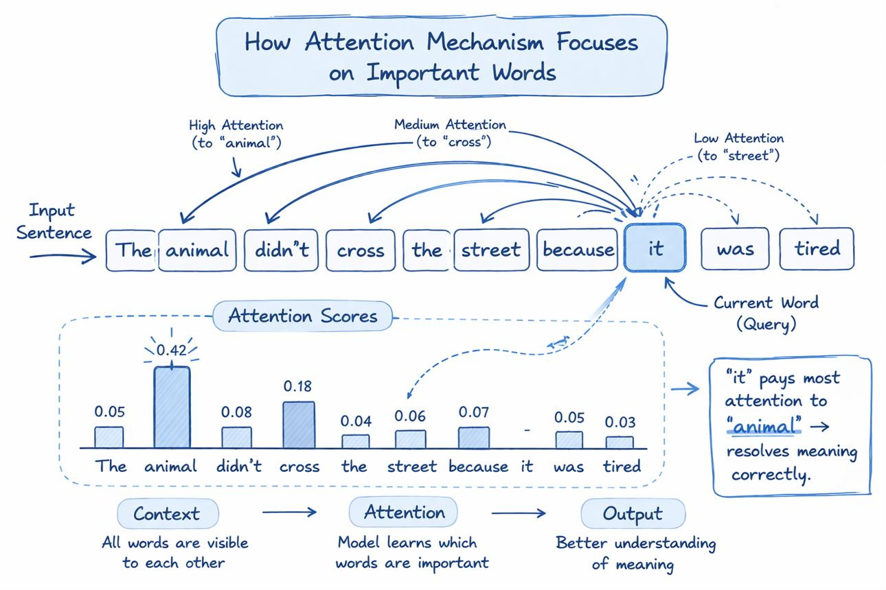

[buildfastwithai.com](https://www.buildfastwithai.com/blogs/attention-mechanism-llm-explained?utm_source=chatgpt.com)

# 1. What is Attention Mechanism?
**Attention Mechanism is a technique used in neural networks that allows a model to focus on the most relevant parts of the input when performing a particular task.**

Instead of treating every input element as equally important, the model learns to assign different importance to different elements.

Let's understand this with an example.

Suppose you are reading this sentence:

> "The animal didn't cross the road because it was too tired."

Now, consider the word **"it"**.

To understand what "it" refers to, you need to look at other words in the sentence.

You would likely connect "it" with "animal".

Your brain doesn't process every word with equal importance when resolving this reference.

It focuses on the relevant information.

This is the intuition behind Attention Mechanism.

Similarly, a neural network can learn which words or input elements are important for its current prediction.

### Another example: Machine Translation
Suppose we want to translate:

> "I love programming."

Into French:

> "J'aime programmer."

While generating the French word `programmer`, the model should pay particular attention to the English word `programming`.

While generating `J'aime`, it should consider the relevant parts of `I love`.

Attention allows the decoder to dynamically focus on relevant input representations during generation.

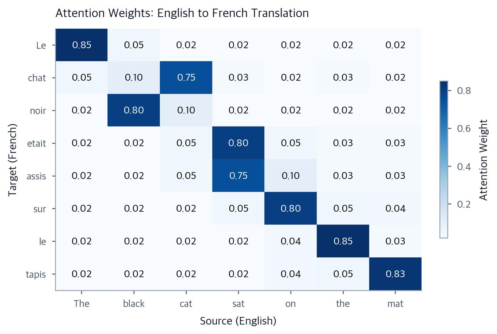

[mbrenndoerfer.com](https://mbrenndoerfer.com/writing/attention-mechanism-intuition-soft-lookup-weights-context-vectors?utm_source=chatgpt.com)

**The key idea: Attention helps a model decide what information to focus on when producing an output.**

# 2. Why Do We Need Attention Mechanism?
To understand why Attention was introduced, let's revisit the traditional Seq2Seq architecture.

Remember how the Encoder-Decoder architecture works?

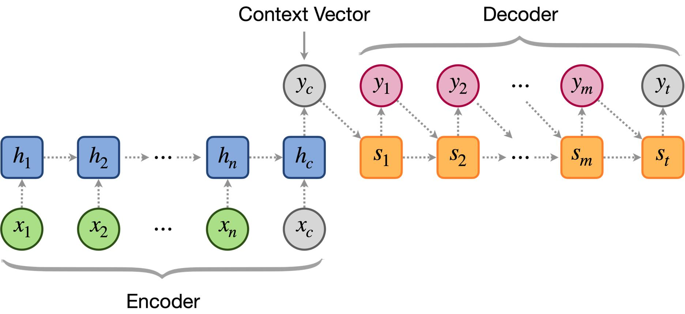

[emory-courses.github.io](https://emory-courses.github.io/nlp-essentials/chapters/contextual_encoding/encoder-decoder-framework/?utm_source=chatgpt.com)

The process:

1. Encoder reads the complete input sequence.
2. Encoder processes the sequence using an RNN or LSTM.
3. The final hidden state is passed to the decoder.
4. Decoder uses that representation to generate the output sequence.

This works reasonably well for short sequences.

However, it introduces a major problem.

## 2.1 Context Vector Bottleneck
In traditional Seq2Seq without attention, the encoder compresses the entire input sequence into a fixed-size representation.

This representation is commonly called the **Context Vector**.

Imagine translating a short sentence:

"How are you?"

This is relatively easy.

But now imagine translating an entire paragraph containing 100 words.

The encoder must compress all the relevant information into its final state.

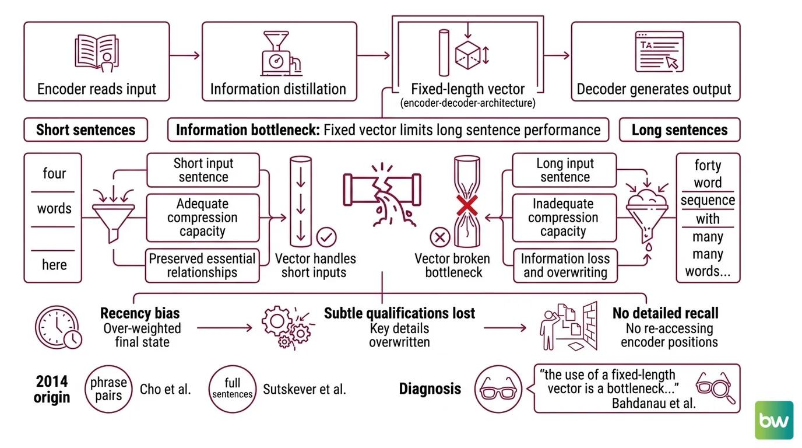

[bestaiweb.ai](https://www.bestaiweb.ai/from-context-vectors-to-cross-attention-how-encoder-decoder-design-overcame-the-bottleneck-problem/?utm_source=chatgpt.com)

This creates several problems:

- Important information may be lost.
- Long sequences become difficult to represent.
- The decoder has limited access to individual input elements.
- Translation quality can deteriorate as sequence length increases.

This is known as the **Context Vector Bottleneck Problem**.

## 2.2 How Attention Solves This Problem
Instead of forcing the decoder to rely only on one fixed-size context vector, Attention allows it to access the encoder's hidden states at different time steps.

For example:

Input:

`I love learning Machine Learning`

The encoder generates representations:

$$ h_1,h_2,h_3,h_4,h_5 $$

Without attention:

The decoder primarily uses one final representation.

With attention:

The decoder can access all these encoder representations and assign different importance to them at each output step.

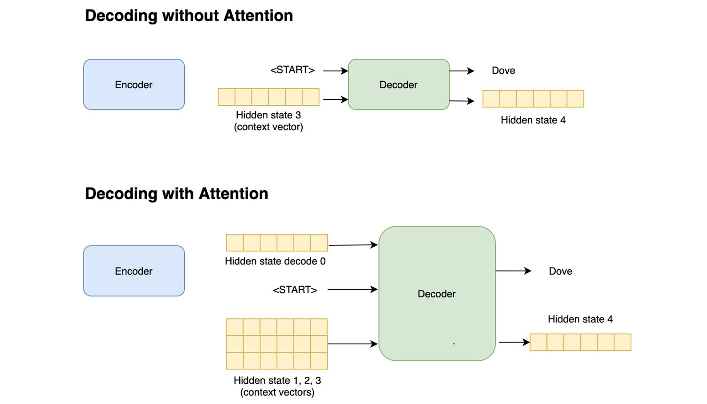

[medium.com](https://medium.com/nlplanet/two-minutes-nlp-visualizing-seq2seq-models-with-attention-10020e233b6c?utm_source=chatgpt.com)

For example, while generating the output word related to `learning`, the model may assign a higher attention weight to the corresponding input representation.

This provides more direct access to relevant information.

### Comparison
| Without Attention                   | With Attention                                          |
| ----------------------------------- | ------------------------------------------------------- |
| Uses a fixed context representation | Computes a context representation at each decoding step |
| Limited access to input details     | Can access encoder hidden states                        |
| Information bottleneck              | Reduces the bottleneck                                  |
| Long sequences can be difficult     | Better handling of relevant long-range information      |
| No explicit attention alignment     | Learns attention weights                                |

**Remember:** Attention was introduced to improve sequence modeling, particularly in Encoder-Decoder architectures. It later became the foundation of the Transformer architecture.

# 3. How Does Attention Mechanism Work?
Now let's understand the actual working.

Attention can be understood as a process involving four major steps:

1. Calculate Attention Scores.
2. Apply Softmax to obtain Attention Weights.
3. Calculate a Weighted Sum.
4. Generate the Context Vector.

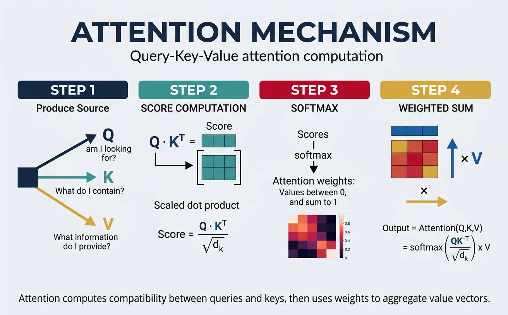

[wasilzafar.com](https://www.wasilzafar.com/pages/series/nlp/nlp-transformers-attention.html?utm_source=chatgpt.com)

Let's understand each step using an example.

Suppose our input sentence is:

`I love Machine Learning`

The encoder produces four hidden-state representations:

$$ H=[h_1,h_2,h_3,h_4] $$

Now the decoder is trying to generate the next output token.

It has a current hidden state $s_t$.

The attention mechanism compares $s_t$ with the encoder hidden states.

## Step 1: Calculate Attention Scores
An Attention Score measures how relevant an encoder representation is to the current decoder state.

We calculate:

$$ e\_{t,i}=score(s_t,h_i) $$

Where:

- $s_t$ = Current decoder state.
- $h_i$ = Encoder hidden state at position $i$.
- $e\_{t,i}$ = Attention score.

Suppose the scores are:

| Input word | Attention score |
| ---------- | --------------- |
| I          | 1.0             |
| love       | 2.0             |
| Machine    | 3.5             |
| Learning   | 4.0             |

Here, `Learning` has the highest score.

But these scores are not probabilities.

They can be negative, positive, or any real number depending on the scoring function.

## Step 2: Apply Softmax
We convert the attention scores into normalized attention weights using the Softmax function.

The equation is:

$$ \boxed{\alpha\_{t,i}= \frac{e^{e\_{t,i}}} {\sum\_{j=1}^{T}e^{e\_{t,j}}}} $$

Where:

- $e\_{t,i}$ = Attention score.
- $\alpha\_{t,i}$ = Attention weight.
- $T$ = Number of input positions.

Softmax converts scores into values between 0 and 1, with all weights summing to 1.

Suppose our attention weights become:

| Input word | Attention weight |
| ---------- | ---------------- |
| I          | 0.04             |
| love       | 0.09             |
| Machine    | 0.30             |
| Learning   | 0.57             |
| **Total**  | **1.00**         |

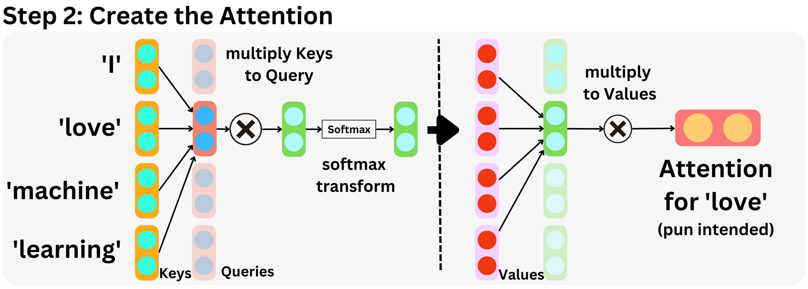

[newsletter.theaiedge.io](https://newsletter.theaiedge.io/p/the-aiedge-everything-you-need-to?utm_source=chatgpt.com)

The model is assigning 57% of the attention weight to `Learning`.

This indicates that the corresponding encoder representation has the greatest influence on the current context calculation.

**Important:** Attention weights represent relative weighting, not necessarily a complete or human-interpretable explanation of what the model understands.

## Step 3: Calculate Weighted Sum
Now we multiply each encoder hidden state by its corresponding attention weight.

The equation is:

$$ c_t=\sum\_{i=1}^{T}\alpha\_{t,i}h_i $$

Expanding:

$$ c_t= \alpha\_{t,1}h_1+ \alpha\_{t,2}h_2+ \alpha\_{t,3}h_3+ \alpha\_{t,4}h_4 $$

Where:

- $h_i$ = Encoder hidden state.
- $\alpha\_{t,i}$ = Attention weight.
- $c_t$ = Context vector.

## Step 4: Generate Context Vector
The weighted sum produces the context vector.

This vector contains a combination of information from the encoder hidden states, weighted according to their relevance to the current decoder step.

The decoder can combine this context with its current hidden state to generate the next output.

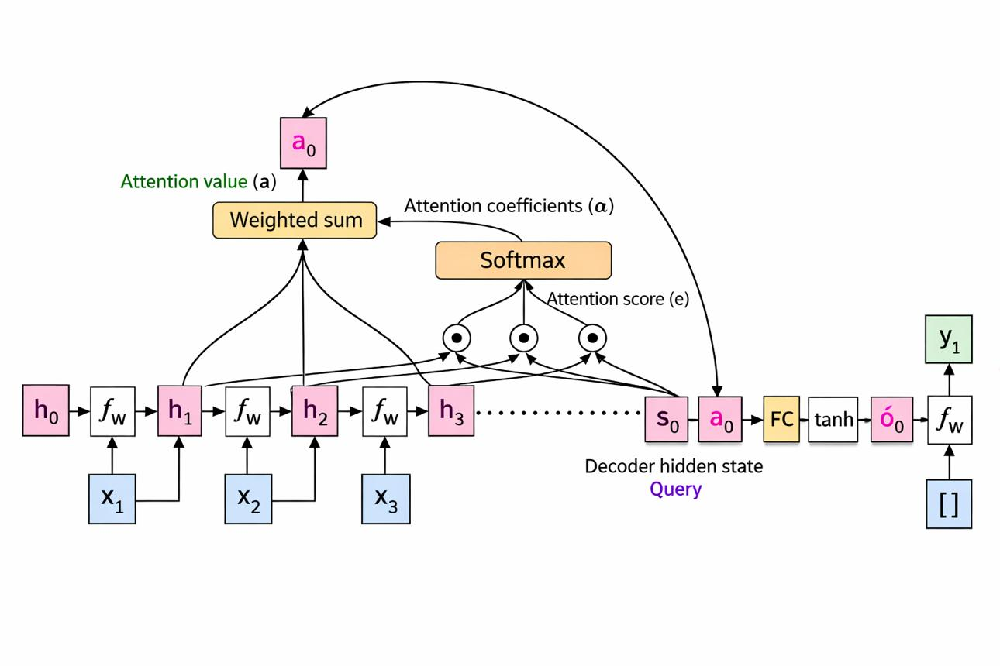

[kcnote.github.io](https://kcnote.github.io/posts/AI-Basic-07-Attention/?utm_source=chatgpt.com)

### Complete Attention Flow
$$ \boxed{ Scores\rightarrow Softmax\rightarrow Weights \rightarrow Weighted\ Sum\rightarrow Context } $$

This is the fundamental mechanism behind attention.

# 4. Understanding Attention Through a Numerical Example
Let's perform an actual mathematical calculation.

This is important because attention becomes much easier once you understand how scores, weights, and context vectors are calculated.

Suppose we have three encoder hidden states:

$$ h_1= \begin{bmatrix} 1\\\0 \end{bmatrix}, \quad h_2= \begin{bmatrix} 0\\\2 \end{bmatrix}, \quad h_3= \begin{bmatrix} 2\\\1 \end{bmatrix} $$

Our attention scores are:

$$ e=[1,2,3] $$

### Step 1: Apply Softmax
$$ \alpha_i=\frac{e^{e_i}}{\sum_j e^{e_j}} $$

Substituting:

$$ \alpha_1=\frac{e^1}{e^1+e^2+e^3} $$

$$ \alpha_2=\frac{e^2}{e^1+e^2+e^3} $$

$$ \alpha_3=\frac{e^3}{e^1+e^2+e^3} $$

The approximate attention weights are:

**Calculated attention weights**

**h₁**

9.0%

**h₂**

24.5%

**h₃**

66.5%

Total = 100%

### Step 2: Calculate Weighted Sum
We know:

$$ c=\alpha_1h_1+\alpha_2h_2+\alpha_3h_3 $$

Substituting:

$$ c= 0.09 \begin{bmatrix} 1\\\0 \end{bmatrix} + 0.245 \begin{bmatrix} 0\\\2 \end{bmatrix} + 0.665 \begin{bmatrix} 2\\\1 \end{bmatrix} $$

Calculating the first dimension:

$$ c_1=0.09(1)+0.245(0)+0.665(2) $$

$$ c_1=1.42 $$

Calculating the second dimension:

$$ c_2=0.09(0)+0.245(2)+0.665(1) $$

$$ c_2=1.155 $$

Therefore:

Final context vector

$$ \boxed{ c= \begin{bmatrix} 1.42\\\ 1.155 \end{bmatrix} } $$

This is how the attention mechanism combines multiple representations into one context vector.

**Important observation:** The third hidden state contributes the most because it received the highest attention weight.

# 5. Types of Attention Mechanisms
Attention is not a single mathematical implementation.

Different attention mechanisms calculate attention scores in different ways.

The two historically important types in RNN-based Seq2Seq architectures are:

1. Additive Attention (Bahdanau Attention).
2. Multiplicative Attention (Luong Attention).

Let's understand both.

## 5.1 Additive Attention (Bahdanau Attention)
Additive Attention was introduced by Dzmitry Bahdanau, Kyunghyun Cho, and Yoshua Bengio in their 2014 research on neural machine translation.

It is also called Bahdanau Attention.

The main idea is to use a small neural network to calculate the relevance between the encoder hidden state and decoder hidden state.

### Mathematical equation
$$ \boxed{ e\_{t,i}=v_a^T\tanh(W_hh_i+W_ss\_{t-1}+b_a) } $$

Where:

| Symbol         | Meaning                          |
| -------------- | -------------------------------- |
| $h_i$      | Encoder hidden state             |
| $s\_{t-1}$ | Previous decoder hidden state    |
| $W_h$      | Learnable encoder transformation |
| $W_s$      | Learnable decoder transformation |
| $b_a$      | Bias                             |
| $v_a$      | Learnable scoring vector         |
| $e\_{t,i}$ | Attention score                  |

Let's understand what happens.

1. Transform the encoder hidden state.
2. Transform the previous decoder hidden state.
3. Add both transformed representations and a bias.
4. Apply Tanh.
5. Multiply by a learnable vector to generate a scalar score.

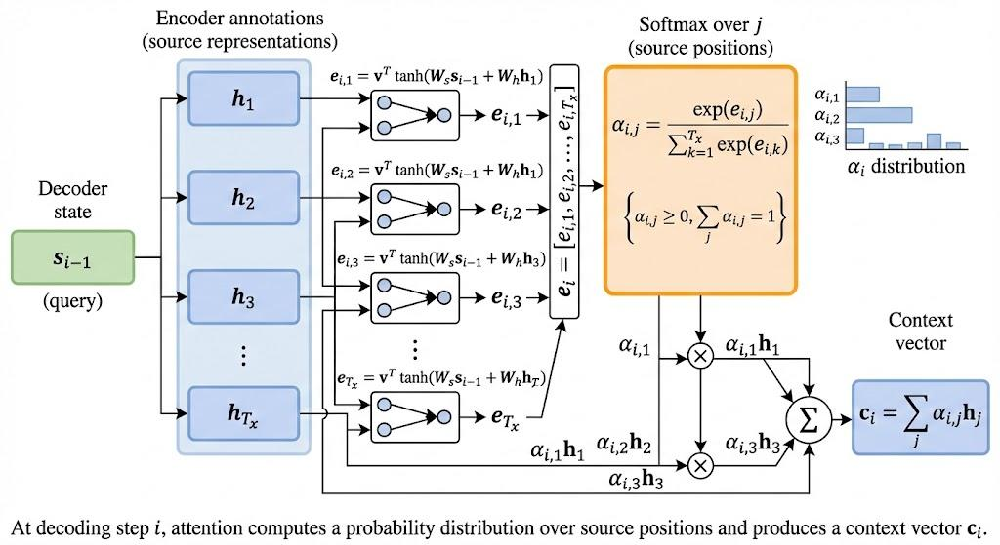

[ickma2311.github.io](https://ickma2311.github.io/ML/papers/attention-origin-transformer.html?utm_source=chatgpt.com)

The scores are then passed through Softmax.

$$ \alpha\_{t,i}=Softmax(e\_{t,i}) $$

Finally, calculate the context vector:

$$ c_t=\sum_i\alpha\_{t,i}h_i $$

### Why is it called Additive Attention?
Because it combines transformed encoder and decoder representations through addition before calculating the attention score.

### Advantages
- Flexible scoring function.
- Can handle encoder and decoder representations with different dimensions.
- Learns a nonlinear relationship between the representations.

### Limitation
It requires additional neural network operations and learnable parameters.

## 5.2 Multiplicative Attention (Luong Attention)
Multiplicative Attention was introduced by Minh-Thang Luong and colleagues in 2015.

Instead of using a small neural network to combine the representations, it uses multiplicative operations.

One simple form is:

$$ \boxed{e\_{t,i}=s_t^Th_i} $$

This is called Dot-Product Attention.

Another form is:

$$ \boxed{e\_{t,i}=s_t^T W_a h_i} $$

This is called General Attention.

Where:

- $s_t$ = Current decoder hidden state.
- $h_i$ = Encoder hidden state.
- $W_a$ = Learnable weight matrix.

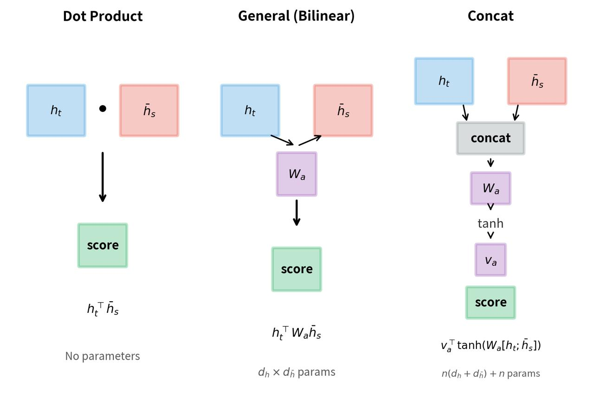

[mbrenndoerfer.com](https://mbrenndoerfer.com/writing/luong-attention-mechanisms-dot-product-general-local?utm_source=chatgpt.com)

### Why is it called Multiplicative Attention?
Because the attention score is calculated using multiplication between the encoder and decoder representations.

### Advantages
- Relatively simple.
- Often computationally efficient.
- Dot-product attention can be implemented efficiently using matrix multiplication.

### Limitation
The dimensions of the representations must be compatible, or a transformation must be applied.

## 5.3 Bahdanau vs Luong Attention
| Feature        | Bahdanau                        | Luong                                |
| -------------- | ------------------------------- | ------------------------------------ |
| Attention type | Additive                        | Multiplicative                       |
| Scoring        | Small neural network            | Dot product or general bilinear form |
| Decoder state  | Traditionally previous state    | Often current state                  |
| Complexity     | More operations                 | Often simpler                        |
| Main idea      | Add transformed representations | Multiply representations             |

**Remember:** Bahdanau and Luong are important in traditional RNN-based attention. Transformer attention uses a different formulation called Scaled Dot-Product Attention.

# 6. Self-Attention: The Most Important Concept
Now we reach the most important part of this chapter.

So far, we have studied attention between:

- Encoder hidden states.
- Decoder hidden states.

But what if we want the words within the same sentence to understand their relationships with one another?

This is where **Self-Attention** comes in.

## 6.1 What is Self-Attention?
**Self-Attention is an attention mechanism in which elements of the same sequence calculate their relationships with one another to generate context-aware representations.**

In simple words:

Every token can look at other relevant tokens in the same sequence and gather information from them.

Let's understand with an example.

Consider:

> "The animal didn't cross the road because it was tired."

The word `it` needs context to understand its reference.

Self-attention allows the representation of `it` to incorporate information from other words, including `animal`.

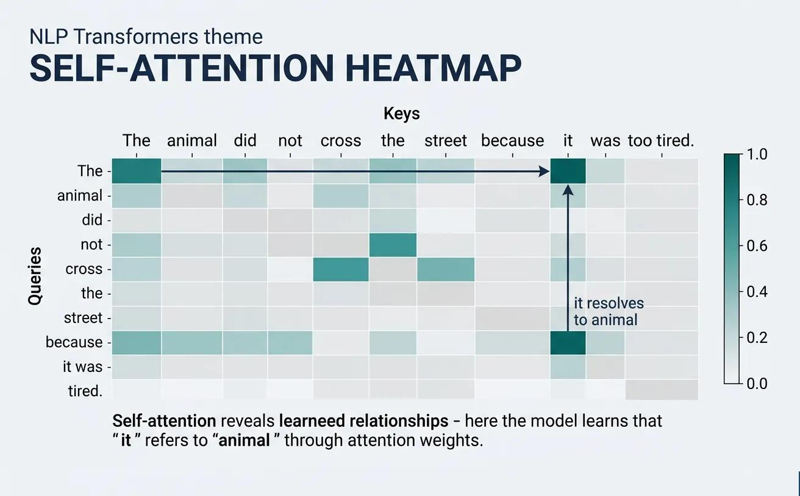

[wasilzafar.com](https://www.wasilzafar.com/pages/series/nlp/nlp-transformers-attention.html?utm_source=chatgpt.com)

Unlike a basic RNN, self-attention doesn't need to carry information from one time step to the next through a recurrent hidden state.

It directly calculates relationships between token representations.

### Another example
Consider:

"The bank is near the river."

And:

"I deposited money in the bank."

The word `bank` has different meanings in these sentences.

Self-attention helps create contextual representations using surrounding words.

In the first sentence, `river` provides useful context.

In the second sentence, `deposited` and `money` provide useful context.

This is one of the reasons self-attention is so powerful in NLP.

# 7. Understanding Query, Key and Value (Q, K, V)
This is arguably the most important mathematical concept in Attention and Transformers.

Almost every explanation of Transformer attention revolves around three components:

1. Query (Q).
2. Key (K).
3. Value (V).

Let's understand them intuitively before moving into mathematics.

## 7.1 Real-world analogy: Searching for a book in a library
Imagine that you're searching for a book about Machine Learning.

You visit a library.

- **Query:** What you're searching for — "Machine Learning".
- **Key:** The searchable information associated with each book.
- **Value:** The actual content of the book.

You compare your query with the keys of available books.

The more relevant a key is to your query, the more attention you give to its corresponding value.

Finally, you combine information from the most relevant books.

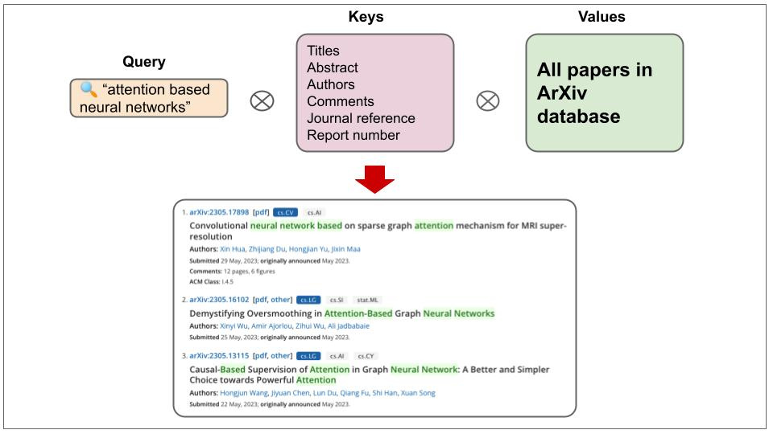

[deeprevision.github.io](https://deeprevision.github.io/posts/001-transformer/?utm_source=chatgpt.com)

This is the basic intuition behind Q, K, and V.

### Query (Q)
Query represents what a token is looking for.

In an attention calculation, the query is compared with keys to determine relevance.

### Key (K)
Key represents the information used to determine how relevant a particular token is to a query.

The query-key similarity determines attention scores.

### Value (V)
Value represents the information that is actually retrieved and combined using the attention weights.

### Easy way to remember
| Component | Think of it as          | Purpose                            |
| --------- | ----------------------- | ---------------------------------- |
| Query     | Search request          | What information do I need?        |
| Key       | Index or matching label | How relevant am I?                 |
| Value     | Actual content          | What information should I provide? |

# 8. How Are Q, K and V Generated?
This is where mathematics enters.

Suppose we have input token embeddings:

$$ X= \begin{bmatrix} x_1\\\ x_2\\\ x_3\\\ x_4 \end{bmatrix} $$

Each row represents an embedding of a token.

We create Query, Key, and Value matrices using three learnable weight matrices.

$$ \boxed{Q=XW_Q} $$

$$ \boxed{K=XW_K} $$

$$ \boxed{V=XW_V} $$

Where:

- $X$ = Input embeddings.
- $W_Q$ = Query weight matrix.
- $W_K$ = Key weight matrix.
- $W_V$ = Value weight matrix.

These weight matrices are learned during training.

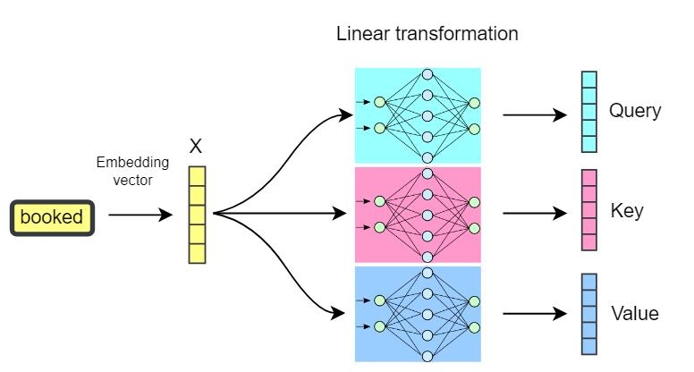

[datasciencedojo.com](https://datasciencedojo.com/blog/kv-cache-how-to-speed-up-llm-inference/?utm_source=chatgpt.com)

### Why do we need three different matrices?
Because Query, Key, and Value serve different purposes.

- Query determines what a token is looking for.
- Key determines how a token can be matched.
- Value determines what information the token contributes.

The same input embedding is transformed into three different representations.

**Important:** Q, K, and V are not manually assigned labels or fixed properties of words. They are learned numerical representations.

# 9. Scaled Dot-Product Attention
Now let's understand the actual attention formula used in the original Transformer architecture.

The formula is:

Most important attention equation

$$ \boxed{ Attention(Q,K,V)= Softmax\left( \frac{QK^T}{\sqrt{d_k}} \right)V } $$

This is called **Scaled Dot-Product Attention**.

It consists of four main operations:

1. Calculate similarity using Query and Key.
2. Scale the scores.
3. Apply Softmax.
4. Multiply the attention weights by Value.

Let's understand each operation.

## Step 1: Calculate Dot Product
$$ Scores=QK^T $$

The dot product measures similarity between queries and keys.

A higher dot product generally means a stronger match.

For example:

Suppose:

$$ Q= \begin{bmatrix} 1&0\\\ 0&1 \end{bmatrix} $$

And:

$$ K= \begin{bmatrix} 1&0\\\ 1&1 \end{bmatrix} $$

Then:

$$ K^T= \begin{bmatrix} 1&1\\\ 0&1 \end{bmatrix} $$

Therefore:

$$ QK^T= \begin{bmatrix} 1&1\\\ 0&1 \end{bmatrix} $$

This gives us the attention score matrix.

Each row represents the scores produced by one query against all keys.

## Step 2: Scaling
Why do we divide the scores by $\sqrt{d_k}$?

Here, $d_k$ represents the dimension of the key vectors.

The scaling factor is:

$$ \sqrt{d_k} $$

Suppose:

$$ d_k=64 $$

Then:

$$ \sqrt{64}=8 $$

We divide the score matrix by 8.

Why?

When the dimensionality of the query and key vectors becomes large, dot products can become large in magnitude.

This can cause Softmax to produce extremely concentrated probabilities, leading to small gradients in certain cases.

Scaling helps keep the scores at a more suitable magnitude.

## Step 3: Apply Softmax
We apply Softmax to each query's row of scores.

$$ Attention\ Weights= Softmax\left(\frac{QK^T}{\sqrt{d_k}}\right) $$

This produces attention weights.

Each query now has a probability distribution over the available keys.

## Step 4: Multiply by Value
Finally:

$$ Output=Attention\ Weights\times V $$

The model combines the Value vectors according to the attention weights.

The resulting vectors are context-aware representations.

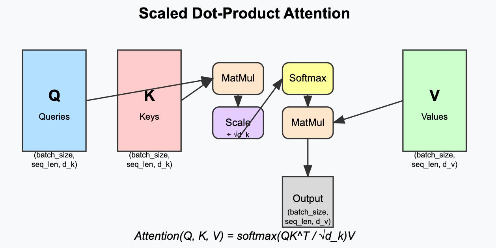

[aignishant.medium.com](https://aignishant.medium.com/multi-headed-attention-how-transformers-think-smarter-not-harder-8c07afed14ac?utm_source=chatgpt.com)

### Remember the complete sequence
$$ \boxed{ QK^T \rightarrow \frac{QK^T}{\sqrt{d_k}} \rightarrow Softmax \rightarrow \times V } $$

This single equation is at the heart of the Transformer architecture.

# 10. Understanding the Attention Score Matrix
Let's go one level deeper.

Suppose our input contains three tokens:

`I love AI`

The Query and Key matrices produce a score matrix.

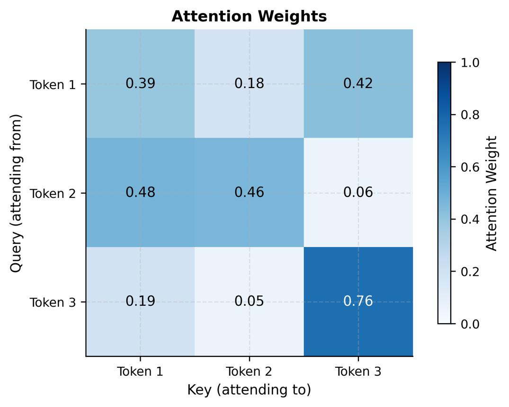

[mbrenndoerfer.com](https://mbrenndoerfer.com/writing/transformer-block-assembly?utm_source=chatgpt.com)

For example:

$$ A= \begin{bmatrix} 0.7&0.2&0.1\\\ 0.1&0.6&0.3\\\ 0.2&0.3&0.5 \end{bmatrix} $$

Here:

- Row 1 represents attention from `I` to all tokens.
- Row 2 represents attention from `love` to all tokens.
- Row 3 represents attention from `AI` to all tokens.

Let's interpret the first row:

$$ [0.7,0.2,0.1] $$

The representation of `I` assigns:

- 70% attention to `I`.
- 20% attention to `love`.
- 10% attention to `AI`.

Each row sums to 1.

The matrix tells us how much each token attends to every other token.

**Important:** This is a hypothetical attention matrix. Actual attention weights are learned through the model and depend on the input and layer.

# 11. Multi-Head Attention
Now that we understand self-attention, let's understand another important Transformer concept:

**Multi-Head Attention (MHA).**

The idea is simple.

Instead of calculating attention only once, we calculate attention multiple times using different learned Query, Key, and Value projections.

Each calculation is called an **Attention Head**.

Why?

Because different heads can learn different relationships between tokens.

For example, in a sentence, different heads may become sensitive to:

- Subject-verb relationships.
- Pronoun references.
- Nearby contextual words.
- Long-distance dependencies.

These are possible learned patterns, not guaranteed one-to-one roles for every head.

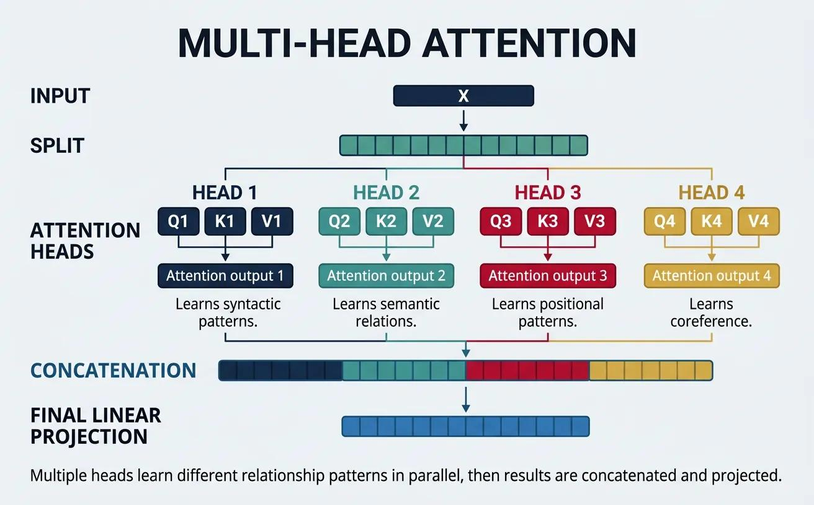

[wasilzafar.com](https://www.wasilzafar.com/pages/series/nlp/nlp-transformers-attention.html?utm_source=chatgpt.com)

## 11.1 How Does Multi-Head Attention Work?
Suppose we have eight attention heads.

Instead of using one set of projections, we use separate learned projections for each head.

For head 1:

$$ head_1=Attention(Q_1,K_1,V_1) $$

For head 2:

$$ head_2=Attention(Q_2,K_2,V_2) $$

And so on.

For eight heads:

$$ head_1,head_2,\ldots,head_8 $$

Each head calculates its own attention output.

## 11.2 Concatenation
After calculating the outputs of all heads, we concatenate them.

$$ Concat(head_1,head_2,\ldots,head_8) $$

## 11.3 Final Linear Projection
The concatenated output is passed through another learnable weight matrix.

$$ \boxed{ MultiHead(Q,K,V)= Concat(head_1,\ldots,head_h)W_O } $$

Where:

- $h$ = Number of attention heads.
- $W_O$ = Output projection matrix.

### Example
Suppose:

- Model dimension = 512.
- Number of heads = 8.

Then each head typically works with:

$$ d_k=d_v=\frac{512}{8}=64 $$

Each head produces a 64-dimensional representation.

The outputs are concatenated:

$$ 8\times64=512 $$

The resulting 512-dimensional representation is passed through the output projection.

### Why use Multi-Head Attention?
1. Allows the model to learn multiple types of relationships.
2. Provides different representation subspaces.
3. Captures different contextual patterns.
4. Improves the expressive capacity of attention layers.

**Remember:** Single-head attention calculates one attention representation. Multi-head attention calculates multiple attention representations in parallel and combines them.

# 12. Different Types of Attention in Transformers
By now, we've covered:

- Additive Attention.
- Multiplicative Attention.
- Self-Attention.
- Scaled Dot-Product Attention.
- Multi-Head Attention.

But Transformers use attention in different ways depending on their position in the architecture.

There are three important concepts:

1. Self-Attention.
2. Masked Self-Attention.
3. Cross-Attention.

Let's understand each.

## 12.1 Self-Attention
Self-Attention allows tokens within the same sequence to attend to one another.

For example:

`The student studies Machine Learning.`

Every token can calculate attention scores against other tokens.

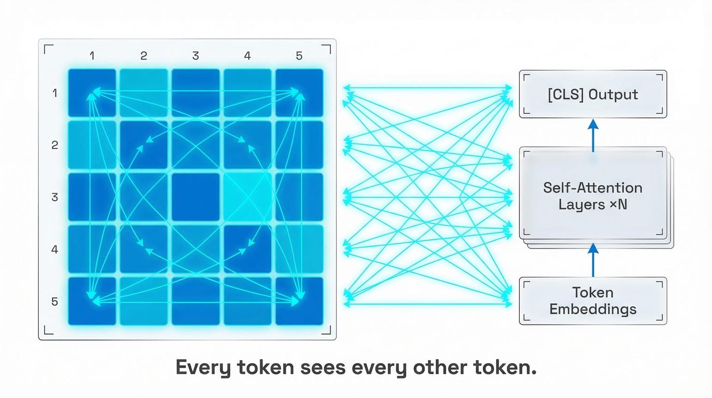

[medium.com](https://medium.com/%40wasowski.jarek/one-mask-three-worlds-encoder-vs-decoder-546f253f736c?utm_source=chatgpt.com)

It is commonly used in Transformer encoders.

## 12.2 Masked Self-Attention (Causal Attention)
Now consider a decoder generating this sentence:

`I love Machine Learning`

Suppose the decoder is generating the second token.

Should it be allowed to look at future tokens such as `Machine` and `Learning`?

No!

During autoregressive generation, the decoder should only use previously available tokens and the current position.

This is why we use **Causal Masking**.

Causal masking prevents a token from attending to future positions.

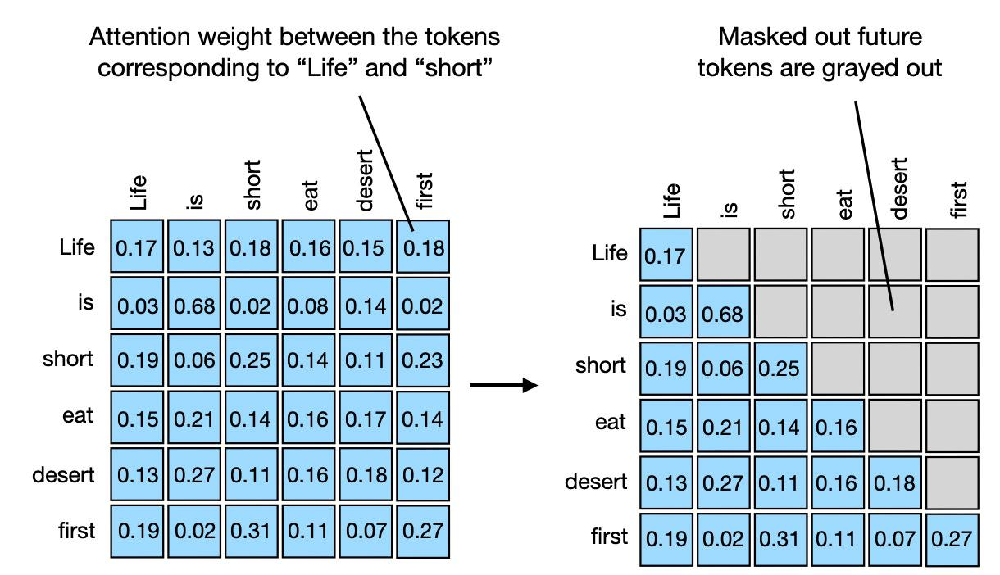

[magazine.sebastianraschka.com](https://magazine.sebastianraschka.com/p/understanding-and-coding-self-attention?utm_source=chatgpt.com)

Consider the attention mask for four tokens:

$$ M= \begin{bmatrix} 0&-\infty&-\infty&-\infty\\\ 0&0&-\infty&-\infty\\\ 0&0&0&-\infty\\\ 0&0&0&0 \end{bmatrix} $$

This mask is added to the attention scores before Softmax.

Why use negative infinity?

Because:

$$ e^{-\infty}=0 $$

Therefore, after Softmax, future positions receive zero attention probability.

The allowed attention pattern looks like this:

**Causal attention mask**

Rows represent queries; columns represent keys.

1

2

3

4

1

2

3

4

Allowed

Blocked

For example:

- Token 1 can attend to token 1.
- Token 2 can attend to tokens 1 and 2.
- Token 3 can attend to tokens 1, 2 and 3.
- Token 4 can attend to all four tokens.

This is how decoder-only Transformers such as GPT maintain autoregressive generation.

**Important:** Causal masking is used in the decoder's self-attention during training and generation. During inference, future tokens simply haven't been generated yet.

## 12.3 Cross-Attention
Cross-Attention allows one sequence to attend to another sequence.

This is particularly important in Encoder-Decoder Transformers.

For example:

- Encoder processes an English sentence.
- Decoder generates a French sentence.

The decoder needs access to the encoder's output representations.

In cross-attention:

- Query comes from the decoder.
- Key comes from the encoder.
- Value comes from the encoder.

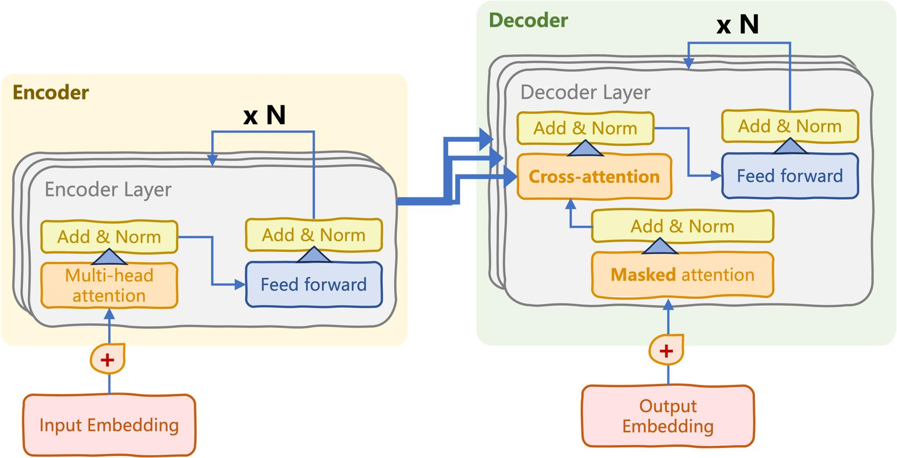

[campus.datacamp.com](https://campus.datacamp.com/courses/transformer-models-with-pytorch/building-transformer-architectures?ex=10\&utm_source=chatgpt.com)

Mathematically:

$$ Q=X\_{decoder}W_Q $$

$$ K=X\_{encoder}W_K $$

$$ V=X\_{encoder}W_V $$

Then:

$$ CrossAttention(Q,K,V)= Softmax\left(\frac{QK^T}{\sqrt{d_k}}\right)V $$

This allows the decoder to retrieve relevant information from the encoder.

### Comparison
| Attention type         | Query   | Key     | Value   | Purpose                          |
| ---------------------- | ------- | ------- | ------- | -------------------------------- |
| Encoder Self-Attention | Encoder | Encoder | Encoder | Understand input context         |
| Masked Self-Attention  | Decoder | Decoder | Decoder | Prevent future-token access      |
| Cross-Attention        | Decoder | Encoder | Encoder | Access encoded input information |

This table is extremely important when studying Transformer architecture.

# 13. Positional Encoding: Why Does Attention Need It?
Here's an interesting problem.

Suppose we have these two sentences:

1. `Dog bites man.`
2. `Man bites dog.`

The words are similar, but their order is different.

Now think about Self-Attention.

It calculates relationships between tokens using their representations.

But the attention operation itself does not inherently know the order of tokens.

It doesn't automatically understand that one token came before another.

We need to provide positional information.

This is where **Positional Encoding** comes in.

## 13.1 What is Positional Encoding?
Positional Encoding is a technique used to provide information about the position of each token in a sequence.

It allows a Transformer to incorporate token-order information.

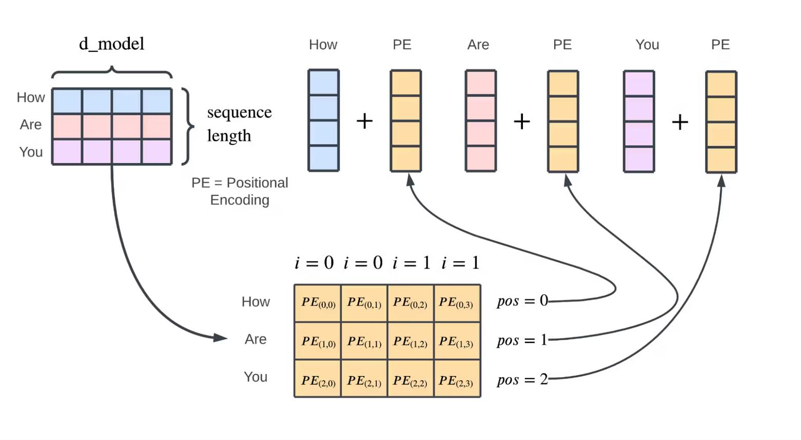

[deepgram.com](https://deepgram.com/learn/visualizing-and-explaining-transformer-models-from-the-ground-up?utm_source=chatgpt.com)

The original Transformer uses sinusoidal positional encodings.

It adds positional information to token embeddings:

$$ \boxed{Input=Token\ Embedding+Positional\ Encoding} $$

The resulting representations are passed to the Transformer layers.

## 13.2 Sinusoidal Positional Encoding
The original Transformer introduced two equations:

For even dimensions:

$$ PE(pos,2i)= \sin\left( \frac{pos}{10000^{2i/d\_{model}}} \right) $$

For odd dimensions:

$$ PE(pos,2i+1)= \cos\left( \frac{pos}{10000^{2i/d\_{model}}} \right) $$

Where:

- $pos$ = Token position.
- $i$ = Dimension index.
- $d\_{model}$ = Model embedding dimension.

Why use Sine and Cosine?

They provide position-dependent patterns at different frequencies.

This allows the model to obtain information about token positions and relative positional relationships.

### Example
Suppose our sentence is:

`I love AI`

Its token embeddings are:

$$ E_1,E_2,E_3 $$

Its positional encodings are:

$$ P_1,P_2,P_3 $$

The actual inputs become:

$$ X_1=E_1+P_1 $$

$$ X_2=E_2+P_2 $$

$$ X_3=E_3+P_3 $$

Now the Transformer has access to both token information and positional information.

**Note:** Modern Transformer models also use learned positional embeddings, relative positional encodings, and rotary positional embeddings (RoPE). Sinusoidal encoding is the original Transformer approach, not the only approach.

# 14. Padding Mask vs Causal Mask
These two concepts are often confused.

Both are masks used in attention, but they solve different problems.

## 14.1 Padding Mask
Suppose we have three sentences:

```
I love AI
Hello
How are you today
```

To process them in a batch, we pad them to the same length:

```
I love AI <PAD>
Hello <PAD> <PAD> <PAD>
How are you today
```

The padding mask prevents the model from attending to padding positions.

This ensures that artificial padding tokens do not contribute to the attention computation as meaningful content.

## 14.2 Causal Mask
Causal masking prevents a token from attending to future positions.

It is used to maintain autoregressive behavior.

### Difference
| Feature               | Padding Mask                  | Causal Mask             |
| --------------------- | ----------------------------- | ----------------------- |
| Purpose               | Ignore padding tokens         | Block future tokens     |
| Main use              | Variable-length batches       | Autoregressive decoding |
| Prevents attention to | PAD positions                 | Future positions        |
| Common in             | Encoder and decoder attention | Decoder self-attention  |

Some implementations combine padding and causal masks.

# 15. Complete Transformer Encoder-Decoder Architecture
Now let's connect all the attention concepts together.

The original Transformer architecture was introduced in the 2017 research paper:

Attention Is All You Need.

It uses attention mechanisms instead of recurrent and convolutional sequence-processing layers.

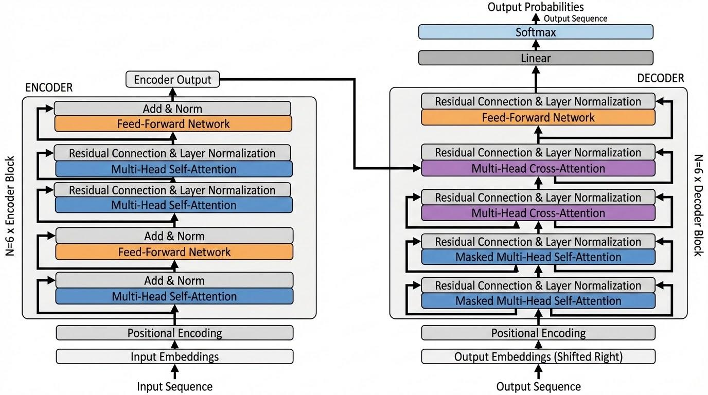

[paper-banana.org](https://paper-banana.org/?utm_source=chatgpt.com)

Let's understand the architecture.

## 15.1 Transformer Encoder
The encoder consists of multiple identical layers.

Each layer contains:

1. Multi-Head Self-Attention.
2. Feedforward Neural Network.
3. Residual Connections.
4. Layer Normalization.

### Encoder working
**Step 1: Input Embedding**

Tokens are converted into dense vectors.

**Step 2: Positional Encoding**

Positional information is added to the embeddings.

**Step 3: Multi-Head Self-Attention**

Each token attends to other tokens in the input sequence.

**Step 4: Feedforward Network**

The resulting representations pass through a position-wise feedforward neural network.

**Step 5: Residual Connections and Layer Normalization**

These help stabilize training and information flow.

The output of the encoder is passed to the decoder.

## 15.2 Transformer Decoder
The decoder also consists of multiple layers.

Each layer contains:

1. Masked Multi-Head Self-Attention.
2. Encoder-Decoder Cross-Attention.
3. Feedforward Neural Network.
4. Residual Connections.
5. Layer Normalization.

### Decoder working
**Step 1: Target Embedding**

Previously generated or shifted target tokens are converted into embeddings.

**Step 2: Positional Encoding**

Positional information is added.

**Step 3: Masked Multi-Head Self-Attention**

Prevents the decoder from accessing future target tokens.

**Step 4: Cross-Attention**

The decoder attends to the encoder's output.

**Step 5: Feedforward Network**

Processes the resulting representations.

**Step 6: Linear + Softmax**

Generates probabilities over the output vocabulary.

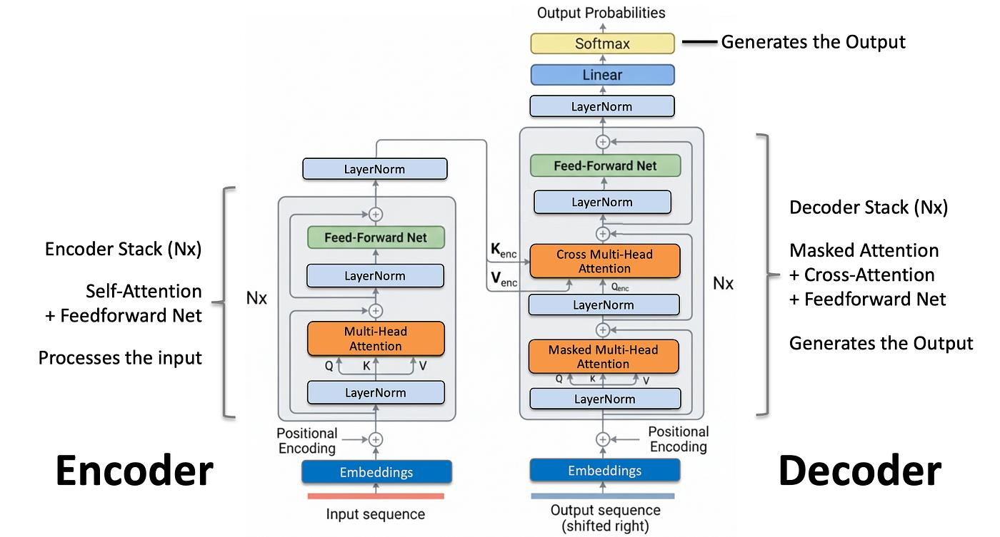

[medium.com](https://medium.com/%40lmpo/transformers-explained-why-attention-is-truly-all-you-need-2e3669242965?utm_source=chatgpt.com)

### The three important attention operations
| Component                     | Function                                          |
| ----------------------------- | ------------------------------------------------- |
| Encoder Self-Attention        | Understands relationships within input tokens     |
| Decoder Masked Self-Attention | Understands previously available output tokens    |
| Decoder Cross-Attention       | Connects output generation to encoder information |

This is the architecture behind the original encoder-decoder Transformer.

# 16. Computational Complexity of Attention
Now let's move towards advanced concepts.

One important limitation of standard self-attention is its computational and memory cost for long sequences.

Suppose we have a sequence containing $n$ tokens.

The attention score matrix has dimensions:

$$ n\times n $$

Therefore, the number of pairwise attention scores grows approximately as:

$$ \boxed{O(n^2)} $$

### Example
| Sequence length | Attention matrix size | Number of scores |
| --------------- | --------------------- | ---------------- |
| 100             | 100 × 100             | 10,000           |
| 500             | 500 × 500             | 250,000          |
| 1,000           | 1,000 × 1,000         | 1,000,000        |
| 2,000           | 2,000 × 2,000         | 4,000,000        |
| 4,000           | 4,000 × 4,000         | 16,000,000       |

Notice how quickly the number of scores increases.

Doubling the sequence length approximately quadruples the size of the attention matrix.

Attention score growth

Number of pairwise scores grows quadratically with sequence length.

04.5M9M13.5M18M100500100020004000

Illustrative standard dense self-attention matrix sizes.

### Why is this a problem?
For very long sequences:

- Memory requirements increase.
- Attention computation becomes expensive.
- Training becomes more resource-intensive.
- Long-context processing becomes challenging.

### Solutions and improvements
Researchers have developed several techniques to improve attention efficiency.

| Technique                | Main idea                                                               |
| ------------------------ | ----------------------------------------------------------------------- |
| Sparse Attention         | Computes attention only for selected token relationships                |
| Local Attention          | Focuses on nearby tokens                                                |
| Sliding Window Attention | Attends within a moving window                                          |
| Linear Attention         | Uses alternative formulations to reduce complexity                      |
| FlashAttention           | Optimizes exact attention computation using efficient GPU memory access |
| Multi-Query Attention    | Shares key/value heads across multiple query heads                      |
| Grouped-Query Attention  | Shares key/value heads among groups of query heads                      |

An important distinction:

**FlashAttention does not change the fundamental mathematical attention operation.** It improves how exact attention is computed and how memory is used.

# 17. Advanced Attention Concepts
Let's explore some concepts that are especially useful when studying modern LLM architectures.

## 17.1 Attention Is a Learnable Mechanism
One important thing to understand is that attention weights are not manually specified.

The model learns them during training.

Remember:

$$ Q=XW_Q $$

$$ K=XW_K $$

$$ V=XW_V $$

The matrices $W_Q,W_K,W_V$ are trainable parameters.

During training:

1. The model generates Q, K and V.
2. Attention scores are calculated.
3. Attention weights are calculated using Softmax.
4. Contextual representations are generated.
5. A loss function measures prediction error.
6. Backpropagation calculates gradients.
7. The optimizer updates the projection matrices.

Over time, the model learns useful attention patterns for its training objective.

**Attention is therefore not a fixed rule-based system. It is a learnable part of the neural network.**

## 17.2 Attention Weights vs Attention Scores
These terms are often used interchangeably, but they are different.

| Attention Scores               | Attention Weights                           |
| ------------------------------ | ------------------------------------------- |
| Raw similarity values          | Normalized values                           |
| Calculated using Query and Key | Calculated using Softmax                    |
| Can be positive or negative    | Between 0 and 1                             |
| Don't necessarily sum to 1     | Each unmasked query row generally sums to 1 |

The transformation is:

$$ Scores\rightarrow Softmax\rightarrow Weights $$

## 17.3 Attention Dimension
In the Transformer architecture, we frequently encounter:

- $d\_{model}$: Model dimension.
- $d_k$: Key dimension.
- $d_v$: Value dimension.
- $h$: Number of attention heads.

For the original Transformer:

$$ d\_{model}=512 $$

$$ h=8 $$

Typically:

$$ d_k=d_v=\frac{d\_{model}}{h} $$

Therefore:

$$ d_k=d_v=\frac{512}{8}=64 $$

Each attention head operates with 64-dimensional Query, Key, and Value representations.

The heads are concatenated to produce a 512-dimensional representation before the output projection.

## 17.4 Self-Attention Is Permutation-Equivariant
This is a more advanced mathematical property.

Self-attention without positional information does not inherently encode the order of the input tokens.

If we permute the input token representations, the output representations are permuted in the same way, assuming the same permutation is applied consistently to Queries, Keys and Values and no position-dependent operation is introduced.

This is called permutation equivariance.

In simplified terms:

- Attention can identify relationships between tokens.
- But without positional information, it doesn't inherently know their original sequence positions.

That's why positional encoding or another positional mechanism is important in Transformers.

## 17.5 Multi-Head Attention vs Multi-Query Attention vs Grouped-Query Attention
You may encounter these terms while studying LLM architectures.

Let's distinguish them.

**Multi-Head Attention (MHA)**

Each query head has its own corresponding Key and Value heads.

**Multi-Query Attention (MQA)**

Multiple query heads share one Key head and one Value head.

**Grouped-Query Attention (GQA)**

Query heads are divided into groups, with each group sharing Key and Value heads.

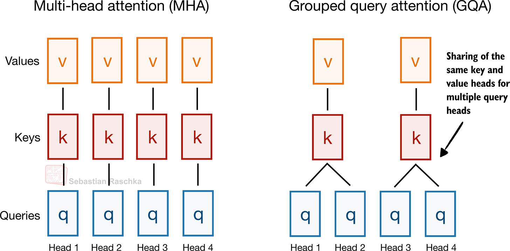

[magazine.sebastianraschka.com](https://magazine.sebastianraschka.com/p/qwen3-from-scratch?utm_source=chatgpt.com)

Why were MQA and GQA introduced?

During autoregressive generation, Transformer models repeatedly access previously computed Key and Value representations stored in the KV cache.

Reducing the number of Key and Value heads can reduce KV cache memory requirements and improve inference efficiency.

| Architecture | Query heads | Key/Value heads |
| ------------ | ----------- | --------------- |
| MHA          | 8           | 8               |
| GQA          | 8           | 2               |
| MQA          | 8           | 1               |

These are illustrative configurations.

GQA provides a compromise between the full representation capacity of MHA and the efficiency of MQA.

## 17.6 KV Cache
This is another important concept in modern LLM inference.

Suppose an LLM generates:

"The weather is beautiful today."

It generates tokens one at a time.

When predicting a new token, it needs access to the Keys and Values of previous tokens.

Instead of recomputing all previous Key and Value representations every time, the model stores them in a cache.

This is called the **Key-Value Cache (KV Cache)**.

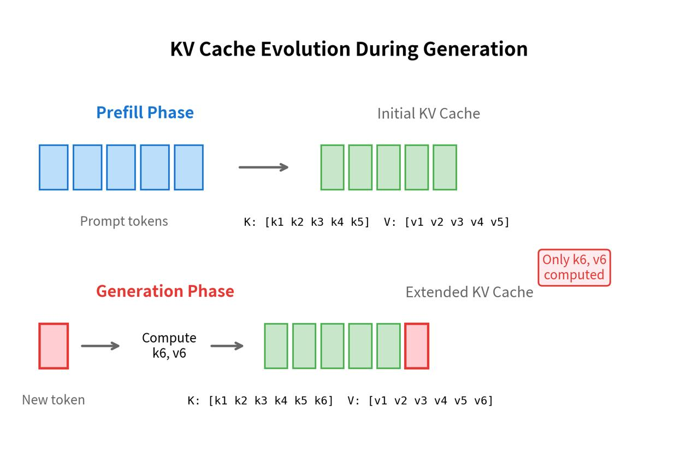

[mbrenndoerfer.com](https://mbrenndoerfer.com/writing/autoregressive-generation-gpt-text-generation?utm_source=chatgpt.com)

Benefits:

- Avoids repeatedly computing old Key and Value representations.
- Speeds up autoregressive generation.
- Makes long-generation inference more efficient.

However, KV cache consumes memory, especially with long contexts and large models.

This is one reason GQA and MQA are useful.

# 18. Implementing Attention Using Python
Let's move from theory to implementation.

We'll use PyTorch to implement Scaled Dot-Product Attention.

This will help you understand what happens internally when a Transformer calculates attention.

### Step 1: Install dependencies
```
pip install torch
```

### Step 2: Import PyTorch
```python
import math

import torch
import torch.nn.functional as F
```

### Step 3: Create Query, Key and Value
```python
Q = torch.tensor([
    [1.0, 0.0],
    [0.0, 1.0],
])
K = torch.tensor([
    [1.0, 0.0],
    [1.0, 1.0],
])
V = torch.tensor([
    [10.0, 0.0],
    [0.0, 20.0],
])
```

Here:

- Q contains query vectors.
- K contains key vectors.
- V contains value vectors.

Each matrix contains two vectors of dimension 2.

### Step 4: Calculate attention scores
```python
scores = torch.matmul(Q, K.T)
print(scores)
```

The operation is:

$$ QK^T $$

### Step 5: Scale the scores
```python
d_k = K.shape[-1]
scaled_scores = scores / math.sqrt(d_k)
print(scaled_scores)
```

We divide the scores by:

$$ \sqrt{d_k} $$

### Step 6: Apply Softmax
```python
attention_weights = F.softmax(scaled_scores, dim=-1)
print(attention_weights)
```

Now each row contains attention weights that sum to 1.

### Step 7: Calculate the weighted sum
```python
output = torch.matmul(attention_weights, V)
print(output)
```

This calculates:

$$ Attention(Q,K,V)= Softmax\left(\frac{QK^T}{\sqrt{d_k}}\right)V $$

### Step 8: Complete implementation
Here's the complete reusable function:

```python
import math

import torch
import torch.nn.functional as F


def scaled_dot_product_attention(Q, K, V, mask=None):
    scores = torch.matmul(Q, K.transpose(-2, -1))
    d_k = K.size(-1)
    scores = scores / math.sqrt(d_k)

    if mask is not None:
        scores = scores.masked_fill(mask == 0, float("-inf"))

    weights = F.softmax(scores, dim=-1)
    output = torch.matmul(weights, V)
    return output, weights


Q = torch.randn(3, 4)
K = torch.randn(3, 4)
V = torch.randn(3, 4)
output, weights = scaled_dot_product_attention(Q, K, V)
```

Notice that this implementation handles a single sequence without a batch dimension.

Real Transformer implementations typically also support batches, multiple heads, padding masks, causal masks, and optimized attention kernels.

# 19. Implementing Multi-Head Attention Using PyTorch
Now let's implement a simplified Multi-Head Attention layer.

The following implementation uses PyTorch's built-in attention module, which handles the Q, K and V projections and attention calculations internally.

```python
import torch
import torch.nn as nn


class MultiHeadAttention(nn.Module):
    def __init__(self, d_model, num_heads):
        super().__init__()
        self.attention = nn.MultiheadAttention(
            embed_dim=d_model,
            num_heads=num_heads,
            batch_first=True,
        )

    def forward(self, x):
        output, weights = self.attention(
            query=x,
            key=x,
            value=x,
            need_weights=True,
        )
        return output, weights


d_model = 512
num_heads = 8
model = MultiHeadAttention(d_model, num_heads)
```

Expected shapes:

```text
Input shape:  torch.Size([2, 5, 512])
Output shape: torch.Size([2, 5, 512])
Attention shape: torch.Size([2, 5, 5])
```

The default attention weights returned by this PyTorch module are averaged across heads. You can request individual head weights using `average_attn_weights=False`.

### What did we implement?
We created a Multi-Head Self-Attention layer.

Because:

```python
query = x
key = x
value = x
```

All three inputs come from the same sequence.

This is Self-Attention.

For Cross-Attention, the Query would come from one sequence and the Key and Value would come from another.

# 20. Attention Mechanism: Complete Comparison
Let's consolidate all the attention mechanisms.

| Attention mechanism          | Main idea                                    | Where you'll encounter it   |
| ---------------------------- | -------------------------------------------- | --------------------------- |
| Additive Attention           | Neural network calculates relevance scores   | Bahdanau Seq2Seq            |
| Multiplicative Attention     | Dot product or bilinear scoring              | Luong Seq2Seq               |
| Self-Attention               | Tokens attend to tokens in the same sequence | Transformer encoder         |
| Masked Self-Attention        | Blocks access to future tokens               | Transformer decoder         |
| Cross-Attention              | One sequence attends to another              | Encoder-decoder Transformer |
| Scaled Dot-Product Attention | Scaled Q-K similarity followed by weighted V | Transformer                 |
| Multi-Head Attention         | Multiple attention heads operate in parallel | Transformer                 |
| Multi-Query Attention        | Multiple query heads share K/V heads         | Efficient LLM inference     |
| Grouped-Query Attention      | Groups of query heads share K/V heads        | Efficient LLM inference     |

# 21. Common Misconceptions About Attention
There are a few things you should be careful about.

**1. Attention is not the same as Self-Attention.**

Self-Attention is one type of attention mechanism.

**2. Attention is not necessarily an RNN feature.**

It was used with RNN-based Seq2Seq models, but Transformers use attention without recurrent connections.

**3. Attention does not automatically understand meaning.**

It learns numerical relationships that help the model perform its training task.

**4. Attention weights are not always explanations.**

A higher attention weight indicates a larger contribution to the weighted combination, but attention weights alone do not necessarily explain why a model made a prediction.

**5. Multi-Head Attention does not mean multiple separate models.**

The heads are different learned projection subspaces within the same overall attention layer.

**6. Attention alone does not provide positional information.**

Standard self-attention needs positional information or another mechanism to represent sequence order.

**7. Softmax is not the entire Attention Mechanism.**

Softmax converts scores into weights. The complete operation also involves Q-K scoring and combining the Value vectors.

# 22. Complete Attention Mechanism Learning Map
Let's connect everything we've studied into one conceptual diagram.

## Attention Mechanism Hierarchy
**Attention Mechanism**

Allows models to focus on relevant information

**Traditional Attention**

\- Additive (Bahdanau)

\- Multiplicative (Luong)

\- Seq2Seq Attention

**Transformer Attention**

\- Self-Attention

\- Masked Attention

\- Cross-Attention

**Core Transformer Operations**

1\. Query, Key, Value

2\. Scaled Dot-Product Attention

3\. Multi-Head Attention

4\. Positional Encoding

5\. Attention Masking

**Advanced LLM Concepts**

\- FlashAttention

\- Sparse / Linear Attention

\- Multi-Query Attention

\- Grouped-Query Attention

\- KV Cache

# 23. The Three Things You Should Write in Your Notes
These are the three most important definitions from this topic.

**1. Attention Mechanism**

An Attention Mechanism is a technique in neural networks that allows a model to assign different importance to different parts of the input when generating an output or learning contextual representations.

**2. Self-Attention**

Self-Attention is a mechanism in which each token calculates its relationships with other tokens in the same sequence to generate context-aware representations using Query, Key, and Value vectors.

**3. Multi-Head Attention**

Multi-Head Attention performs multiple attention operations in parallel using different learned Query, Key, and Value projections. Their outputs are concatenated and passed through a final linear projection.

### Five equations worth memorizing
| Concept                  | Equation                         |
| ------------------------ | -------------------------------- |
| Query                    | $Q=XW_Q$                     |
| Key                      | $K=XW_K$                     |
| Value                    | $V=XW_V$                     |
| Attention                | $Softmax(QK^T/\sqrt{d_k})V$  |
| Context vector (Seq2Seq) | $c_t=\sum_i\alpha\_{t,i}h_i$ |

The most important equation is:

$$ \boxed{ Attention(Q,K,V)= Softmax\left(\frac{QK^T}{\sqrt{d_k}}\right)V } $$

If you understand this equation, you understand the mathematical foundation of Transformer attention.

# 24. Test Your Understanding
Let's check how well you've understood Attention, from its fundamentals to advanced concepts.

**Attention Mechanism Quiz**

0/10 answered

**1. Why was Attention introduced into traditional Seq2Seq architectures?**

To eliminate all neural network layers

To address the fixed-size context vector bottleneck

To remove tokenization

To replace the loss function

**2. What does Softmax do in an attention mechanism?**

Creates token embeddings

Converts raw attention scores into normalized weights

Updates model parameters

Calculates positional encodings

**3. What does Query represent?**

Information being retrieved

What a token is looking for

The final model output

The positional encoding

**4. What is the purpose of the Value matrix?**

To calculate the sequence length

To identify future tokens

To provide information combined using attention weights

To calculate the loss

**5. Why do we divide by the square root of d_k?**

To reduce the vocabulary size

To control the magnitude of dot-product scores before Softmax

To remove positional encoding

To increase the number of attention heads

**6. What is the primary purpose of Causal Masking?**

To block padding tokens only

To prevent attention to future positions

To remove previous tokens

To reduce embedding dimensions

**7. In Transformer Cross-Attention, where do Q, K and V come from?**

All from the encoder

All from the decoder

Q from decoder; K and V from encoder

Q from encoder; K and V from decoder

**8. What is Multi-Head Attention?**

Running multiple independent datasets

Performing several attention operations in parallel and combining their outputs

Using multiple encoders without attention

Increasing the number of tokens

**9. What is the role of Positional Encoding?**

To store the output vocabulary

To provide information about token positions

To calculate attention weights

To normalize the loss

**10. What does KV Cache optimize?**

Model training accuracy

Repeated computation of previous Key and Value representations during generation

Tokenization speed

The number of Transformer layers

Submit answers

# 25. What Should You Study Next?
You've now completed the theoretical foundation of Attention Mechanism, including the mathematics behind Transformer attention.

I recommend following this sequence next:

## Your Next Learning Roadmap
1. **Scaled Dot-Product Attention — Numerical Practice**

   Covered

   Practise Q, K, V matrices, Softmax and weighted sums manually.
2. **Self-Attention in Depth**

   Covered

   Understand token-to-token relationships and attention matrices.
3. **Multi-Head Attention Implementation**

   Build Q, K, V projections, split heads, concatenate outputs and apply output projection.
4. **Positional Encoding**

   Sinusoidal encoding, learned embeddings, relative positions and RoPE.
5. **Transformer Architecture**

   Encoder, decoder, feedforward layers, residual connections and layer normalization.
6. **BERT, GPT and T5**

   Understand encoder-only, decoder-only and encoder-decoder Transformers.
7. **Advanced LLM Architecture**

   KV Cache, GQA, FlashAttention, RoPE and efficient inference.

**My recommendation:** Before moving to the complete Transformer architecture, make sure you can manually calculate a small Scaled Dot-Product Attention example using Q, K and V matrices. That one exercise will connect the entire mathematical foundation of this topic.

The most important concept to take away:

**Query asks what information is needed, Key determines how relevant each token is, and Value provides the information that gets combined.**