# Transformers in Deep Learning & NLP — Complete Learning Guide
Next topic in your NLP learning journey

Beginner → Advanced


Now we're moving to one of the most important breakthroughs in modern Artificial Intelligence: **the Transformer architecture**.

Transformers are the foundation of many technologies you interact with today, including:

- ChatGPT and GPT models
- Google Gemini
- Claude
- BERT
- T5
- Machine translation systems
- Modern code-generation models
- Many multimodal AI systems

Before understanding Transformers, let's connect everything we've studied so far.

## Contents

- [1. Where Transformers Fit in the Learning Journey](#1-where-do-transformers-fit-in-our-learning-journey)
- [2. Why Transformers Were Introduced](#2-why-were-transformers-introduced)
- [3. What Is a Transformer?](#3-what-exactly-is-a-transformer)
- [4. Overall Transformer Architecture](#4-the-overall-transformer-architecture)
- [5. Transformer Building Blocks](#5-understand-the-building-blocks-of-a-transformer)
- [6. Transformer Encoder](#6-inside-a-transformer-encoder)
- [7. Transformer Decoder](#7-inside-a-transformer-decoder)
- [8. Complete Original Architecture](#8-complete-original-transformer-architecture)
- [9. Three Transformer Architectures](#9-three-types-of-transformer-architectures)
- [10. Text Generation](#10-how-does-a-transformer-generate-text)
- [11. Training Speed](#11-why-are-transformers-faster-than-rnns-during-training)
- [12. PyTorch Implementation](#12-a-practical-transformer-implementation-using-pytorch)
- [13. Terminology](#13-important-transformer-terminology)
- [14. Next Steps](#14-what-should-you-study-next)
- [15. Key Notes](#15-the-three-things-you-should-write-in-your-notes)
- [16. Knowledge Check](#16-test-your-understanding)

## 1. Where do Transformers fit in our learning journey?
So far, we've covered:

1. **Artificial Neural Networks (ANNs)**

   Learn patterns from data using interconnected neurons.
2. **Recurrent Neural Networks (RNNs)**

   Process sequential data while maintaining a hidden state.
3. **Encoder-Decoder / Seq2Seq**

   Use an encoder to understand an input sequence and a decoder to generate an output sequence.
4. **Attention Mechanism**

   Allow a model to focus on relevant parts of an input instead of relying only on a fixed-size context vector.
5. We are here

   **Transformers**

   Use attention-based operations to process sequences without recurrence.
6. **Large Language Models (LLMs)**

   Large-scale models, commonly Transformer-based, trained to understand and generate language.

The key idea is that Transformers take the attention mechanism we just studied and make it the central building block of the architecture.

## 2. Why were Transformers introduced?
To understand Transformers, first understand the limitations of RNNs and traditional Seq2Seq architectures.

### 2.1 Problem with RNNs
Suppose we have this sentence:

> The student who was sitting near the window and reading a book was extremely intelligent.

An RNN processes this sentence sequentially:

**RNN processing**

The

student

who

was

sitting

...

intelligent

One token at a time

Hidden state carries information forward

Each step depends on the previous step.

The RNN must process one token before moving to the next.

This creates three major problems.

**Problem 1: Sequential processing**

An RNN processes tokens one by one.

- Token 2 waits for token 1.
- Token 3 waits for token 2.
- Token 4 waits for token 3.

This makes parallel processing difficult.

**Problem 2: Long-term dependencies**

Consider:

> I grew up in India. I speak fluent Hindi because I spent most of my childhood there.

To understand the context of "there", the model needs information from much earlier in the sentence.

RNNs can struggle to preserve information over long sequences, even with LSTMs and GRUs.

**Problem 3: Information bottleneck**

Traditional Seq2Seq models compress the entire input into a fixed-size context vector.

As the input becomes longer, preserving all relevant information in that vector becomes increasingly difficult.

### 2.2 How does attention help?
Attention allows a model to directly compare different tokens.

For example:

> The animal didn't cross the street because it was too tired.

What does "it" refer to?

The model needs to connect "it" with "animal".

Attention allows the representation of "it" to incorporate information from "animal", even though the words are separated.

However, the original attention mechanisms were often added to RNN-based architectures. Researchers wanted an architecture that relied entirely on attention rather than recurrence.

### 2.3 The Transformer breakthrough
In 2017, researchers introduced the Transformer in the research paper:

**"Attention Is All You Need"**

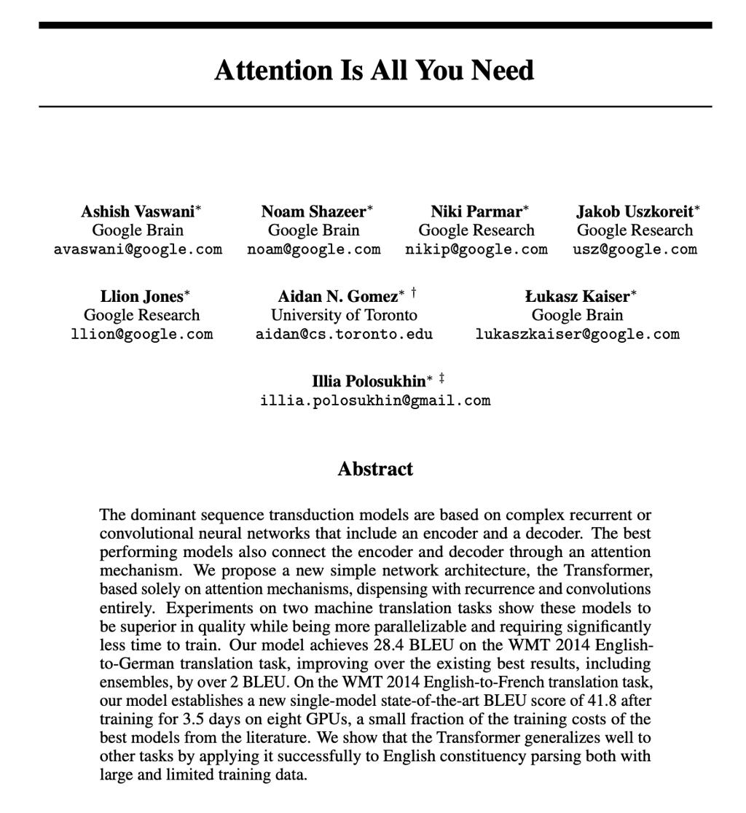

**Attention Is All You Need**

Authors: Vaswani et al.

Published: 2017

The paper introduced the original Transformer architecture based on attention mechanisms.

Its central idea:

> Instead of processing words sequentially using recurrence, process their relationships using attention.

This allows Transformer models to process all input tokens in parallel during training (subject to attention masks).

## 3. What exactly is a Transformer?
A **Transformer is a neural network architecture that uses attention mechanisms to process sequential data, especially text.**

It learns relationships between tokens and builds contextual representations.

Let's understand it with a simple example.

Sentence:

> I love machine learning.

First, the sentence is converted into tokens.

| Token    | Token representation |
| -------- | -------------------- |
| I        | Token 1              |
| love     | Token 2              |
| machine  | Token 3              |
| learning | Token 4              |

Each token is converted into a numerical vector called an embedding.

The Transformer then processes these vectors using multiple layers of attention and feed-forward neural networks.

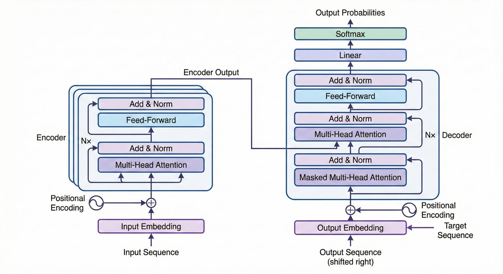

[sam-herman.github.io](https://sam-herman.github.io/blogs/embedding-adaptation-for-domain-specific.html?utm_source=chatgpt.com)

The output contains contextual representations of the input tokens.

For example, the representation of "learning" can incorporate information from "machine", "love", and "I".

This is one of the most important ideas behind Transformers.

## 4. The overall Transformer architecture
The original Transformer architecture consists of two main components:

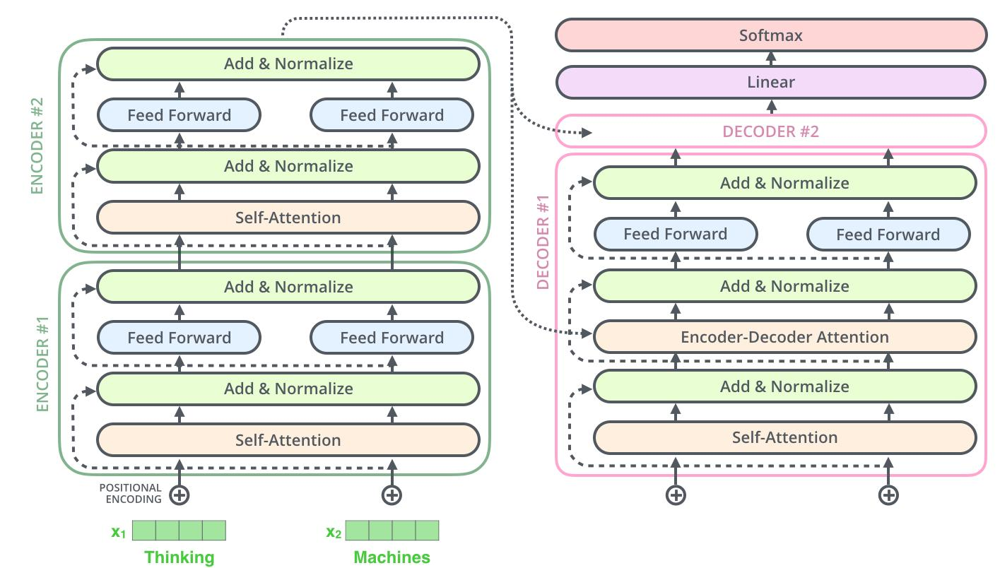

**Encoder**

Reads and builds contextual representations of the input sequence.

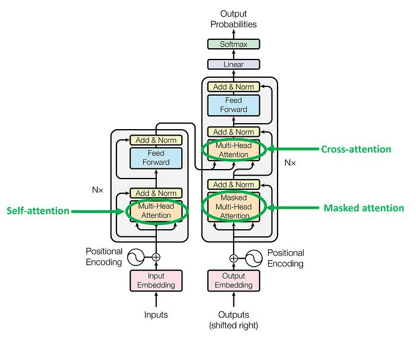

**Decoder**

Generates an output sequence, one token at a time.

Let's understand each component.

### 4.1 Encoder
The encoder receives the input sequence and creates contextual representations.

For example:

**Input:** "I love machine learning."

The encoder:

1. Converts tokens into embeddings.
2. Adds positional information.
3. Applies multi-head self-attention.
4. Applies feed-forward neural networks.
5. Repeats these operations through multiple layers.

The final encoder output contains contextual representations of all input tokens.

### 4.2 Decoder
The decoder generates the output sequence.

For example:

**Input:** "I love machine learning."

**Expected translation:** "J'aime l'apprentissage automatique."

The decoder:

1. Receives previously generated output tokens.
2. Applies masked self-attention.
3. Uses cross-attention to access encoder outputs.
4. Processes the representations through feed-forward networks.
5. Predicts the next token.

The decoder repeats this process until it generates an end-of-sequence token.

**Important:** Not every Transformer uses both encoder and decoder. We'll explore this distinction shortly.

## 5. Understand the building blocks of a Transformer
Before studying the complete architecture, we need to understand its major components.

**Transformer building blocks**

1. Input tokenization
2. Token embeddings
3. Positional encoding
4. Multi-head self-attention
5. Feed-forward neural network
6. Residual connections
7. Layer normalization
8. Output layer and Softmax (for token prediction)

Let's explore them one by one.

### 5.1 Tokenization
A Transformer does not directly understand human language.

It receives numerical token IDs.

Consider:

> I love artificial intelligence.

A tokenizer might split it into:

```
["I", "love", "artificial", "intelligence", "."]
```

It then converts the tokens into IDs:

```
[101, 2293, 7976, 4454, 102]
```

These numbers are illustrative; actual IDs depend on the tokenizer.

**What is tokenization?**

Tokenization is the process of dividing text into smaller units called tokens and converting them into numerical IDs.

Tokens may be:

- Complete words.
- Subwords.
- Individual characters.
- Punctuation or special symbols.

For example, a word such as "unbelievable" might be divided into multiple subword tokens.

### 5.2 Token Embeddings
Token IDs are just identifiers. The model needs meaningful numerical representations.

This is where embeddings come in.

Each token ID is mapped to a dense vector.

For example:

```
"I"            → [0.21, 0.42, 0.15, 0.87]
"love"         → [0.32, 0.71, 0.44, 0.19]
"machine"      → [0.64, 0.28, 0.93, 0.51]
"learning"     → [0.58, 0.37, 0.72, 0.14]
```

These are simplified illustrative vectors.

In a real Transformer, embedding dimensions can be much larger.

For example:

- 128 dimensions
- 256 dimensions
- 512 dimensions
- 768 dimensions
- 1024 dimensions

The embedding layer is learned during training.

**Important:** An embedding represents a token, but by itself it does not fully capture the token's meaning in its current sentence.

That is why we need attention.

### 5.3 Positional Encoding
Here's a problem.

Consider these two sentences:

1. The dog chased the cat.
2. The cat chased the dog.

They contain the same words but have different meanings because their order is different.

Self-attention alone does not inherently understand token order.

We need to provide positional information.

That's the purpose of positional encoding.

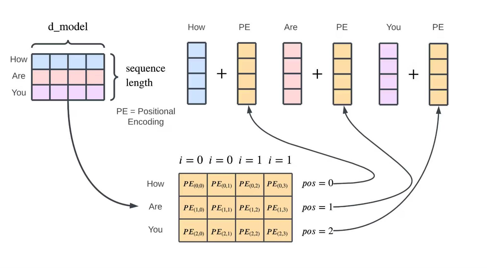

[deepgram.com](https://deepgram.com/learn/visualizing-and-explaining-transformer-models-from-the-ground-up?utm_source=chatgpt.com)

The basic idea is:

$$ Input=TokenEmbedding+PositionalEncoding $$

For example:

| Token  | Token position |
| ------ | -------------- |
| The    | 0              |
| dog    | 1              |
| chased | 2              |
| the    | 3              |
| cat    | 4              |

The positional information is combined with the token embedding.

### Types of positional information
**1. Sinusoidal positional encoding**

The original Transformer paper used sine and cosine functions.

$$ PE(pos,2i)=\sin\left(\frac{pos}{10000^{2i/d\_{model}}}\right) $$

$$ PE(pos,2i+1)=\cos\left(\frac{pos}{10000^{2i/d\_{model}}}\right) $$

Here:

- $pos$: token position.
- $i$: embedding dimension index.
- $d\_{model}$: embedding dimension.

**2. Learned positional embeddings**

The model learns positional vectors during training.

**3. Relative positional representations**

Instead of only representing absolute positions, the model can represent relationships between token positions.

**4. Rotary Position Embeddings (RoPE)**

RoPE incorporates relative positional information by rotating query and key representations. It is used in many modern decoder-only language models.

We'll revisit positional encoding in more mathematical detail later.

### 5.4 Self-Attention
The heart of Transformers

Self-attention allows each token to look at other tokens in the same sequence and determine which ones are relevant.

Example:

> The animal didn't cross the street because it was tired.

When processing "it", the model may assign significant attention to "animal".

The attention mechanism uses three important concepts:

- Query (Q)
- Key (K)
- Value (V)

We covered these in our previous Attention lesson.

The scaled dot-product attention equation is:

$$ Attention(Q,K,V)= Softmax\left(\frac{QK^T}{\sqrt{d_k}}\right)V $$

In simple terms:

1. Query asks: What information am I looking for?
2. Key helps determine: How relevant is this token?
3. Value provides: What information should be collected?
4. Attention combines relevant values into a new representation.

**Why is it called self-attention?**

Because Query, Key and Value are derived from the same input sequence.

### 5.5 Multi-Head Attention
A single attention operation can learn relationships between tokens.

But language contains many different types of relationships.

For example:

> The boy ate an apple because he was hungry.

Different attention heads could learn to focus on:

- Pronoun relationships.
- Grammatical structure.
- Nearby words.
- Long-distance relationships.

Multi-head attention allows the model to perform multiple attention operations in parallel.

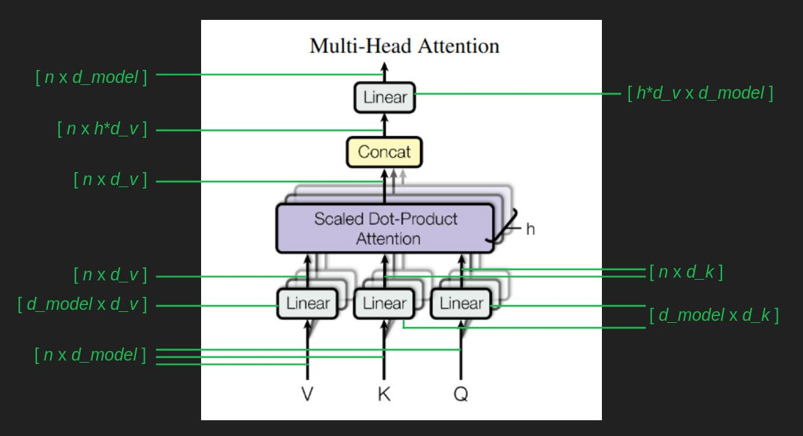

[brandonrohrer.org](https://brandonrohrer.org/transformers.html?utm_source=chatgpt.com)

The equation:

$$ MultiHead(Q,K,V)= Concat(head_1,\ldots,head_h)W_O $$

Each head uses its own learned projections.

This helps the model learn different representation patterns.

### 5.6 Feed-Forward Neural Network (FFN)
After attention, each token representation passes through a feed-forward neural network.

This is essentially a small ANN applied independently to every token position.

A common formulation is:

$$ FFN(x)=W_2\sigma(W_1x+b_1)+b_2 $$

Where:

- $W_1,W_2$: learned weight matrices.
- $b_1,b_2$: biases.
- $\sigma$: activation function, commonly ReLU or GELU.

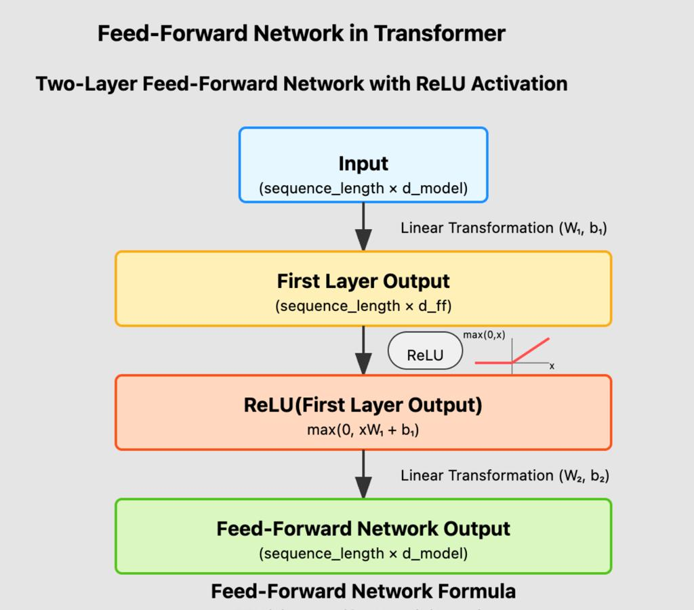

[medium.com](https://medium.com/%40robin5002234/attention-is-all-you-need-a-deep-dive-into-transformer-architecture-8c34753098c7?utm_source=chatgpt.com)

**What is its purpose?**

Attention mixes information across tokens.

The feed-forward network transforms the representation at each token position.

Think of it this way:

| Component            | Main purpose                          |
| -------------------- | ------------------------------------- |
| Self-attention       | Learn relationships between tokens    |
| Feed-forward network | Transform each token's representation |

### 5.7 Residual Connections
Transformers use residual connections to help information and gradients flow through deep networks.

Instead of simply calculating:

$$ y=F(x) $$

We calculate:

$$ y=x+F(x) $$

Here, the original input $x$ is added to the output of the transformation.

This helps with training deeper architectures.

### 5.8 Layer Normalization
Layer normalization helps stabilize the values flowing through the network.

It normalizes activations across the feature dimensions of a token representation.

The Transformer uses residual connections and normalization around its sublayers.

The original Transformer used a post-normalization arrangement, while many modern architectures use pre-normalization.

We'll distinguish these when we study the full layer.

## 6. Inside a Transformer Encoder
Now let's combine the building blocks.

A Transformer encoder layer consists of:

1. Multi-head self-attention.
2. Residual connection and layer normalization.
3. Feed-forward neural network.
4. Another residual connection and layer normalization.

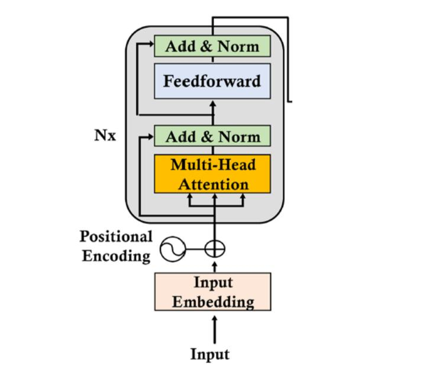

[medium.com](https://medium.com/%40info.codetitan/i-revealed-transformers-architecture-that-actually-fostering-ai-31f77a322608?utm_source=chatgpt.com)

The original Transformer stacks multiple encoder layers.

For example, the original paper used 6 encoder layers.

Let's represent the process:

```
Input Tokens
     |
     v
Token Embeddings
     |
     v
Positional Encoding
     |
     v
+-----------------------+
| Transformer Encoder  |
|                       |
| Multi-Head Attention  |
|          |            |
|      Add & Norm       |
|          |            |
|    Feed Forward       |
|          |            |
|      Add & Norm       |
+-----------------------+
     |
     v
Encoder Layer Output
```

The output of one encoder layer becomes the input of the next.

After the final encoder layer, we obtain contextual representations of the input sequence.

## 7. Inside a Transformer Decoder
The decoder is slightly more complicated.

A decoder layer in the original Transformer contains three major sublayers:

1. Masked multi-head self-attention.
2. Encoder-decoder attention (cross-attention).
3. Feed-forward neural network.

Each sublayer also has residual connections and normalization.

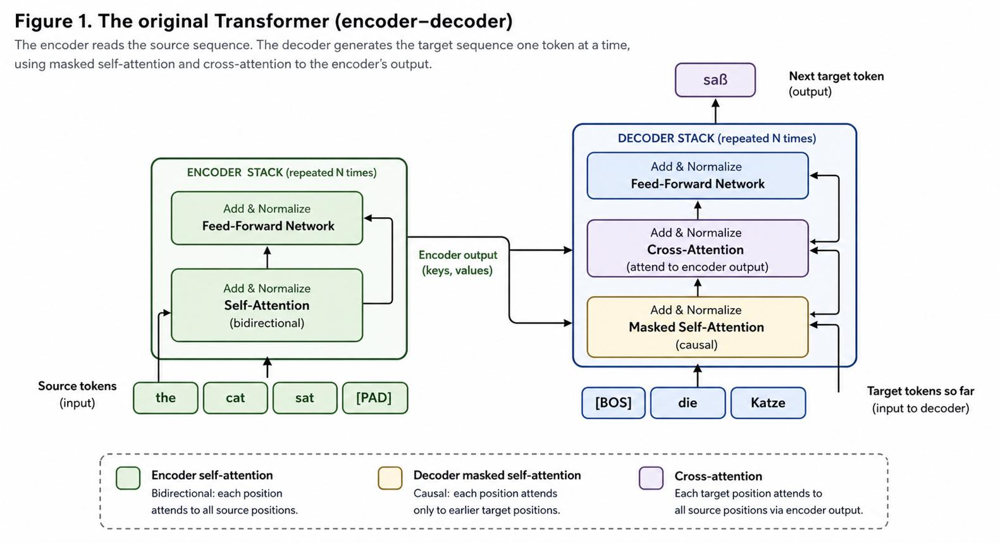

[danielfridljand.de](https://danielfridljand.de/post/transformer-architectures?utm_source=chatgpt.com)

### 7.1 Masked Self-Attention
Suppose the decoder is generating:

```
I love machine learning
```

When predicting the next token, it must not look at future tokens that it hasn't generated yet.

For example:

| Current prediction | Allowed context               |
| ------------------ | ----------------------------- |
| I                  | Start token                   |
| love               | Start token, I                |
| machine            | Start token, I, love          |
| learning           | Start token, I, love, machine |

This is called **causal masking** or **look-ahead masking**.

The attention scores for future positions are masked, typically by setting them to negative infinity before Softmax.

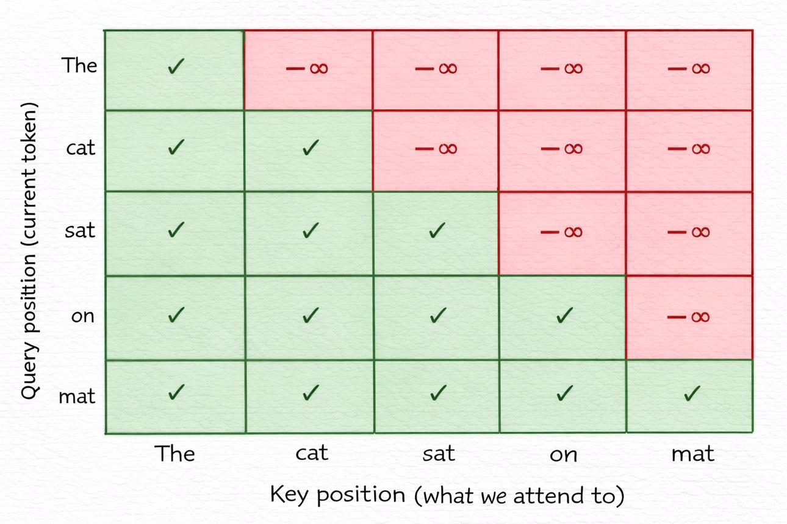

[imaddabbura.github.io](https://imaddabbura.github.io/posts/nlp/Transformer-Architecture-Explained.html?utm_source=chatgpt.com)

### 7.2 Cross-Attention
Cross-attention allows the decoder to access information from the encoder.

This is especially important in translation.

For example:

**Input:** I love machine learning.

**Output:** J'aime l'apprentissage automatique.

The decoder needs to access the original English sentence while generating French tokens.

The source of Q, K and V is different:

| Component | Comes from |
| --------- | ---------- |
| Query (Q) | Decoder    |
| Key (K)   | Encoder    |
| Value (V) | Encoder    |

This is the key difference between self-attention and cross-attention.

## 8. Complete Original Transformer Architecture
Let's put everything together.

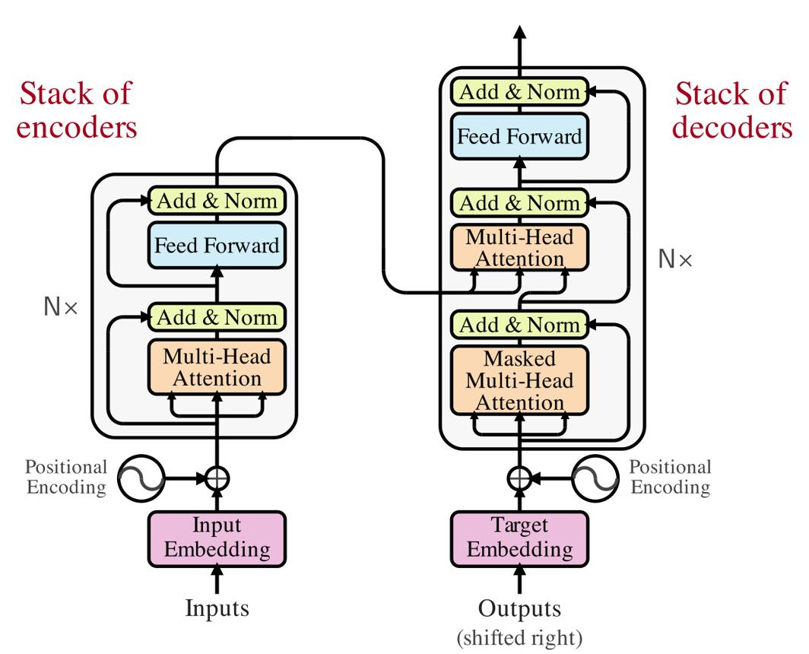

[pyml.substack.com](https://pyml.substack.com/p/transformer-architecture?utm_source=chatgpt.com)

The complete flow:

**Encoder side:**

```
Input Text
    |
    v
Tokenization
    |
    v
Token Embeddings
    |
    v
Positional Encoding
    |
    v
Encoder Layer 1
    |
    v
Encoder Layer 2
    |
    v
...
    |
    v
Encoder Layer N
    |
    v
Encoder Representations
```

**Decoder side:**

```
Previous Output Tokens
    |
    v
Token Embeddings
    |
    v
Positional Encoding
    |
    v
Masked Self-Attention
    |
    v
Cross-Attention
    |
    v
Feed-Forward Network
    |
    v
Decoder Layer N
    |
    v
Linear Layer
    |
    v
Softmax
    |
    v
Next Token Prediction
```

The decoder predicts one token at a time during autoregressive generation.

## 9. Three types of Transformer architectures
This is one of the most important concepts to understand because not all Transformers have the same structure.

There are three major categories.

**1. Encoder-only**

Understand input

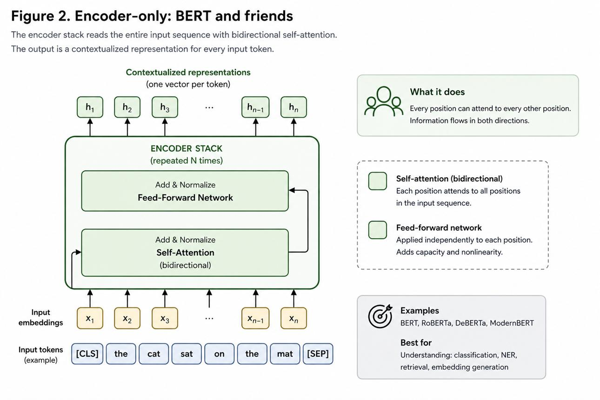

[danielfridljand.de](https://danielfridljand.de/post/transformer-architectures?utm_source=chatgpt.com)

**Example:** BERT

Encoder processes the input using bidirectional self-attention.

Common applications:

- Sentiment analysis.
- Text classification.
- Named Entity Recognition (NER).
- Extractive question answering.
- Sentence representation.

**2. Decoder-only**

Generate output

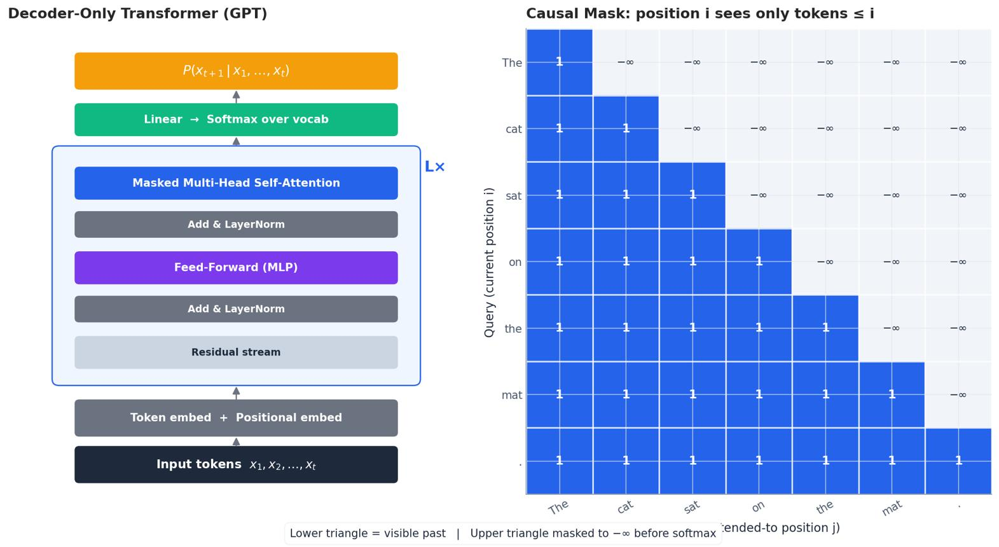

[chenk.top](https://www.chenk.top/en/nlp/gpt-generative-models/?utm_source=chatgpt.com)

**Examples:** GPT, Llama

Uses causal self-attention to predict the next token.

Common applications:

- Chatbots.
- Text generation.
- Code generation.
- Conversational AI.
- General-purpose LLMs.

**3. Encoder-Decoder**

Transform input

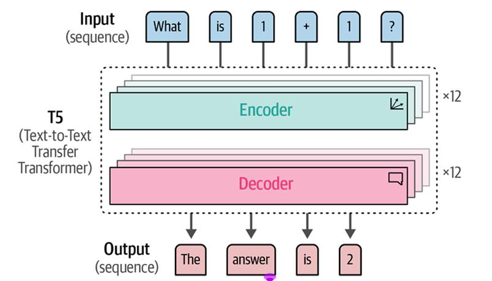

[medium.com](https://medium.com/%40gaurlokesh1211/text-classification-with-language-models-a-practical-guide-ce2fda416ab2?utm_source=chatgpt.com)

**Example:** T5

Encoder understands the input; decoder generates the output using cross-attention.

Common applications:

- Machine translation.
- Text summarization.
- Text-to-text transformations.
- Certain question-answering tasks.

### Comparison table
| Feature                | Encoder-only             | Decoder-only    | Encoder-Decoder                         |
| ---------------------- | ------------------------ | --------------- | --------------------------------------- |
| Main purpose           | Understand               | Generate        | Transform                               |
| Attention              | Bidirectional self       | Causal self     | Self + cross                            |
| Future tokens visible? | Yes, in standard encoder | No              | Decoder cannot see future output tokens |
| Examples               | BERT                     | GPT, Llama      | T5                                      |
| Typical task           | Classification           | Text generation | Translation                             |

One important clarification: BERT, GPT and T5 are model families built around Transformer architecture, but their training objectives and implementations differ.

## 10. How does a Transformer generate text?
Let's understand how a decoder-only Transformer generates a response.

Input prompt:

> Artificial Intelligence is

The model predicts the next token.

**Illustrative next-token generation**

INPUT PROMPT

**Artificial Intelligence is**

**Next-token probabilities**

the

42%

changing

27%

a

18%

important

13%

Illustrative probabilities, not actual model output.

SELECTED TOKEN

**the**

**Artificial Intelligence is the**

The model now predicts another token using the expanded context.

The process continues:

```
Artificial Intelligence is
             |
             v
Artificial Intelligence is the
             |
             v
Artificial Intelligence is the future
             |
             v
Artificial Intelligence is the future of
             |
             v
...
```

This process is called **autoregressive generation**.

The model repeatedly predicts the next token based on previous tokens.

It may use greedy decoding, temperature-based sampling, top-k sampling, or nucleus (top-p) sampling to select the next token.

## 11. Why are Transformers faster than RNNs during training?
This is a key architectural advantage.

Consider a sequence of 5 tokens.

**RNN:**

```
Token 1 → Token 2 → Token 3 → Token 4 → Token 5
```

Each hidden state depends on the previous hidden state.

The computation is sequential.

**Transformer:**

```
Token 1 ─┐
Token 2 ─┤
Token 3 ─┼── Self-Attention
Token 4 ─┤
Token 5 ─┘
```

The attention operation can process all token positions together using matrix multiplication.

This allows parallel computation across positions during training.

| Feature                  | RNN                                 | Transformer                          |
| ------------------------ | ----------------------------------- | ------------------------------------ |
| Processing               | Sequential                          | Parallel across tokens               |
| Long-range relationships | Harder to learn                     | Direct attention paths               |
| Training parallelism     | Limited                             | High                                 |
| Memory                   | Hidden states                       | Attention and layer activations      |
| Sequence complexity      | Typically linear in sequence length | Standard full attention is quadratic |

### Important limitation
Transformers are not automatically faster in every situation.

Standard self-attention has a time and memory cost that grows approximately as:

$$ O(n^2d) $$

Where:

- $n$: sequence length.
- $d$: representation dimension.

For long sequences, attention can become expensive.

Also, autoregressive text generation in decoder-only Transformers still generates tokens sequentially, although each individual forward pass processes the available context in parallel.

## 12. A practical Transformer implementation using PyTorch
Let's connect the concepts to actual code.

PyTorch provides `nn.TransformerEncoder` and related components.

Here is a simplified encoder-only Transformer classifier:

```python
import torch
import torch.nn as nn


class TransformerClassifier(nn.Module):
    def __init__(
        self,
        vocab_size,
        embedding_dim,
        num_heads,
        num_layers,
        num_classes,
        max_length,
    ):
        super().__init__()
        self.embedding = nn.Embedding(vocab_size, embedding_dim)
        self.position_embedding = nn.Embedding(max_length, embedding_dim)

        encoder_layer = nn.TransformerEncoderLayer(
            d_model=embedding_dim,
            nhead=num_heads,
            dim_feedforward=embedding_dim * 4,
            batch_first=True,
        )
        self.transformer = nn.TransformerEncoder(
            encoder_layer,
            num_layers=num_layers,
        )
        self.classifier = nn.Linear(embedding_dim, num_classes)

    def forward(self, token_ids):
        batch_size, sequence_length = token_ids.shape
        positions = torch.arange(
            sequence_length,
            device=token_ids.device,
        ).expand(batch_size, sequence_length)

        x = self.embedding(token_ids) + self.position_embedding(positions)
        x = self.transformer(x)
        pooled = x.mean(dim=1)
        return self.classifier(pooled)
```

What does this implementation do?

- `nn.Embedding`: creates token embeddings.
- `position_embedding`: adds positional information.
- `TransformerEncoderLayer`: performs attention and feed-forward operations.
- `TransformerEncoder`: stacks multiple encoder layers.
- `nn.Linear`: produces classification logits.

This is a teaching example, not a production-ready text classifier. A practical implementation should also handle padding masks and use suitable pooling over non-padding tokens.

## 13. Important Transformer terminology
Let's consolidate the concepts.

| Term                 | Meaning                                      |
| -------------------- | -------------------------------------------- |
| Token                | A unit of text                               |
| Tokenizer            | Converts text into token IDs                 |
| Embedding            | Dense vector representing a token            |
| Positional encoding  | Adds information about token position        |
| Self-attention       | Tokens attend to tokens in the same sequence |
| Cross-attention      | One sequence attends to another              |
| Query                | What information is being requested          |
| Key                  | What determines relevance                    |
| Value                | Information being aggregated                 |
| Multi-head attention | Multiple attention operations in parallel    |
| FFN                  | Position-wise feed-forward network           |
| Residual connection  | Adds a sublayer's input to its output        |
| Layer normalization  | Normalizes activations                       |
| Causal mask          | Prevents access to future tokens             |
| Autoregressive       | Generates one token based on previous tokens |
| Context window       | Maximum input context a model can process    |

## 14. What should you study next?
We've now covered the complete high-level architecture. But to truly understand Transformers, we should study the following topics in depth.

**Your Transformer learning roadmap**

1. Covered at a high level

   **Transformer Architecture**

   Encoder, decoder, attention, FFN, residual connections and normalization.
2. **Transformer Encoder in depth**

   Understand each operation mathematically, including tensor shapes and data flow.
3. **Transformer Decoder in depth**

   Masked attention, cross-attention, causal masking and autoregressive generation.
4. **Positional Encoding in depth**

   Sinusoidal encoding, learned embeddings, relative positions and RoPE.
5. **BERT vs GPT vs T5**

   Understand their architectures, training objectives and differences.
6. **Building a Transformer from scratch**

   Implement embeddings, attention, FFN, normalization and the complete architecture using PyTorch.
7. **Modern Transformer and LLM concepts**

   KV cache, FlashAttention, MQA, GQA, RoPE, pre-training, fine-tuning and inference.

## 15. The three things you should write in your notes
1. **Transformer:** A neural network architecture that uses attention mechanisms to process sequences, allowing parallel computation across tokens during training.
2. **Encoder:** Processes the input sequence and creates contextual representations. **Decoder:** Generates output tokens, typically autoregressively.
3. **Three architectures:** Encoder-only (BERT) for understanding, decoder-only (GPT) for generation, and encoder-decoder (T5) for sequence-to-sequence tasks.

## 16. Test your understanding
Try these questions before moving to the deeper mathematical implementation.

**Transformer knowledge check**

0/7 answered

**1. What is the main reason Transformers were introduced?**

To eliminate neural networks

To overcome limitations of sequential processing in RNNs and use attention directly

To replace tokenization

To remove embeddings

**2. What is the purpose of positional encoding?**

To convert text into token IDs

To identify the next token

To provide information about token order

To calculate the loss

**3. Which component learns relationships between tokens?**

Feed-forward network

Self-attention

Softmax output layer only

Tokenizer

**4. In decoder cross-attention, where does Query come from?**

Encoder

Decoder

Tokenizer

Output Softmax

**5. Which architecture is commonly used for next-token generation?**

Encoder-only

Decoder-only

ANN-only

RNN-only

**6. What is the purpose of causal masking?**

Prevent the decoder from seeing future tokens

Remove padding tokens from vocabulary

Reduce embedding dimensions

Disable attention

**7. What does the Transformer FFN primarily do?**

Tokenize text

Transform each token representation independently

Add positional encoding

Generate token IDs

Submit answers

**My recommendation:** Don't rush directly into GPT or LLMs yet. First, understand the Transformer encoder and decoder mathematically, including the dimensions of Q, K, V and how data flows through every layer. That foundation will make BERT, GPT and modern LLM architectures much easier to understand.